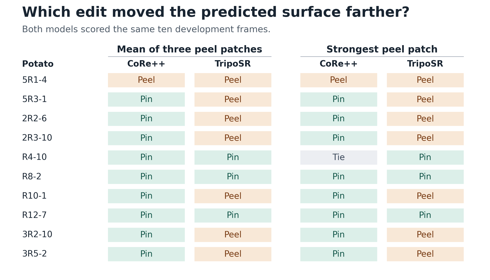

## Does registration-pin color influence single-view 3D shape completion?

On 29 previously unscored potatoes assigned to the CoRe++ test split by the authors’ published rules, recoloring the registration pin moved the predicted surface **0.494 mm farther on average** than applying the same per-pixel RGB changes to three matched peel patches (95% acquisition-group bootstrap interval **0.309–0.627 mm**). Pin displacement exceeded the mean peel displacement on 25 potatoes, tied on one, and was smaller on three. The difference remained positive against each potato’s strongest peel patch (**0.398 mm**, 95% group interval **0.227–0.496 mm**). CoRe++ used fixed depth and matched masks, with dropout paired across 16 seeds. The result is descriptive because the five acquisition groups fell short of the prespecified six-group minimum for a confirmatory decision. [Fresh-potato results](../studies/regional_shape_v1/corepp_pin_confirmation/report.md) · [Frozen protocol](../studies/regional_shape_v1/corepp_pin_confirmation_protocol.md)

To test whether sensitivity followed the RGB pixels, we swapped the pin patch with each peel patch in turn on ten development potatoes, keeping depth and site locations fixed. We then recolored each site separately and measured displacement from its own layout’s unedited prediction. Sensitivity shifted toward the transplanted pin pixels on **9/10** potatoes. On **8/10**, the more responsive site switched from the original pin location to the transplant location for at least two of the three swaps. This control links the response to transplanted appearance under the tested swaps. Visible seams and residual pin rims leave open whether CoRe++ recognizes marker identity. [Swap results and example crops](../studies/regional_shape_v1/corepp_pin_swap_replication/report.md)

Surface displacement measures how far the prediction moved. Accuracy measures the distance to an independent reference scan. On the ten development potatoes, recoloring improved CoRe++ reference error on **6/10**, worsened it on **3/10**, and tied on **1/10**. The synthetic RGB edits leave open how physically removing the pin would affect accuracy. [Reference-error results](../studies/regional_shape_v1/corepp_pin_accuracy/report.md) · [Archived displacement and accuracy figure](../studies/regional_shape_v1/corepp_pin_findings.png)

**Cross-model comparison.** On the same ten development frames, CoRe++ favored the pin on **9/10** against the mean peel response, and RGB-only TripoSR favored it on **3/10**. Both favored the pin on those three potatoes, both favored peel on one, and the other six favored pin in CoRe++ and peel in TripoSR. Against the strongest peel patch within each model, both favored the pin on only **2/10**. The matched edits and swaps provide a reproducible way to measure sensitivity to a registration cue. The paired comparison shows that the CoRe++ preference transferred to TripoSR on few of the same potatoes. [Paired results](../studies/regional_shape_v1/triposr_pin_multituber/report.md)

**Figure.** Each row compares the same potato in both models. Pin and Peel indicate which edit produced greater symmetric surface displacement from the unchanged prediction. Tie indicates equal displacement under the model’s scoring rule. The strongest patch is selected within each model. The figure shows direction only. The [plotting script](tools/plot_pin_recoloring_directions.py) reads the [archived table](../studies/regional_shape_v1/triposr_pin_multituber/per_potato.csv).
