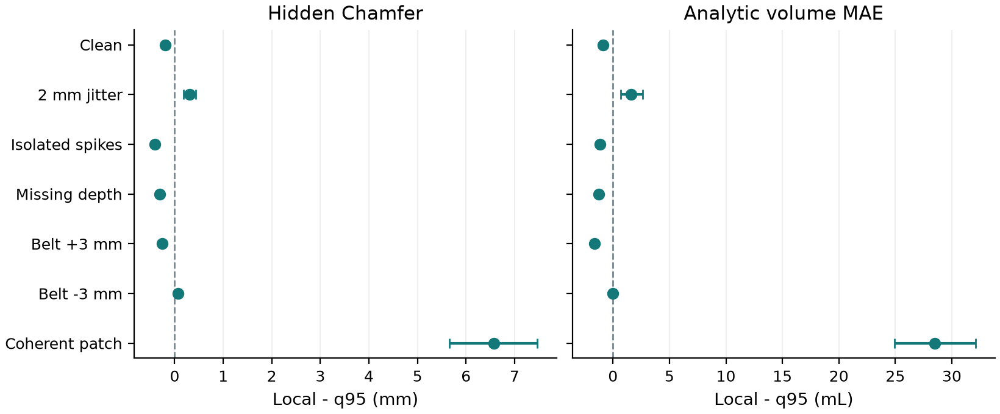
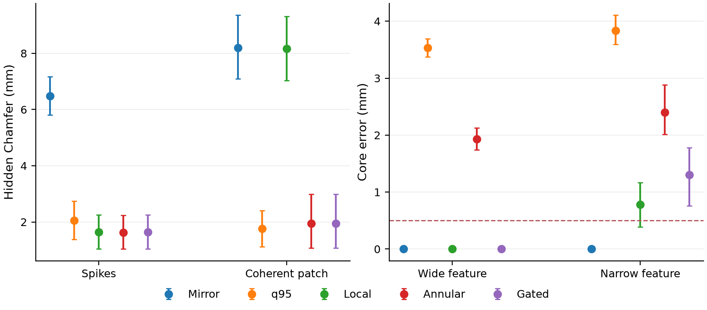
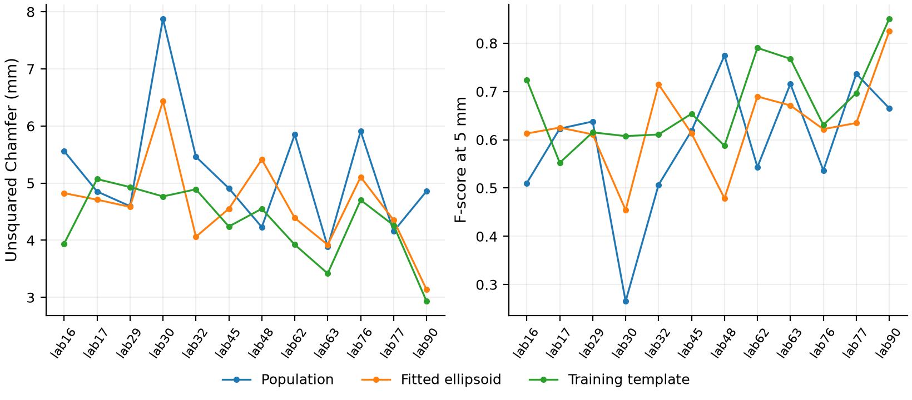
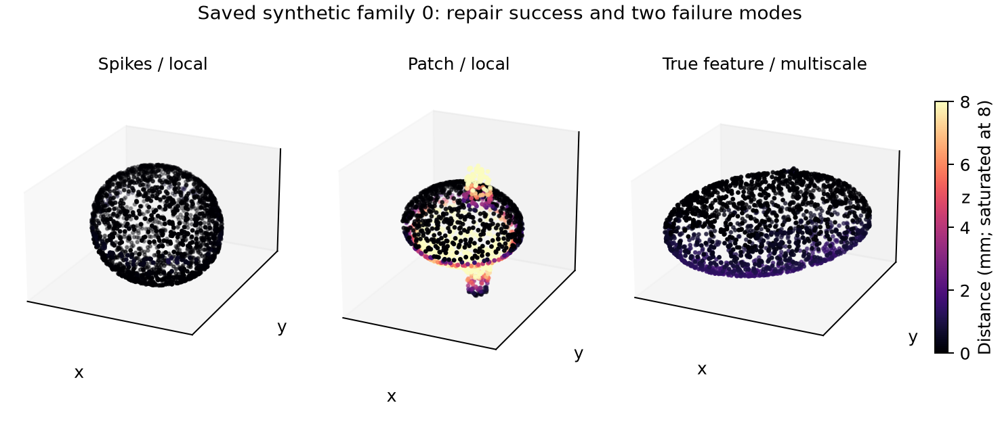

# CPU Shape Completion from Partial Produce Scans

## Selective depth repair, feature loss and hidden-shape ambiguity

CSE527 Graduate Computer Vision | Experimental project report | 26 November 2026

### Abstract

Completing a produce surface from one partial RGB-D scan requires assumptions
about both measurement reliability and unseen geometry. We implement a CPU-only
geometry pipeline, audit five registered public potato demo pairs, and evaluate
classical completion and selective positive-depth repair under sealed protocols.
Local quadratic support improves isolated synthetic spikes while preserving
smooth clean observations: all five prespecified confirmation checks pass on
twelve independent families. Coherent errors defeat local support. An annular
extension reduces patch error but fails two of seven criteria, including genuine
narrow-feature preservation. A separate laboratory sweet-pepper study completes
24 development and 72 local-holdout predictions; training templates have the
best descriptive mean Chamfer of 4.303 mm. The fitted ellipsoid's co-primary
hypothesis does not fully pass. In a separate RGB intervention, pin recoloring
moved CoRe++ surfaces 0.494 mm farther than matched peel edits on average across
29 fresh potatoes. Five acquisition groups make this result descriptive. On
ten development potatoes, CoRe++ and TripoSR jointly favored the pin on three
against mean peel and two against the strongest peel. Together the frozen
studies quantify failure modes in geometry-based completion and sensitivity
to an appearance cue in learned completion.

### 1. Motivation and research question

A conveyor camera measures the exposed cap while the underside is occluded.
Completing that surface can support geometric inspection and volume estimation,
but a plausible closed mesh need not be the correct hidden shape. A high positive
depth error can also corrupt a height-derived symmetry plane. We ask whether
input-only local support can reduce this failure while retaining reliable visible
geometry, using an Apple M2 Pro without CUDA or neural-network training.

The initial ambition was observation-aware potato completion. The actual evidence
supports a narrower conclusion: successful repair depends on the corruption and
feature geometry, and hidden-surface ambiguity persists even with accurate visible
measurements. The potato demo is an audited smoke test, and the laboratory-pepper study
provides local-holdout evidence for the geometric baselines. The separate real-potato
study examines sensitivity of learned shape completion to pin color.

### 2. Related work and positioning

Symmetry-based fruit completion [1] predates this project. DeepSDF [2] represents
learned shape classes with continuous signed distances. CoRe [3] learns fruit
shape priors and predicts them from RGB-D; transformer completion [4] combines
learned features and template deformation. CoRe++ [5] addresses potato completion.
We implement classical CPU comparisons rather than retraining these networks.

3DPotatoTwin [6] supplies paired potato observations and references. Bonn [7]
supplies RGB-D sweet peppers and laser geometry. PointRAFT [8] predicts weight
directly from partial points; weight accuracy is not completed-surface accuracy.
Robust moving least squares and sharp-feature reconstruction [9] establish that
robust local fitting and feature/noise ambiguity are longstanding topics. Our
specific residual gate is an experimental candidate built from standard tools.

This focused review does not establish algorithmic novelty or superiority to
those methods. The differentiating evidence is the matched ablations, independent
confirmation families, genuine-feature controls, explicit hidden twins and
reproducible negative results. Published scores are not mixed with ours.

<!-- page -->

## 3. Data, metrics and validity boundaries

<!-- widths: 0.23,0.22,0.18,0.37 -->
| Evidence block | Independent units | Predictions | Permitted interpretation |
|---|---|---|---|
| Potato public demo | 5 tubers; 5 registered frames | 15 baseline | Data/geometry smoke only |
| Height development | 12 synthetic families | 720 | Development ablations |
| Local support | 6 development / 12 confirmation families | 588 / 1,344 | Conditional synthetic confirmation |
| Annular support | 6 development / 12 confirmation families | 432 / 864 | Separate feature-controlled confirmation |
| Bonn laboratory fruit | 8 training; 3 development; 12 local holdout | 24 / 72 evaluated | Public-validation pepper baseline |
| Potato pin recoloring | 29 fresh and 10 separate development potatoes | Paired RGB edits | Descriptive CoRe++ sensitivity and paired development controls |

### 3.1 Potato audit

The downloaded 279 MB public demo contains 138 partial frames but only five
explicit named registration pairs. The supplied camera-to-SfM registration is
inverted for reference placement; predictions never use it for reference-driven
alignment. Source geometry and transform translations are meters; evaluation is
in millimeters. A 350 mm camera-to-belt depth is an approximate paper value, not
a certified per-scan support-plane measurement.

All five released reference meshes are open. They are not repaired or used as
direct closed-mesh volume targets. CSV physical and reported SfM volumes remain
separate target types. Object 2R2-8 has unresolved geometry/metadata inconsistency;
it is retained and flagged. The gated 111 GB full dataset was not acquired.

### 3.2 Synthetic and real reference conventions

Analytic shapes have known surfaces, volumes and top-root visibility. Corruptions
include 2 mm Gaussian depth jitter, 2% independent positive spikes, a coherent
2% +15 mm patch, missing depth and belt offsets of +/-3 mm. Genuine protrusions
are different clean geometries, not injected errors. All variants of a geometric
family stay together. Identical observed caps with different hidden profiles
test identifiability without letting the hidden reference enter prediction.

Bonn references are point clouds. The adapter applies supplied intrinsics,
masked metric depth and camera-to-fruit pose; it assumes no belt plane. Native
reference points are used without triangulation or volume invention. Only eight
official-training references build priors. The three development and twelve
reserved holdout IDs come from public validation; previously audited val/lab15
is excluded. This is not official hidden-test scoring or greenhouse evaluation.

### 3.3 Metrics and uncertainty in estimates

`CD(P,R) = 0.5 * [mean_p d(p,R) + mean_r d(r,P)]`, with Euclidean distances in mm.

Predictions use 10,000 fixed-seed area samples. Synthetic mesh references use
matched common reference samples; Bonn uses all native laser points. F-scores
use inclusive 2/5/10 mm thresholds. Sampling has a nonzero error floor; native
laser density weights real scores. These definitions do not reproduce a published
benchmark's distance convention. No cross-paper ranking is justified.

Observed fidelity is exact point-to-triangle distance, using all supplied points
in the synthetic studies and fixed subsets of at most 1,500 raw/used points for
Bonn. Visible/hidden scores exist only for analytic visibility. Analytic volume
error is MAE in mL; physical, reported SfM and direct mesh targets are never merged.
Synthetic paired 95% intervals bootstrap twelve independent families, not frames
or hidden twins (2,000 replicates). Bonn intervals pair twelve object IDs (10,000
replicates). These intervals condition on the specified data and sampling scheme;
they do not calibrate per-point support scores into correctness probabilities.

<!-- page -->

## 4. Completion methods and interventions

### 4.1 Classical belt-frame baselines

All baseline methods receive the same deterministic fit-point subset. A fitted
ellipsoid estimates horizontal position, yaw and radii while setting vertical
center/radius to half the highest input point, enforcing tangency to the assumed
belt. The convex baseline takes the hull of observations plus their vertical
belt projections. It creates a closed body but can overfill grooves and rounded
undersides. The mirror baseline triangulates the upper height field in XY,
reflects about H/2, joins boundaries and clips the lower body to the belt.
The projected domain can bridge holes and cannot represent an overhanging cap.

The fixed-q95 ablation replaces maximum-based body height with the 95th height
quantile and clips the cap. It can reduce extreme positive errors while lowering
a genuine reliable apex. Height-only and cap-only interventions isolate whether
an apparent gain comes from moving the symmetry plane or modifying observations.

### 4.2 Selective local repair

For each query, take 32 other nearest XY neighbors, center and normalize their
coordinates, and fit the basis `[1,x,y,x*x,x*y,y*y]`. Three Cauchy IRLS iterations
fit heights relative to their median, with non-intercept ridge 1e-6. The robust
scale is `s = max(1.4826 * MAD(residual), 0.5 mm)`; degenerate neighborhoods
fall back to their median. No reference, clean label or hidden profile enters
this calculation.

Let the predicted query height be z_hat. A point is suspect only when
`z - z_hat > max(tau, 3*s)`. The complete development budget is tau in {3,5} mm;
the registered tie-break selects 3 mm. Trusted XYZ values stay exact. For suspect
points only, replace z by the local prediction clipped into [0,H], where H is the
trusted maximum. Mirror completion then uses this repaired cap and height.
The support score is a heuristic, not a calibrated probability.

The full method changes height and cap together. Height-only retains the original
cap; cap-only retains the original maximum-based plane. The latter can float
above the belt and is a diagnostic rather than a deployable rule. Correcting
observations while retaining a corrupted plane need not improve hidden geometry.

### 4.3 Annular support and genuine-feature gate

The follow-up fits broader quadratic support after excluding an inner neighbor
set. Two reserved options are 32/160 and 64/256 inner/outer ranks. A component
gate accepts broad repair only with abrupt boundary support; fixed settings use
8 boundary neighbors, a 6 mm residual jump and at least two boundary-support
points. XY component connectivity is three times the median third-neighbor
distance. Fine local suspects and accepted broad suspects are repaired together.
The selected annulus is 64/256. Thresholds and selection were not revised after
confirmation exposed narrow-feature damage.

### 4.4 Training-only fruit completion

The canonical population ellipsoid uses median training bounding-box centers and
half-extents. A partial ellipsoid fits center and log radius ratios using a
pseudo-Huber radial residual (2 mm scale) plus a shape/position prior, bounded
to radii 0.5-2 times the prior and center within one prior radius. L-BFGS-B uses
at most 150 iterations. Development chooses prior strength 0.15 or 0.5.

Template completion compares eight closed training convex hulls. Identity
canonical rotation, isotropic scale [0.5,2], bounded translation, 15 robust
nearest-neighbor iterations and a fixed prior strength 0.15 define the method.
Retrieval minimizes input fit plus prior cost. No evaluation reference becomes
a template. Templates are deliberately convex and cannot recover concavities.
These real-fruit methods test classical priors; they do not test the synthetic
belt-dependent repair rule on a new species.

<!-- page -->

## 5. Local repair: a conditional positive result

Six development families selected tau=3 mm by the preset tie-break; twelve fresh
confirmation families supplied both hidden profiles and seven conditions.
All 1,344 confirmation predictions were valid. The five prespecified checks
passed. Deltas below are local repair minus the named baseline; lower is better
for these errors. CIs resample families and include both hidden alternatives.

<!-- widths: 0.44,0.18,0.24,0.14 -->
| Confirmation check | Mean delta | Paired 95% CI | Outcome |
|---|---:|---|---|
| Clean hidden CD vs q95 (mm) | -0.1972 | [-0.2139,-0.1803] | Pass |
| Spike hidden CD vs mirror (mm) | -4.6760 | [-5.3160,-4.0185] | Pass |
| Spike hidden CD vs q95 (mm) | -0.4088 | [-0.4367,-0.3802] | Pass |
| Spike volume MAE vs q95 (mL) | -1.1518 | [-1.3382,-0.9648] | Pass |
| Clean observation error vs mirror (mm) | 0 | [0,0] | Pass |

The last three required upper bounds were 0.10 mm, 1 mL and 0.05 mm respectively;
the first two required strictly negative upper bounds. These endpoints were fixed
before confirmation. They support the registered smooth-cap/isolated-spike
hypothesis, not universal reliability.

<!-- figure-height: 176 -->

### 5.1 Failures and ablations

Local repair flags 600/600 known isolated spikes with no extra flags in this
generator. It misses 565/600 coherent-patch points. Their mutually consistent
neighborhoods corrupt the trusted height: coherent-patch hidden CD is 8.2943 mm,
versus q95's 1.7190 mm. Under Gaussian jitter, local hidden CD is 1.9368 mm versus
q95's 1.6312 mm. These are retained negative conditions, not exclusions.

On isolated spikes, hidden CD for mirror / q95 / height-only / cap-only / full
local is 6.2748 / 2.0076 / 1.8947 / 13.5419 / 1.5988 mm. The cap-only failure
shows why changing the surface without correcting the plane can be harmful.
Full local analytic-volume MAE is 6.5867 mL versus q95's 7.7385 mL.

### 5.2 The unseen underside stays ambiguous

All 84 paired inputs and 672 paired predictions match byte-for-byte across
hidden twins. Full local clean hidden CD is 0.5390 mm on symmetric undersides
and 2.6567 mm on asymmetric undersides; analytic-volume MAE is 0.7761 versus
12.3974 mL. The same visible scan cannot identify which underside generated it.
Lower visible error is insufficient evidence of hidden-shape correctness.

<!-- page -->

## 6. Broader support: patch gains, narrow-feature loss

A separate reserved study adds genuine smooth protrusions and independently
generated families. Development selects annulus 64/256. All 864 confirmation
predictions on twelve families are valid. The full hypothesis fails two of
seven criteria. Deltas are boundary-gated multiscale minus the named baseline.

<!-- widths: 0.38,0.17,0.28,0.17 -->
| Prespecified check | Mean delta | Paired 95% CI | Upper bound / result |
|---|---:|---|---|
| Patch hidden vs local (mm) | -6.2089 | [-8.0581,-4.4659] | <0 / Pass |
| Patch volume MAE vs local (mL) | -27.3304 | [-37.2325,-18.3802] | <0 / Pass |
| Patch hidden vs q95 (mm) | +0.1894 | [-0.1538,+0.8177] | <=0.20 / Fail |
| Spike hidden vs local (mm) | +0.0006 | [-0.0015,+0.0029] | <=0.10 / Pass |
| Clean hidden vs mirror (mm) | 0 | [0,0] | <=0.05 / Pass |
| Wide core error vs mirror (mm) | 0 | [0,0] | <=0.50 / Pass |
| Narrow core error vs mirror (mm) | +1.3070 | [+0.7570,+1.7817] | <=0.50 / Fail |

<!-- figure-height: 218 -->

Gated patch hidden CD improves from local's 8.1623 to 1.9534 mm on these new
cases, but q95 is 1.7640 mm and the noninferiority upper bound exceeds 0.20 mm.
An acceptable mean difference alone does not satisfy that criterion.

Wide-feature core error falls from ungated annular repair's 1.9283 mm to zero
with the gate. Narrow-feature core error remains 1.3070 mm: 46/108 genuine core
points are selected for repair. Only 599/600 coherent patch points are detected;
the surviving family-11 point shifts maximum-based height by 11.91 mm. These
diagnostics explain the negative result without changing the protocol.

This stage rejects a generic repair claim. It motivates conservative handling
of unsupported features and alternative body-height priors, but supplies no
fresh-case validation for either. Further threshold searches on these scored
families would not establish a new out-of-sample result.

<!-- page -->

## 7. Real laboratory fruit: a separate baseline study

The bounded Bonn subset uses 55.0 MB of compressed ZIP members, all size/CRC/SHA
verified; the full 8.37 GB archive is not downloaded. Laboratory references
alone supply eight training priors. Three public-validation development objects
select ellipsoid strength 0.15 by mean CD across both input conditions (4.7604 mm
versus 4.9735 mm for 0.5). Source, prior, selection and twelve local holdout IDs
are frozen before holdout retrieval. Each fruit's six predictions are exported
before opening its laser reference. All 24 development and 72 holdout predictions
are valid, with no ellipsoid optimizer nonconvergence.

Raw input uses the official positive mask and finite depth strictly between
0 and 1 m. The second condition keeps the largest 4-neighbor depth component
with <=10 mm neighbor jumps and at least 100 pixels. It retains 99.9623% of
holdout points on average, so it changes these lab scores little. It is neither
a verified confidence label nor evidence that strong contamination is solved.

<!-- widths: 0.24,0.31,0.16,0.13,0.16 -->
| Input | Method | CD mm | F5 | Raw fidelity mm |
|---|---|---:|---:|---:|
| Raw | Population ellipsoid | 5.1798 | 0.5945 | 5.6524 |
| Raw | Fitted ellipsoid | 4.6234 | 0.6298 | 2.5944 |
| Raw | Training template | 4.3040 | 0.6742 | 2.4929 |
| Depth component | Population ellipsoid | 5.1798 | 0.5945 | 5.6524 |
| Depth component | Fitted ellipsoid | 4.6241 | 0.6294 | 2.6089 |
| Depth component | Training template | 4.3029 | 0.6740 | 2.4920 |

Equal-object means use all twelve fruit; laser references have 31,473-47,717
native points each. The fitted-minus-population paired filtered CD delta is
-0.5557 mm, CI [-1.0149,-0.0647]; F5 delta is +0.0349, CI [-0.0484,+0.1083].
Both co-primary checks were required, so the full hypothesis does not pass.
Template superiority is descriptive; no post-hoc superiority test was added.

<!-- figure-height: 240 -->

These public-validation lab fruit are not an official hidden-test cohort.
Cultivar/session independence is unverified; templates cannot model concavity.
No physical or direct mesh volume target is invented from point clouds, and no
unverified real visible/hidden split is emitted. Potato and greenhouse transfer
remain open. Raw real assets are excluded from the submission archive.

<!-- page -->

## 8. Does registration-pin color influence single-view 3D shape completion?

The geometric baselines above tested how partial depth and measurement errors
affect completion. The real-potato experiment holds geometry fixed and varies
a small appearance cue, testing whether a learned model changes its predicted
shape even when the measured depth and foreground mask stay the same.

On 29 previously unscored potatoes assigned to the CoRe++ test split by the authors’ published rules, recoloring the registration pin moved the predicted surface **0.494 mm farther on average** than applying the same per-pixel RGB changes to three matched peel patches (95% acquisition-group bootstrap interval **0.309 to 0.627 mm**). Pin displacement exceeded the mean peel displacement on 25 potatoes, tied on one, and was smaller on three. The difference remained positive against each potato’s strongest peel patch (**0.398 mm**, 95% group interval **0.227 to 0.496 mm**). CoRe++ used fixed depth and matched masks, with dropout paired across 16 seeds. The result is descriptive because the five acquisition groups fell short of the prespecified six-group minimum for a confirmatory decision. [Fresh-potato results](../studies/regional_shape_v1/corepp_pin_confirmation/report.md) · [Frozen protocol](../studies/regional_shape_v1/corepp_pin_confirmation_protocol.md)

To test whether sensitivity followed the RGB pixels, we swapped the pin patch with each peel patch in turn on ten development potatoes, keeping depth and site locations fixed. We then recolored each site separately and measured displacement from its own layout’s unedited prediction. Sensitivity shifted toward the transplanted pin pixels on **9/10** potatoes. On **8/10**, the more responsive site switched from the original pin location to the transplant location for at least two of the three swaps. This control links the response to transplanted appearance under the tested swaps. Visible seams and residual pin rims leave open whether CoRe++ recognizes marker identity. [Swap results and example crops](../studies/regional_shape_v1/corepp_pin_swap_replication/report.md)

Surface displacement measures how far the prediction moved. Accuracy measures the distance to an independent reference scan. On the ten development potatoes, recoloring improved CoRe++ reference error on **6/10**, worsened it on **3/10**, and tied on **1/10**. The synthetic RGB edits leave open how physically removing the pin would affect accuracy. [Reference-error results](../studies/regional_shape_v1/corepp_pin_accuracy/report.md) · [Archived displacement and accuracy figure](../studies/regional_shape_v1/corepp_pin_findings.png)

**Cross-model comparison.** On the same ten development frames, CoRe++ favored the pin on **9/10** against the mean peel response, and RGB-only TripoSR [10] favored it on **3/10**. Both favored the pin on those three potatoes, both favored peel on one, and the other six favored pin in CoRe++ and peel in TripoSR. Against the strongest peel patch within each model, both favored the pin on only **2/10**. The matched edits and swaps provide a reproducible way to measure sensitivity to a registration cue. The paired comparison shows that the CoRe++ preference transferred to TripoSR on few of the same potatoes. [Paired results](../studies/regional_shape_v1/triposr_pin_multituber/report.md)

<!-- figure-height: 265 -->

<!-- page -->

## 9. Showcase, computation and reproducibility

The self-contained offline viewer presents six fixed-family cases: clean cap,
isolated spikes, coherent local failure, broader patch repair, genuine narrow
feature damage and the asymmetric hidden twin. Input/reference and prediction
views share a camera. Saved surfaces are area sampled only for display; colors
are exact one-way sample-to-reference-triangle distance. The 8 mm color ceiling
is a display saturation choice, not an acceptance threshold or new aggregate
endpoint. The numeric scores come from unchanged original result rows.

<!-- figure-height: 208 -->

### 9.1 Measured CPU cost

Python 3.12.14 on an Apple M2 Pro, CPU only, with OpenBLAS/OMP/VECLIB limits 1.
Synthetic run times include generation, checking, scoring and export; later
figures/analysis and process imports are excluded. Fit times exclude common
evaluation/export. They are one-machine measurements, not deployment throughput.

<!-- widths: 0.33,0.28,0.39 -->
| Stage | Run elapsed | Representative mean fit |
|---|---|---|
| Local confirmation | 375.85 s / 1,344 predictions | Local 65.7 ms; q95 18.7 ms on spikes |
| Multiscale confirmation | 286.66 s / 864 predictions | Gated 302 ms; local 63 ms; q95 18 ms on patches |
| Bonn local holdout | 19.94 s / 72 predictions | Template 251.7 ms; fitted 27.9 ms; population 0.42 ms, filtered |

Peak process RSS is 530.09 MiB for local and 725.17 MiB for multiscale confirmation.
Bonn peak memory is unavailable: the external timing wrapper could not read a
sandboxed kernel statistic after the experiment completed. It was not rerun.

### 9.2 Evidence and restoration

Seals, split manifests, seeds, source hashes, parameters, per-case CSV/JSON and
separate source snapshots preserve each study. The latest snapshot passes 71
tests, including transforms/units, geometry, metrics, role guards, reference-load
order and changed-reference prediction invariance. Eight training priors and all
eight development predictions for one Bonn fruit reproduce bitwise. Earlier
JSON records are checked unchanged. No scored holdout was rerun for this report.

The reproduction archive includes the plotting script and archived paired table
for Figure 4 along with the original study reports. Its version-specific source
snapshots preserve the earlier studies' source checks. A fresh install can run
tests and an unscored
analytic fixture without downloading data. Full-study regeneration is a frozen
verification workflow, never permission to tune on closed cohorts. Figure and
showcase provenance point to saved artifacts. The report and source are packaged
locally; no course submission, dataset agreement or external upload is performed.

<!-- page -->

## 10. Discussion and conclusion

Three findings survive the limitations. First, clean visible geometry and hidden
shape correctness are different objectives: hidden twins receive the same
prediction and incur different underside errors. Second, local geometric support
can identify isolated positive errors on smooth caps while coherent errors evade
it. Third, widening support can trade noise removal for destruction of genuine
features. The narrow-feature criterion prevents a favorable global mean from
concealing this cost. These findings are empirical and conditional.

The separate real-potato experiment adds a test of appearance sensitivity. On
29 fresh potatoes in five acquisition groups, CoRe++ moved 0.494 mm farther after
pin recoloring than after matched peel recoloring. This estimate is descriptive.
On ten development potatoes, the swap shifted sensitivity toward transplanted
pin pixels on nine. CoRe++ and TripoSR jointly favored the pin on three potatoes
against mean peel and two against strongest peel. Reference error changed in
both directions. The effect of physically removing the pin remains unknown.

The CPU baselines and matched interventions establish specific failure modes
under the tested conditions. Calibrated uncertainty and a generally reliable
potato-completion method remain open. Synthetic visibility and corruption
choices, approximate conveyor geometry and limited acquisition-group coverage
bound these conclusions. Existing confirmation and holdout cohorts remain closed.

## References

[1] Y. Ge, Y. Xiong and P. J. From. Symmetry-based 3D shape completion for fruit localisation for harvesting robots. Biosystems Engineering 197, 188-202, 2020. [Publisher](https://doi.org/10.1016/j.biosystemseng.2020.07.003).

[2] J. J. Park, P. Florence, J. Straub, R. Newcombe and S. Lovegrove. DeepSDF: Learning Continuous Signed Distance Functions for Shape Representation. CVPR, 2019. [Venue](https://openaccess.thecvf.com/content_CVPR_2019/html/Park_DeepSDF_Learning_Continuous_Signed_Distance_Functions_for_Shape_Representation_CVPR_2019_paper.html).

[3] F. Magistri et al. Contrastive 3D Shape Completion and Reconstruction for Agricultural Robots using RGB-D Frames. IEEE RA-L 7(4), 10120-10127, 2022. [Author PDF](https://www.ipb.uni-bonn.de/wp-content/papercite-data/pdf/magistri2022ral-iros.pdf).

[4] F. Magistri et al. Efficient and Accurate Transformer-Based 3D Shape Completion and Reconstruction of Fruits for Agricultural Robots. ICRA, 2024. [Author PDF](https://www.ipb.uni-bonn.de/wp-content/papercite-data/pdf/magistri2024icra.pdf).

[5] P. M. Blok et al. High-throughput 3D shape completion of potato tubers on a harvester. Computers and Electronics in Agriculture 228, 109673, 2025. [Primary preprint v3](https://arxiv.org/html/2407.21341v3).

[6] H. Wang et al. 3DPotatoTwin: a paired potato tuber dataset for 3D multi-sensory fusion. Plant Phenomics 7, 100123, 2025. [Publisher](https://doi.org/10.1016/j.plaphe.2025.100123).

[7] F. Magistri et al. A Dataset and Benchmark for Shape Completion of Fruits for Agricultural Robotics. arXiv:2407.13304v2, 17 September 2024. [Primary text](https://arxiv.org/html/2407.13304v2).

[8] P. M. Blok et al. PointRAFT: 3D deep learning for high-throughput prediction of potato tuber weight from partial point clouds. arXiv:2512.24193v2, 4 November 2026. [Primary text](https://arxiv.org/html/2512.24193v2).

[9] S. Fleishman, D. Cohen-Or and C. T. Silva. Robust Moving Least-squares Fitting with Sharp Features. ACM TOG / SIGGRAPH, 2005. [Author PDF](https://sci.utah.edu/~csilva/papers/sig2005.pdf).

[10] D. Tochilkin et al. TripoSR: Fast 3D Object Reconstruction from a Single Image. 2024. [Preprint](https://arxiv.org/abs/2403.02151).

Primary-source review and its access limits are recorded in related_work.md.
Experiment evidence: docs/spatial_confidence_results.json,
docs/multiscale_confidence_results.json and docs/bonn_real_v1_results.json,
with the corresponding sealed protocols and original run artifacts.
