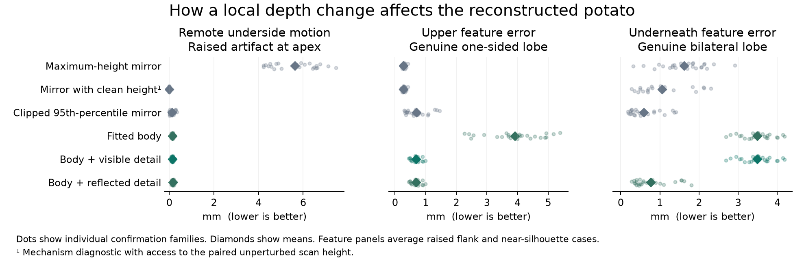

# How a local depth change reaches the hidden surface

A raised artifact at the apex moved the maximum-height mirror's underside by **5.63 mm** on average at locations distant from the artifact. Holding just the mirror height at its value on the clean scan reduced that movement to **0.00 mm**. This identifies one way a local error can change a global reconstruction. A deployable alternative, fitting a smooth body and restoring detail only on top, passed four of five confirmation checks. Its failure on genuine bilateral lobes rules out adopting it as a general replacement under the frozen decision rule.

## Experiment

One synthetic family represents one independently drawn potato-like body. We used six families for development and reserved 24 for confirmation. Each had a clean top view and six modified views, crossing apex, flank and near-silhouette locations with raised and depressed patches. Each modified view had three possible reference shapes. In one, the patch was a depth artifact. In another, the patch was genuine but confined to the upper surface. In the third, it had a corresponding lower-surface feature. The observations and predictions matched byte for byte across each triple, while the three reference surfaces differed.

The confirmation set contained 168 distinct scans, 456 scored cases and 1,008 reconstructions across six methods. Comparing the reconstructions to all applicable reference shapes produced 2,736 score rows. Distances below are mean absolute vertical distances in millimeters. The feature core includes rays where the imposed deviation reaches at least 25% of its peak. Remote rays lie at least two patch radii from its center. The evaluation charges missed reference rays 15 mm. Confidence intervals resample whole families with 10,000 replicates. [Prospective protocol](protocol.md)

## Frozen decision

The candidate fits a smooth body to the observed points and restores local residual detail only on the upper surface. Negative paired differences favor the candidate. All five checks were required.

| Candidate endpoint | Mean | 95% family bootstrap interval | Required bound | Result |
|---|---:|---:|---|---|
| Remote underside motion on artifacts, difference from maximum-height mirror | −1.243 mm | −1.394 to −1.105 | Upper < −0.50 mm | Pass |
| Absolute underside error on artifacts, difference from clipped 95th-percentile mirror | −0.539 mm | −0.597 to −0.481 | Upper < 0 mm | Pass |
| Upper feature error on genuine one-sided lobes | 0.691 mm | 0.642 to 0.741 | Upper ≤ 0.75 mm | Pass |
| Lower feature error on raised bilateral flank and near-silhouette lobes, difference from reflecting the detail | +2.715 mm | +2.480 to +2.934 | Upper ≤ 0.75 mm | **Fail** |
| Fraction of reference rays covered | 1.000 | 1.000 to 1.000 | Lower ≥ 0.95 | Pass |

## What explains the result

**Mirror height controls the remote effect.** Changing only the height source on the raised-apex artifact reduced remote motion by 5.63 mm (paired 95% interval for fixed minus ordinary mirror, −6.02 to −5.23 mm). The ordinary mirror still moved 5.61 mm when measured only on remote rays present in both reconstructions. Coverage changes therefore explain little of the result. Location and sign mattered. For the ordinary mirror, raised patches produced 5.63 mm at the apex, 2.02 mm on the flank and 0.07 mm near the silhouette. Depressed patches produced 0.09 mm at the apex and 0.00 mm at the other two sites. The fixed-height diagnostic uses a paired clean scan unavailable during ordinary single-view inference.

**How detail is used matters independently of the body fit.** Keeping the same fitted body and restoring detail on top reduced true one-sided upper-feature error from 3.69 to 0.69 mm. Applying that same operation to artificial patches increased upper-feature error from 0.61 to 3.21 mm. For genuine raised bilateral flank and near-silhouette lobes, the true lower surface moved 3.39 mm on average in the core. Withholding underside detail gave 3.48 mm of lower-feature error. Reflecting it reduced the error to 0.77 mm. An observation common to all three references cannot reveal which one generated it.

| Method | Artifact remote motion | Artifact underside error | Genuine one-sided upper-core error | Genuine bilateral lower-core error¹ |
|---|---:|---:|---:|---:|
| Maximum-height mirror | 1.30 | 2.26 | 0.27 | 1.61 |
| Mirror with paired clean height (diagnostic) | 0.00 | 1.03 | 0.27 | 1.05 |
| Clipped 95th-percentile mirror | 0.06 | 0.76 | 1.00 | **0.59** |
| Fitted body | 0.06 | 0.22 | 3.69 | 3.48 |
| Body with visible detail | 0.06 | 0.22 | 0.69 | 3.48 |
| Body with reflected detail | 0.07 | 0.63 | 0.69 | 0.77 |

¹ Raised flank and near-silhouette cases only. Other columns average all six signed locations. All entries are in mm.



## Scope and next experiment

These results establish the mechanism on synthetic shapes with a densely observed elliptical outline, a known support plane, mild noise and prescribed patches. This geometry favors the fitted body. Vertical errors do not measure lateral surface error, and the chosen margins have no established grading interpretation. The constructed frequencies of the three reference types do not estimate their prevalence on real potatoes.

The next empirical question is how often a visible lobe on a real potato has a corresponding underside feature. Use fresh, registered single-view and full-surface pairs. Identify visible lobes using only the top scans, measure corresponding underside displacements from the reference scans in millimeters, and report registration uncertainty. Score the clipped mirror, visible-detail and reflected-detail methods on the same tubers. This would test whether the ambiguity documented here materially affects real reconstruction.

## Evidence and reproduction

The two independent development runs produced byte-identical score tables and summaries. The runner checks the protocol, source and development hashes against the [confirmation seal](confirmation_seal.json) before generating confirmation cases. The confirmation run used single-thread numerical libraries and took 47 seconds. The original row tables, stratified summaries and software manifests from both stages are in [evidence](evidence/). The archived CSVs and summaries decompress to the exact bytes identified in the manifests.

For independent reproduction on the recorded software versions, run from the project root with a fresh output directory. The existing seal is the reference for the replay.

```sh
export OPENBLAS_NUM_THREADS=1 VECLIB_MAXIMUM_THREADS=1 OMP_NUM_THREADS=1
export MPLCONFIGDIR="$PWD/.cache/matplotlib"
.venv/bin/python -m pytest -q tests studies/body_detail_v1/test_body_detail.py
.venv/bin/python studies/body_detail_v1/study.py development --out outputs/body_detail_replay
.venv/bin/python studies/body_detail_v1/study.py confirmation --out outputs/body_detail_replay
```
