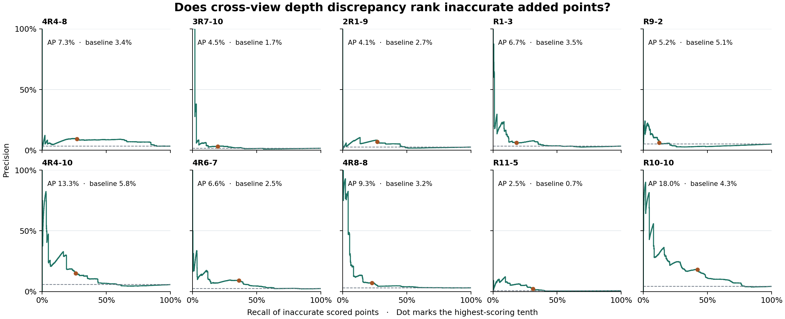

# Does cross-view depth discrepancy rank inaccurate fusion points?

**Yes, the score enriched for inaccurate points on all ten development potatoes with usable comparisons.** The highest-scoring tenth was **8.43% inaccurate** versus **3.28%** across all points with a score, a gain of **5.14 percentage points**. Mean average precision was **7.75%** and exceeded the scored-set prevalence on **10/10** potatoes. The ranking signal is consistent, with limited absolute precision. The highest tenth still contained mostly accurate points and captured **26.33%** of the errors among scored points. This diagnostic supports ranking for inspection. It gives little basis for deleting points on this score alone. [Per-potato results](per_potato.csv) · [Summary and label hashes](results.json)

## Score and denominator

For each raw point contributed by either outer view, we took the largest signed difference between the nearest of the four supported depths and projected axial Z, divided by the pair's frozen tolerance. Positive values are in front of the measured surface. Zero usable comparisons meant a missing score. The frozen masks, frame hashes, point order, projection checks, and all **252** archived rejection decisions replayed. The score arrays contain the archived fused point index, the normalized score and the number of usable comparisons. The ten arrays and their hashes were written before reading the reference meshes. [Protocol](protocol.md) · [Frozen score hashes](frozen_scores.json) · [Scores](scores)

After freezing, we applied the archived center-to-SfM pose and measured closest-triangle distance. An error is strictly more than 2 mm. The diagnostic labeled **325,701 raw outer-view points** and gave **313,557** a usable score. The earlier unfiltered fusion result used **111,655 fused voxel centroids**, which include center-frame contributions and use a 1 mm centroid grid. Its **5.85%** mean far-point rate has a different denominator from the **4.10%** mean prevalence across all raw added points here. Both means weight potatoes equally. [Archived voxel result](../depth_consistency_fusion_v1/report.md#surface-results) · [Raw point labels](labels)

**12,144 raw points (3.73%)** lacked usable comparisons. Their mean inaccurate fraction was **21.88%**. In pooled counts, they contained **2,667 of the 11,712** inaccurate raw points. The score cannot rank those points. There were zero scoring failures, and all ten potatoes contributed to every reported mean.

## Per-potato results

All error rates and average precision (AP) are percentages. AP change uses percentage points relative to that potato's scored-set prevalence. The top tenth is taken within the scored set. The archived voxel count is shown for denominator context.

| Potato | Raw added | Scored raw | Archived fused voxels | All raw error % | Scored error % | Top tenth error % | AP % | AP change (pp) | No-score error % |
| --- | ---: | ---: | ---: | ---: | ---: | ---: | ---: | ---: | ---: |
| 4R4-8 | 21,014 | 19,697 | 8,331 | 5.15 | 3.43 | 9.29 | 7.26 | 3.83 | 30.98 |
| 3R7-10 | 15,888 | 15,417 | 6,217 | 2.35 | 1.69 | 3.31 | 4.48 | 2.79 | 23.99 |
| 2R1-9 | 26,771 | 25,836 | 10,734 | 3.46 | 2.65 | 7.16 | 4.07 | 1.42 | 25.88 |
| R1-3 | 31,584 | 30,209 | 10,185 | 4.26 | 3.46 | 6.36 | 6.74 | 3.28 | 22.04 |
| R9-2 | 21,791 | 21,104 | 8,813 | 5.33 | 5.15 | 6.35 | 5.21 | 0.06 | 11.06 |
| 4R4-10 | 16,989 | 16,033 | 6,810 | 7.82 | 5.79 | 15.15 | 13.27 | 7.47 | 41.74 |
| 4R6-7 | 73,978 | 72,152 | 21,479 | 2.98 | 2.52 | 9.13 | 6.62 | 4.10 | 21.41 |
| 4R8-8 | 39,795 | 38,619 | 15,139 | 3.10 | 3.16 | 7.20 | 9.30 | 6.14 | 0.94 |
| R11-5 | 54,503 | 52,231 | 14,896 | 1.66 | 0.73 | 2.28 | 2.47 | 1.74 | 23.11 |
| R10-10 | 23,388 | 22,259 | 9,051 | 4.91 | 4.26 | 18.06 | 18.05 | 13.78 | 17.63 |



The dashed line shows each potato's error prevalence among points with a score. The dot marks the highest-scoring tenth. Exact score ties share one precision–recall step, with fused point order used to resolve a tie at the tenth cutoff. [All curve points](precision_recall.csv.gz)

## Reproduce

Run from the workspace root with the archived RGB-D, mask, transform and reference assets. The first phase freezes scores, and the second phase reads the reference meshes.

```sh
export OPENBLAS_NUM_THREADS=1 OMP_NUM_THREADS=1 VECLIB_MAXIMUM_THREADS=1
export DYLD_LIBRARY_PATH="$PWD/outputs/corepp_cpu_audit/runtime/libusb/1.0.30/lib"
export MPLCONFIGDIR="$PWD/.cache/matplotlib"
diagnostic_out=$(mktemp -d)
diagnostic_python=outputs/corepp_cpu_audit/venv/bin/python
diagnostic_script=studies/depth_consistency_diagnostic_v1/run.py
"$diagnostic_python" "$diagnostic_script" freeze --out "$diagnostic_out" &&
"$diagnostic_python" "$diagnostic_script" evaluate --out "$diagnostic_out"
```

[Runner](run.py)
