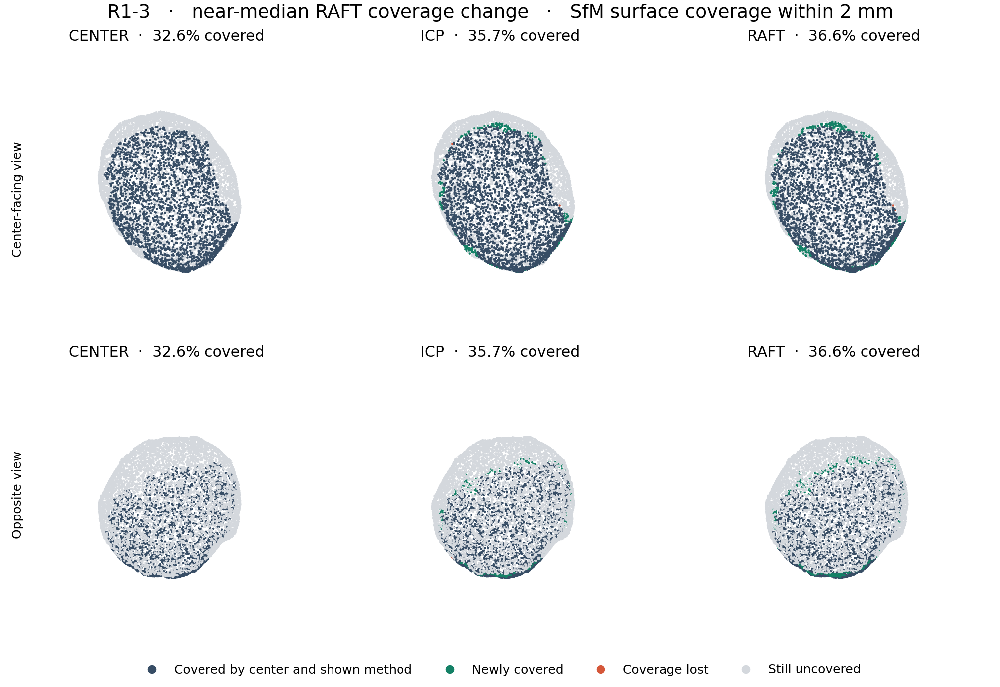
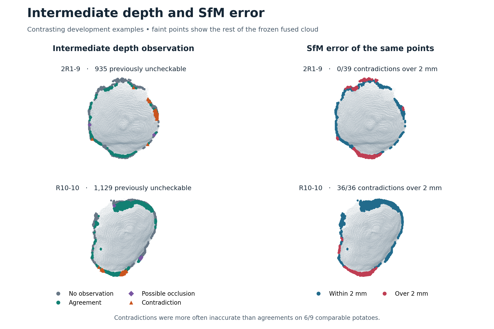

# Three Conveyor Views and One Peel Click

*Final report on multi-frame potato geometry, weight and volume estimation, and SAM 2 tracking on 3DPotatoTwin*

1. **Did three views recover more surface? Yes, including when both reconstructions started from the same peel click.** On the **10 geometry development potatoes**, SAM 2-to-RAFT fusion increased coverage within 2 mm of the independent structure-from-motion (SfM) surface from **36.63% to 41.14%**. The paired gain was **4.50 percentage points** (95% interval **+3.71 to +5.33**). The fraction of output points more than 2 mm from the reference also increased by **1.54 percentage points** (**+0.92 to +2.23**). [End-to-end development study](sam2_raft_end_to_end_v1/report.md)
2. **Did that improve weight or water-displacement volume? The same-click comparison did not establish a gain.** On the other **30 development potatoes**, fusion changed weight mean absolute error (MAE) by **−0.51 g** (paired 95% interval **−1.52 to +0.37 g**) and volume MAE by **−0.14 mL** (**−1.10 to +0.71 mL**) and added **17.1 seconds per potato** in timed processing. [End-to-end trait results](sam2_raft_end_to_end_v1/report.md#weight-and-volume-on-the-30-trait-potatoes)
3. **Could an operator initialize SAM 2 reliably? One first-time operator succeeded on all 45 held-out potatoes in the separate center-frame confirmation.** With the coached peel-click instruction and an annotation-derived target arrow, **45/45** center masks matched (exact 95% binomial interval **92.1% to 100.0%**). All 45 weights were scorable. MAE was **12.26 g** with SAM 2 and **12.36 g** with provided masks, a paired change of **−0.11 g** (95% interval **−0.85 to +0.60 g**). [Held-out SAM 2 confirmation](sam2_human_prompt_confirmation_v1/report.md)
4. **Which center-frame estimator worked best? L3, the silhouette regression with camera-estimated height, had the lowest weight and volume MAEs on the 40 development potatoes.** The matched L4 RGB-D point-cloud estimator increased paired MAE by **21.28 g** for weight and **20.80 mL** for volume. [Center-frame L0–L4 comparison](#center-frame-depth-comparison-l0l4)

## 1. What surface did the extra views recover?

The geometry pilot used ten of the 40 development potatoes, selected by a frozen hash rule. All conditions used the provided masks and released depth support. The lower and upper frames were near the quarter positions of each potato’s observed image travel. Spacing is defined by image position, and the physical viewing-angle differences were unverified. Intermediate frames estimated motion, and only the same three chosen clouds contributed to either fused output. ICP and RAFT used the same depth support. RAFT lifted checked optical-flow matches into 3D and fitted rigid transforms to the center. All outputs used the same released center-to-SfM transform and 1 mm voxel grid. The archived scoring sampled 50,000 points uniformly by surface area on each independent SfM mesh. [Geometry protocol and registration checks](raft_fusion_geometry_v1/report.md)

| Geometry pilot, 10/10 potatoes | SfM surface within 2 mm | Coverage at equal point count | Output points more than 2 mm from SfM |
|---|---:|---:|---:|
| Registered center cloud | 36.31% | 36.31% | 3.99% |
| Three frames, ICP fusion | 40.01% | 39.48% | 6.46% |
| Three frames, RAFT fusion | 40.79% | 40.32% | 5.54% |

RAFT gained **4.49 percentage points** over center on average and increased coverage on **10/10** potatoes. It gained **0.78 points** over ICP and increased coverage on **8/10**. The respective gains at equal point count were **4.01** and **0.84 points**. Relative to center, RAFT newly covered **606.3 mm²** and lost **3.1 mm²** on average. Both fused clouds had a larger fraction of far points than the center cloud, and RAFT’s far-point fraction was **0.92 percentage points lower** than ICP’s. The geometry archive gives paired observations and signs without a confidence interval. [Per-potato geometry scores](raft_fusion_geometry_v1/per_potato.csv) · [Geometry pilot report](raft_fusion_geometry_v1/report.md)

*Figure 1. Archived provided-mask example R1-3, near the median RAFT coverage gain. Green samples mark supported surface added around the margins of the center view, and gray marks surface still uncovered at the 2 mm threshold. The rows show two renderings of the same reference surface. Coverage was 32.6% at center, 35.7% with ICP and 36.6% with RAFT.* [Figure and source scores](raft_fusion_geometry_v1/report.md#where-coverage-changed)

### Same-click geometry with SAM 2 masks

The end-to-end study reused the coached peel clicks on the 40 development potatoes. SAM 2 reproduced all 40 archived center masks pixel for pixel and continued each track through the upper frame. The propagated masks defined the depth support, RAFT crops and flow matches used to recompute the rigid transforms. All 552 links succeeded, and fusion completed on **10/10 geometry potatoes** and **30/30 trait potatoes**. The separate 45-potato held-out confirmation evaluated center-frame masks and weights. [End-to-end protocol](sam2_raft_end_to_end_v1/protocol.md) · [Registration and replay results](sam2_raft_end_to_end_v1/report.md)

| Metric, 10/10 paired geometry potatoes | SAM 2 center | SAM 2 three-frame RAFT | Fusion minus center (percentage points) [paired 95% interval] |
|---|---:|---:|---:|
| Reference surface within 2 mm | 36.63% | 41.14% | +4.50 [+3.71, +5.33] |
| Reference surface within 2 mm at equal point count | 36.62% | 40.61% | +3.99 [+3.27, +4.77] |
| Output points more than 2 mm from the reference | 4.31% | 5.85% | +1.54 [+0.92, +2.23] |

The gain persisted at equal point count, alongside an increase in points far from the reference. As a mask-source check on the same ten potatoes, SAM 2 fusion covered **41.14%** of the reference versus **40.79%** with provided-mask fusion. At equal point count, their paired difference was **+0.29 percentage points** (95% interval **−0.02 to +0.62**). [End-to-end geometry results](sam2_raft_end_to_end_v1/report.md#surface-scoring-on-the-ten-geometry-potatoes) · [Per-potato geometry](sam2_raft_end_to_end_v1/geometry_per_potato.csv)

### Fusion closeout

On the same ten geometry potatoes, some of the **4.50 percentage-point** coverage gain depended on points with no usable comparison in the other selected views. Deleting all **12,144** of those **raw outer-view points** lowered the fraction of rebuilt **1 mm fused centroids** farther than 2 mm from SfM to **4.82%**, versus **5.82%** after count-matched random deletion. It also lost **165.20 mm²** per potato of the surface originally recovered beyond center (**27.46%**), versus **2.06 mm²** (**0.37%**) after random deletion. [Same-click coverage](sam2_raft_end_to_end_v1/report.md#surface-scoring-on-the-ten-geometry-potatoes) · [Blanket-deletion comparison](zero_comparison_fusion_v1/report.md)

The nearest intermediate frames supplied usable depth for **7,816/12,144 raw points (64.36%)**, including **197** potentially occluded points. These frames helped estimate pose and supplied additional depth evidence. SfM supplied the independent accuracy labels. On the nine potatoes with both agreement and contradiction, **39.44%** of contradicted raw points and **17.32%** of agreeing raw points exceeded 2 mm from SfM, weighting potatoes equally. The ordering varied by specimen. **Retain the added points and flag their uncertainty** when the goal is additional surface coverage. [Intermediate-depth verification](intermediate_depth_verification_v1/report.md)

*Figure 2. Contrasting development examples 2R1-9 and R10-10. Each pair shows the same raw points at the same angle, with the remaining fused cloud faint. On 2R1-9, 0/39 contradictions exceeded 2 mm SfM error. On R10-10, 36/36 did. Across the cohort, contradictions were more often inaccurate than agreements on **6/9** potatoes with both categories.* [Archived counts](intermediate_depth_verification_v1/per_potato.csv) · [Plotting script](intermediate_depth_verification_v1/plot_contrasting_examples.py)

## 2. Did the added surface improve the physical estimates?

### Weight and volume from the area × height regression

The trait evaluation used the other **30 of the 40** development potatoes. These potatoes were new to the fusion comparison and had already been used in weight development. Each method and trait received its own train-only fit from the same **117 complete training potatoes**. One of the 118 planned training potatoes lacked a required RAFT link. All four methods scored all 30 evaluation potatoes. Weight was measured in grams including the tack (`weight_g_inctack`), and volume was measured by water displacement (`volume_ml`). Geometry came from provided masks and released RGB-D depth support. Fusion stayed in center-camera coordinates, with SfM geometry and transforms excluded from trait features. [Trait evaluation and failure accounting](raft_fusion_traits_v1/report.md)

| Method, same 30 development potatoes | Weight MAE (g) | RAFT minus method, paired change (g) [95% interval] | Volume MAE (mL) | RAFT minus method, paired change (mL) [95% interval] |
|---|---:|---:|---:|---:|
| Center alone | 15.41 | −0.24 [−1.33, +0.70] | 15.63 | −0.19 [−1.23, +0.72] |
| Average of three frame predictions | 15.49 | −0.32 [−1.15, +0.52] | 15.00 | +0.43 [−0.32, +1.19] |
| ICP fusion | 15.33 | −0.16 [−1.08, +0.70] | 15.01 | +0.43 [−0.27, +1.12] |
| RAFT fusion | 15.17 | — | 15.44 | — |

Negative changes favor RAFT. Intervals use paired tuber bootstrap resampling. All six intervals include zero. [Trait results](raft_fusion_traits_v1/results.json) · [Per-potato errors](raft_fusion_traits_v1/per_potato.csv)

### Same-click weight, volume and runtime

On the same **30 trait development potatoes**, the end-to-end comparison used the same peel click for center and fusion. Each condition used the corresponding coefficients from the archived provided-mask study, with no refit. Both weight and volume were scorable for all 30 potatoes in both conditions. Each paired interval included zero. [End-to-end trait results](sam2_raft_end_to_end_v1/report.md#weight-and-volume-on-the-30-trait-potatoes) · [Per-potato trait errors](sam2_raft_end_to_end_v1/traits_per_potato.csv)

| Trait, 30/30 paired potatoes | SAM 2 center MAE | SAM 2 three-frame RAFT MAE | Fusion minus center [paired 95% interval] |
|---|---:|---:|---:|
| Weight (g) | 14.78 | 14.27 | −0.51 [−1.52, +0.37] |
| Water-displacement volume (mL) | 15.28 | 15.14 | −0.14 [−1.10, +0.71] |

Fusion added **513.26 s across the 30 trait potatoes** (**17.1 s per potato**) and **163.54 s across the 10 geometry potatoes** (**16.4 s per potato**). These totals sum timed processing across potatoes and include continued tracking past center, additional depth processing, RAFT and fused features. The timing through center includes loading the full RGB clip. [Runtime accounting](sam2_raft_end_to_end_v1/report.md#failures-and-incremental-cpu-runtime) · [Per-potato runtime](sam2_raft_end_to_end_v1/runtime_by_potato.csv)

**Why both results can hold.** SfM coverage credits any additional patch close to the reference. Much of the gain in Figure 1 follows the margins, where extra points can leave the projected hull and robust height largely unchanged. The area × height regression compresses the entire cloud into that one size proxy. Fusion also adds some points far from the reference, and most reference area remains beyond 2 mm even after fusion. These factors can limit trait gains despite measurable coverage gains. The two evaluations used disjoint potatoes, leaving the association between individual coverage gains and trait improvements unmeasured. [Geometry pilot](raft_fusion_geometry_v1/report.md) · [Trait evaluation](raft_fusion_traits_v1/report.md)

### Does a learned shape estimator benefit?

On the same **117 training and 30 evaluation potatoes**, a compact **CPU PointRAFT-style adaptation** learned from metric point coordinates and a separate height input. Training started from scratch in both arms. The center and fused inputs shared 1 mm voxelization, deterministic 1,024-point sampling, metric normalization and the height rule. The matched regression used those same sampled points and heights. All six neural fits completed under three paired seeds with training-only selection. [Learned comparison and matched control](raft_pointcloud_weight_v1/report.md)

| Estimator, same 30 development potatoes | Center weight MAE (g) | RAFT-fused weight MAE (g) | Fused minus center (g) [paired 95% interval] |
|---|---:|---:|---:|
| CPU adaptation, mean prediction across seeds | 26.95 | 25.26 | −1.69 [−4.03, +0.86] |
| Matched area × height control | 15.43 | 14.94 | −0.49 [−1.67, +0.63] |
| CPU adaptation, seed 133 | 22.98 | 23.74 | +0.76 [−2.12, +3.93] |
| CPU adaptation, seed 527 | 33.05 | 34.81 | +1.76 [−0.58, +4.22] |
| CPU adaptation, seed 2401 | 36.00 | 24.25 | −11.75 [−16.82, −6.44] |

Only one individual seed improved with fusion, and the prespecified three-seed result was uncertain. The simple control was more accurate with either input. These scores apply to the compact adaptation on this development cohort. [Seed results and fitted models](raft_pointcloud_weight_v1/report.md)

### What the earlier provided-mask weight studies found

On the **40 development potatoes**, center alone gave **16.15 g** MAE, compared with **16.82 g** for adjacent-frame averaging and **16.63 g** for spaced-frame averaging. Spaced minus adjacent was **−0.20 g** (paired 95% interval **−0.91 to +0.41 g**). Spaced minus center was **+0.48 g** (**−0.53 to +1.37 g**), and adjacent minus center was **+0.68 g** (**−0.003 to +1.43 g**). A matched center-only regression, Model A, was retained for the mask studies. The outer-area correction changed its MAE from **16.227 to 16.230 g** (**+0.0025 g**, 95% interval **−0.2810 to +0.3028 g**). [Frame averaging](multiframe_weight_v1/report.md) · [Matched center model and area correction](multiframe_weight_correction_v1/report.md)

On those same 40 potatoes, adding the centroid viewing ray and its size interactions changed mean single-frame MAE across three positions from **17.02 to 16.94 g** (**−0.08 g**, paired 95% interval **−2.39 to +2.07 g**). When the three weight predictions were averaged first, the comparison was **16.63 to 16.67 g** (**+0.05 g**, **−2.32 to +2.29 g**). This tests image position through the centroid ray. It leaves the cloud-rotation variant open. [Viewing-direction study](view_direction_weight_v1/report.md)

### Center-frame depth comparison (L0–L4)

All five arms scored the same **40 development potatoes** at the same center frames. They used the provided alpha masks, released D405 intrinsics and a fixed nominal 350 mm belt distance, without measured tuber thickness. L0 used silhouette features alone. L1, L2 and L3 used the same frozen coefficients for each trait, with height from a frozen monocular model, a learned RGB-plus-silhouette model, or camera depth, respectively. L4 used per-point RGB and metric XYZ reconstructed from raw depth using the exact L3 pixel-validity rule. Its height input reproduced the archived L3 value before sampling. The 45-potato held-out SAM 2 confirmation remains a separate tracking study. [L0 and L3 benchmark](rgb_only_height_value_v1/report.md) · [L1 monocular benchmark](rgb_monocular_height_v1/report.md) · [L2 learned RGB benchmark](rgb_predicted_height_v1/report.md) · [L4 matched point-cloud benchmark](rgbd_pointcloud_l4_v1/report.md)

| Arm, same 40 development potatoes | Scored per trait | Weight MAE (g) | Water-displacement volume MAE (mL) | Weight change vs L0 (g) [paired 95% interval] |
|---|---:|---:|---:|---:|
| L0 · Silhouette alone | 40/40 | 16.02 | 16.99 | — |
| L1 · Frozen monocular height | 40/40 | 23.71 | 22.75 | +7.69 [+3.76, +11.55] |
| L2 · Learned RGB height | 40/40 | 15.92 | 16.73 | −0.10 [−0.53, +0.29] |
| L3 · Camera-estimated height | 40/40 | 14.18 | 15.12 | −1.83 [−3.16, −0.57] |
| L4 · RGB-D point cloud plus the L3 height | 40/40 | 35.46 | 35.92 | +19.44 [+6.14, +34.25] |

Weight changes use unrounded absolute errors. Negative values favor the indicated arm over silhouette alone. The 95% intervals use 10,000 paired whole-potato bootstrap draws. [Five-arm per-potato results](rgbd_pointcloud_l4_v1/per_potato.csv) · [Paired intervals](rgbd_pointcloud_l4_v1/results.json)

L1 overestimated the camera-height proxy on **40/40 potatoes**, with mean signed bias **+30.21 mm**. Its fixed rule estimated height as `350 × (1 − T/B)` in mm, using the fifth percentile inside the target for `T` and the 85th percentile outside it for `B`. Training overlays show that many pixels in the upper background depth tail lie in roller gaps. If those pixels raise `B` above the depth of the supporting roller surface, the formula produces a taller estimate for the same `T`. The overestimation is observed across the cohort. The contribution of roller gaps remains unmeasured. [L1 height results](rgb_monocular_height_v1/results.json) · [Training overlays](rgb_monocular_height_v1/training_overlays.png) · [Belt calibration audit](regional_shape_v1/calibration_data_audit.md)

Against L3 on the same 40 potatoes, L4 increased paired weight MAE by **21.28 g** (95% interval **+7.78 to +36.49 g**) and volume MAE by **20.80 mL** (**+10.43 to +31.51 mL**). Its compact CPU PointRAFT-style regressors used three train-only fits per trait, with all individual seeds also yielding higher MAE than L3. The L3–L4 comparison changes both input representation and estimator architecture. The earlier 30-potato point-cloud study remains a separate comparison of center and fused clouds using thickness-filtered released point support. [L4 matched results and seed variation](rgbd_pointcloud_l4_v1/report.md) · [Earlier point-cloud protocol](raft_pointcloud_weight_v1/protocol.md)

## 3. How reliably did a one-click prompt initialize SAM 2?

The four development conditions reused the same **40 potatoes**. SAM 2.1 propagated one entry-frame prompt through the RGB sequence to center. A correct center mask had intersection over union (IoU) **≥ 0.5** with the provided potato mask. In the simulated relocation test, the pin and potato annotations identified eligible replacement pixels. In the human sessions, an off-potato arrow derived from the provided entry-mask bounding box identified the intended tuber in the full scene. The arrow was visible to the operator, and the tracker received the untouched RGB. [Controlled relocation protocol](sam2_pin_prompt_v1/protocol.md) · [Human collector protocol](sam2_human_prompt_v1/protocol.md)

| Entry prompt | Cohort | Correct center masks | Paired weights scorable | SAM 2 / provided weight MAE (g) | Paired change (g), SAM 2 minus provided [95% interval if archived] |
|---|---|---:|---:|---:|---:|
| Simulated deepest-interior point | [40 development](sam2_center_weight_v1/report.md) | 24/40 | 40/40 | 56.20 / 16.23 | +39.97 [+21.60, +59.63] |
| Move the 12 on-pin prompts to eligible peel | [Same 40 development](sam2_pin_prompt_v1/report.md) | 34/40 | 40/40 | 28.96 / 16.23 | +12.73 |
| First human session | [Same 40 development](sam2_human_prompt_v1/report.md) | 1/40 | 39/40 | 148.44 / 16.34 | +132.11 |
| Coached human repeat | [Same 40 development](sam2_human_prompt_v1/repeat_01/report.md) | 40/40 | 40/40 | 15.57 / 16.23 | −0.66 |
| Frozen coached instruction, first-time operator | [45 held-out potatoes](sam2_human_prompt_confirmation_v1/report.md) | 45/45 | 45/45 | 12.26 / 12.36 | −0.11 [−0.85, +0.60] |

All 12 original on-pin clicks ended on the pin. Moving just those clicks recovered **10/12** potatoes and reduced the 40-potato MAE by **27.24 g** relative to the original prompt. The four tracked pin failures from clicks just outside the outline already selected the pin at entry and stayed on it. A small pin mask can still yield a numeric weight while discarding most of the potato’s footprint. In the first human session, **35/40** clicks hit the pin. The repeat clarified that the small colored circle was the registration pin and asked the operator to leave a gap from it and the edge. All **40** repeat clicks landed on the intended peel in those familiar scenes. [Relocation and entry replays](sam2_pin_prompt_v1/report.md) · [Development sequence](sam2_human_prompt_confirmation_v1/final_report.md#how-the-click-protocol-developed)

The held-out confirmation used **45 previously unused PointRAFT test potatoes**, disjoint from the 40 development IDs. One first-time operator followed only the frozen written instruction and target arrow. All 45 clicks landed on the intended potato outside the pin, with no skips or failed center masks. The **92.1% to 100.0%** exact interval describes mask success across enrolled potatoes in that operator’s session. The paired weight interval includes zero. The study evaluates replacing the center mask within a fixed pipeline, with the same measured RGB-D depth, intrinsics, thickness-dependent filter and frozen Model A for both estimates. It provides no estimate of between-operator variability or of performance without the annotation-derived target cue. [Held-out protocol](sam2_human_prompt_confirmation_v1/protocol.md) · [Held-out results](sam2_human_prompt_confirmation_v1/report.md)

The original geometry, trait, point-cloud and earlier weight studies used the provided segmentation or its released PLY support. The center-frame SAM 2 studies substituted only the mask in the depth-to-weight pipeline. The end-to-end study also used the propagated SAM 2 masks to drive RAFT registration and fusion. The SAM 2 and fusion pipelines retain the release filter’s measured tuber thickness input (`x3_depth_mm`) for both mask sources, through the released segmented clouds or raw-depth replay. The human prompts relied on the annotation-derived target arrow, and weight was measured including the tack. [Released support in fusion](raft_fusion_traits_v1/protocol.md) · [Raw-depth mask replay](sam2_center_weight_v1/report.md) · [End-to-end development protocol](sam2_raft_end_to_end_v1/protocol.md)

## Proposal checklist

Aim labels follow the teammate’s *Multi-Frame Fusion for Potato Weight Estimation with SAM 2 and RAFT*, original §§1–10 and revised §§11–13. “Tested” refers to the archived scope and does not imply the hypothesis was supported.

| Proposal aim | Status | What the archive establishes |
|---|---|---|
| Original H1 · Recover additional SfM-supported surface | **Tested** | Three provided-mask views improved 2 mm coverage in the ten-potato pilot, including at equal point count. [Geometry pilot](raft_fusion_geometry_v1/report.md) |
| Original H2 · Improve weight or volume from fused geometry | **Tested** | Compared calibrated regressions and a CPU PointRAFT-style weight model against center. The simple regressions also included three-prediction averaging. The full authors’ PointRAFT implementation and learned volume remain open. [Trait evaluation](raft_fusion_traits_v1/report.md) · [Learned comparison](raft_pointcloud_weight_v1/report.md) |
| Original H3 · Improve registration with RAFT over ICP | **Partially tested** | RAFT modestly improved reference coverage and reduced far points versus ICP. These are outputs measured against SfM, with no independent sequence of frame poses to score motion error directly. [Geometry pilot](raft_fusion_geometry_v1/report.md) |
| Original extensions · Sweep fusion window and alternate registration | **Partially tested** | The evaluated setting used one center or three spaced clouds. The full window sweep, translation-only cohort comparator and RAFT-3D remain open. [Geometry protocol](raft_fusion_geometry_v1/protocol.md) |
| Original pipeline · End-to-end SAM 2-to-RAFT fusion | **Tested on development data** | Fusion completed on all 10 geometry and 30 trait potatoes using propagated SAM 2 masks from coached clicks. Coverage increased over the same-click center cloud, with more far points and no clear reduction in weight or volume error. [End-to-end development study](sam2_raft_end_to_end_v1/report.md) |
| Revised H1 · View-aware weight estimation | **Partially tested** | The centroid ray was tested with the geometry regression. Cloud rotation and a view-aware PointRAFT variant remain open. [Viewing-direction study](view_direction_weight_v1/report.md) |
| Revised H2 · Aggregate frame predictions | **Partially tested** | Three-frame arithmetic averaging and an outer-area feature were tested. Longer sequences and learned weighting remain open. [Frame averaging](multiframe_weight_v1/report.md) · [Area correction](multiframe_weight_correction_v1/report.md) |
| Revised H3 · Replace provided masks with SAM 2 | **Tested** | Prompt development on 40 potatoes and held-out confirmation on 45 established performance for guided, center-frame mask substitution. Generalization to more operators or automated target identification remains open. [SAM 2 final report](sam2_human_prompt_confirmation_v1/final_report.md) |
| Revised center-frame depth comparison · L0–L3 | **Tested on development data** | The same 40 potatoes and provided masks were scored with silhouette alone, frozen monocular height, learned RGB height and camera-estimated height, without measured thickness. [L0 and L3](rgb_only_height_value_v1/report.md) · [L1](rgb_monocular_height_v1/report.md) · [L2](rgb_predicted_height_v1/report.md) |
| Revised L4 · Matched full RGB-D point-cloud comparison | **Tested on development data** | The CPU RGB-D point-cloud estimator used the same 118 training IDs, 40 development centers, provided masks and thickness-free L3 height rule. L3 had lower weight and volume MAE. [L4 matched point-cloud benchmark](rgbd_pointcloud_l4_v1/report.md) |
| Original and revised validation extensions · Robustness, bias and generalization | **Partially tested** | The archive includes paired tuber intervals, prompt failure analysis and position-specific bias. Depth-noise ablations, a DBSCAN replacement benchmark, trait error by weight class and the proposed tuber-level cross-validation remain open. [SAM 2 center masks](sam2_center_weight_v1/report.md) · [Viewing-direction study](view_direction_weight_v1/report.md) |

## Practical decision

**Use the one-click center estimate for weight and volume under this setup.** The development comparison showed small, uncertain changes in error with extra processing. **Use three-frame fusion when additional reference-supported surface coverage matters**, with the observed increase in far points as part of that tradeoff. This decision applies to the coached, arrow-guided peel click and the measured-thickness RGB-D pipeline evaluated here. [End-to-end development results](sam2_raft_end_to_end_v1/report.md)

**Use L3 for weight and volume when using the provided masks and thickness-free center-frame benchmark.** It had the lowest error among the five tested estimators on the same 40 development potatoes. [L0–L4 results](rgbd_pointcloud_l4_v1/report.md)
