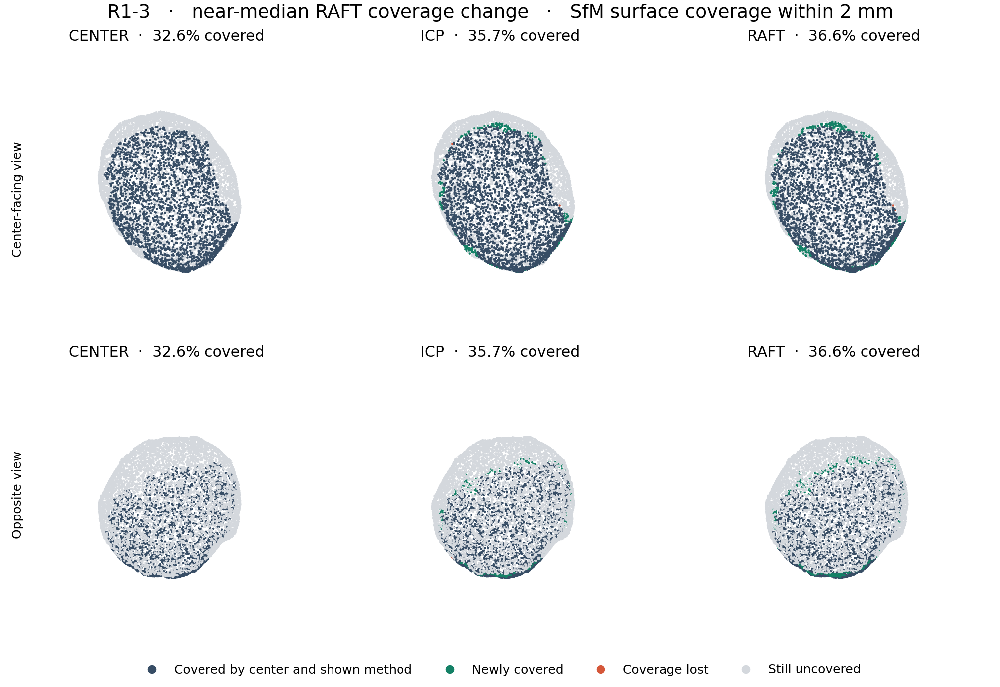
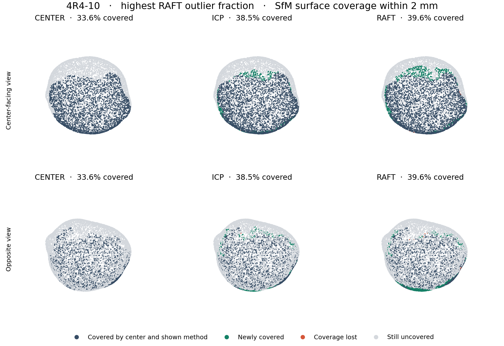

# Spaced-frame potato surface fusion with RAFT and ICP

**Spaced-frame fusion recovered additional SfM-supported surface on all ten potatoes.** Mean reference coverage within 2 mm rose from **36.31%** for the registered center cloud to **40.01%** with ICP and **40.79%** with RAFT. RAFT gained **4.49 percentage points** over center and **0.78 points** over ICP. At equal point count, the gains were **4.01** and **0.84 points**, respectively. [Protocol](protocol.md) · [Full-precision results](results.json)

**RAFT added a modest advantage over this ICP baseline.** It increased coverage on **8/10** potatoes and had **0.92 percentage points fewer** output points farther than 2 mm from the reference, on average. Both fused methods had more far points than the center cloud. The result describes a ten-potato development pilot. [Per-potato scores](per_potato.csv)

## Frozen geometry comparison

All 40 archived development IDs were eligible by file metadata. The fixed hash order selected ten and retained their archived quarter-position and registered-center frames. All 45 SAM 2 confirmation potatoes and reserved cohorts stayed closed. The 146 views supplied 136 adjacent links per method. Intermediate frames estimated motion, and exactly the three selected views contributed points to each fused output. The same released foreground cloud support was used for ICP and RAFT. [Frozen IDs, frames and member checksums](frame_manifest.json)

Each released PLY was converted from meters to camera millimeters and mapped back into its own full-resolution provided mask and raw depth. The maximum XYZ replay discrepancy across the 146 views was **0.000019 mm**. RAFT predicted forward and reverse pixel flow in a common crop at native scale. After checking the cycle and target depth support, we restored the crop origin and lifted source and target endpoints with the released intrinsics and raw axial depth in mm. RANSAC fit the source-to-next rigid pose. ICP used trimmed point-to-point registration on the same adjacent links. Below center, the link poses were composed forward. Above center, their inverses were composed back to the center. Every output used the same released center-to-SfM pose, with the translation converted to mm. No output was aligned to the reference. [Fixed fit settings](protocol.md) · [Released registration convention](../../docs/methodology.md) · [Registration and support checks](registration.json)

RAFT used Torchvision 0.22.1 RAFT-small C_T_V2, with SHA-256 `01064c6dba73b0fc9fc8edf772248560a00a3acfd62ac6677e9eeebad9680e27`. A known image translation of (+8, −6) px yielded median flow of (+8.01, −6.24) px. Synthetic 3D checks verified lifting, rigid fit with outliers, transform composition on both sides of center, and m-to-mm anchoring. A triangle fixture verified the 2 mm distance convention. [RAFT paper and code](https://github.com/princeton-vl/RAFT) · [Torchvision pretrained model](https://docs.pytorch.org/vision/stable/models/generated/torchvision.models.optical_flow.raft_small.html) · [Alignment preflight](alignment_freeze.json) · [Metric preflight](score_freeze.json)

## Coverage, outliers and density

We applied the same 1 mm SfM voxel grid to all outputs. For each potato, we used the same 50,000 area-uniform SfM surface samples to measure coverage. The far-point fraction uses point-to-triangle distance on the independent SfM mesh. A newly covered sample is within 2 mm after fusion and outside 2 mm for center alone. A lost sample makes the opposite transition. The table gives equal-potato averages. [Frozen endpoints](protocol.md) · [Full scores](per_potato.csv)

| Condition | Reference covered | Covered at equal count | Output points >2 mm from SfM | Mean points | Newly covered area | Area lost |
|---|---:|---:|---:|---:|---:|---:|
| Registered center | 36.31% | 36.31% | 3.99% | 6,276.5 | — | — |
| Three views with ICP | 40.01% | 39.48% | 6.46% | 11,579.4 | 495.8 mm² | 2.0 mm² |
| Three views with RAFT | 40.79% | 40.32% | 5.54% | 11,069.1 | 606.3 mm² | 3.1 mm² |

The equal-count check used the smallest cloud count per potato and averaged ten downsampling repeats. The gain persisted for each potato relative to center. The fixed poses and SfM errors contribute to the 2 mm measurements, so the extra area is evidence of supported coverage under these registrations. The far-point fractions show the cost of adding points as well. [Per-potato scores](per_potato.csv)

### Paired RAFT changes by potato

Values are percentage-point changes with RAFT first. Positive coverage changes add reference support. Negative far-point changes reduce outliers. [Per-potato scores](per_potato.csv)

| Potato | Coverage vs center | Coverage vs ICP | Equal-count coverage vs center | Equal-count coverage vs ICP | Far points vs center | Far points vs ICP |
|---|---:|---:|---:|---:|---:|---:|
| R1-3 | +4.02 | +0.95 | +3.68 | +1.02 | +2.89 | −0.83 |
| 4R6-7 | +2.75 | +0.83 | +2.51 | +0.95 | +0.99 | −4.10 |
| 4R4-10 | +5.98 | +1.10 | +5.20 | +1.04 | +4.34 | +2.17 |
| R11-5 | +3.92 | +0.26 | +3.62 | +0.29 | +1.28 | −0.36 |
| 4R8-8 | +5.62 | +0.89 | +5.11 | +0.86 | +0.69 | −1.49 |
| 4R4-8 | +6.99 | +2.53 | +6.48 | +2.42 | +1.28 | −0.45 |
| 3R7-10 | +2.48 | −0.64 | +2.05 | −0.49 | −0.41 | −0.15 |
| 2R1-9 | +5.09 | −0.10 | +4.59 | −0.04 | +1.40 | +0.17 |
| R10-10 | +3.74 | +1.09 | +3.19 | +1.25 | +1.55 | −3.47 |
| R9-2 | +4.28 | +0.93 | +3.66 | +1.08 | +1.43 | −0.67 |

## Where coverage changed

**Typical case — R1-3.** The new reference support appears along the edge of the center view’s covered region. RAFT increased coverage from 32.6% to 36.6%, compared with 35.7% for ICP. [Per-potato scores](per_potato.csv)



**Highest RAFT outlier fraction — 4R4-10.** RAFT increased coverage from 33.6% to 39.6%, and 10.5% of its output points were farther than 2 mm from the mesh. The corresponding ICP rates were 38.5% coverage and 8.3% far points. [Per-potato scores](per_potato.csv)



## Registration failures and runtime

All 136 links per method succeeded, and all ten potatoes contributed all three outputs and equal-count scores. There were no shared-support, registration, or reference scoring failures. On the local CPU, shared support loading and checking took **4.37 s** total. ICP fitting and fusion took **17.87 s**. RAFT flow took **27.88 s** including its image decoding and flow writes, and RAFT rigid fitting and fusion took **4.67 s**, for **32.55 s** excluding checkpoint setup. Reference measurement took **46.38 s** across the three conditions. Per-potato and per-link timings are archived. [Registration failures](registration_failures.csv) · [Link logs](registration.json) · [Per-potato timings](per_potato.csv)

## Reproduce

Run from the workspace root with the released local archives and the cached checkpoint at `outputs/raft_fusion_geometry_v1/assets/raft_small_C_T_V2-01064c6d.pth`. Use a fresh study output for a full run. The scorer also accepts `--out` to check the fixed registered clouds in a fresh directory.

```bash
export OPENBLAS_NUM_THREADS=1 OMP_NUM_THREADS=1 VECLIB_MAXIMUM_THREADS=1
export MPLCONFIGDIR="$PWD/.cache/matplotlib"
export DYLD_LIBRARY_PATH="$PWD/outputs/corepp_cpu_audit/runtime/libusb/1.0.30/lib"
study=studies/raft_fusion_geometry_v1
cpu_python=outputs/corepp_cpu_audit/venv/bin/python
.venv/bin/python "$study/prepare.py" &&
"$cpu_python" "$study/flow.py" &&
.venv/bin/python "$study/register.py" &&
"$cpu_python" "$study/score.py"
```
