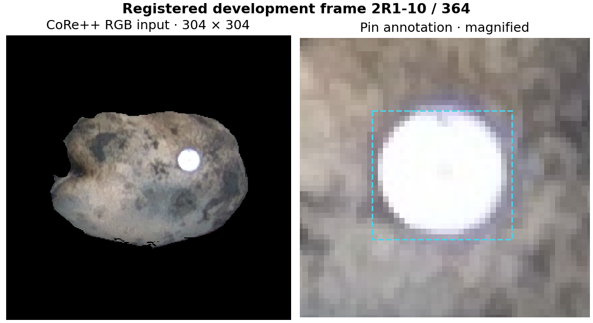

# CoRe++ CPU audit on one registered development frame

**CPU inference succeeded on 2R1-10, frame 364.** Both passes used the same unchanged RGB-D input. All **624 pixels inside the published pin box** survived preprocessing with their RGB values intact. The released test loop leaves decoder dropout active. Two successive passes produced different surfaces and volumes despite bitwise-identical input tensors and encoder outputs.

## Checkpoints and CPU path

The authors' `potato_32` folder supplied `super3d_32.json`, `specs.json`, `_super3d_32_best_model.pt` and `500.pth`. The two checkpoints loaded on CPU with PyTorch's weights-only loader and strict model-key checks. Their saved epoch fields are 39 and 500 respectively. Following the released test code, the harness first loaded the standalone DeepSDF decoder, then loaded both encoder and decoder weights from the joint best checkpoint. [Official weight folder](https://drive.google.com/drive/folders/1OmkgRUn8-Y-gXbGOywB4zBiJZp7-mzAK?usp=sharing) · [Released test code](https://github.com/UTokyo-FieldPhenomics-Lab/corepp/blob/0d6bae40b9215332efd566e6bca83bea171b99e9/test.py#L95-L128)

| Checkpoint | SHA-256 |
| --- | --- |
| `_super3d_32_best_model.pt` | `6d5555fad2fe2f5fc2ecbbdd0f2b2b0a9f42e09aa91460c88538970bc345cf9f` |
| `500.pth` | `72bdb43a710a4ea28b7332b816474147f2b824679d0241eccdcac6e2d0106132` |

The stock launcher hard-codes CUDA. The audit harness runs the original crop and padding functions, encoder, DeepSDF decoder, 20³ grid, convex hull, and Loop subdivision on CPU. It skips the test dataset's target-latent bookkeeping and reference accuracy metrics. The grid used the original bounding-box helper on a split containing only this development tuber, with the released SfM sampling procedure seeded at 133. Its cube was **94.839 mm** on a side. The grid depends on that one tuber's reference extent, so this measurement is a repeatability check at a fixed grid size. [Grid generation](https://github.com/UTokyo-FieldPhenomics-Lab/corepp/blob/0d6bae40b9215332efd566e6bca83bea171b99e9/sdfrenderer/grid.py) · [Mesh generation](https://github.com/UTokyo-FieldPhenomics-Lab/corepp/blob/0d6bae40b9215332efd566e6bca83bea171b99e9/utils.py#L146-L177)

## Pin survival

The released pair JSON identified frame 364, and the RGB, depth, registration and SfM hashes matched the archived development intake. The 26 × 24 px COCO box started at source `(x, y) = (1041, 325)`. All 624 box pixels passed the target alpha mask and the frame's depth filter, which accepted 290.0–320.1 mm. The original crop added a 20-pixel margin and produced a 189 × 250 px image. Zero padding brought it to 304 × 304. The released test transform applies no interpolation or resizing. The box moved to `(182, 122)` and stayed 26 × 24 px. The box is a location annotation, so the count includes any surrounding pixels inside it. [Released preprocessing](https://github.com/UTokyo-FieldPhenomics-Lab/corepp/blob/0d6bae40b9215332efd566e6bca83bea171b99e9/dataloaders/cameralaser_w_masks.py#L233-L291) · [Released padding](https://github.com/UTokyo-FieldPhenomics-Lab/corepp/blob/0d6bae40b9215332efd566e6bca83bea171b99e9/dataloaders/transforms.py#L14-L46)



## Two unchanged passes on CPU

The test preserved the released module modes and used seed 133 once before running two consecutive passes in the same process. The encoder produced the same 32-value latent both times. The decoder's active dropout at probability 0.2 changed the inside/outside label of 496 of 8,000 grid points. Both meshes were watertight. [Decoder dropout](https://github.com/UTokyo-FieldPhenomics-Lab/corepp/blob/0d6bae40b9215332efd566e6bca83bea171b99e9/deepsdf/networks/deep_sdf_decoder.py#L67-L96)

| Pass | RGB-D preprocessing | Forward and mesh | Predicted volume |
| --- | ---: | ---: | ---: |
| 1 | 71.0 ms | 221.5 ms | 258.2734 mL |
| 2 | 61.9 ms | 208.0 ms | 260.8405 mL |

The absolute volume difference was **2.5671 mL**. The bidirectional distance from 20,000 area-weighted samples per mesh to the other mesh had a **1.2310 mm mean**, **3.3287 mm p95**, and **4.7964 mm maximum**. Timings use one CPU thread on an Apple M2 Pro and exclude checkpoint loading, preparing the reference bounding box, and writing artifacts. The numerical audit records all input, checkpoint, source, tensor, latent, SDF and PLY hashes. The two meshes and exact 304 × 304 RGB PNG are in the run directory. The annotated inset is for display only. The confirmation cohorts stayed closed and no color edits were made. [Machine-readable audit](corepp_cpu_audit.json) · [CPU harness](corepp_cpu_audit.py)

## Reproduce the audit

The run used Python 3.13.1, PyTorch 2.7.1, torchvision 0.22.1, Open3D 0.20.0, OpenCV 4.10.0.84, and scikit-image 0.25.2. Open3D needed the libusb 1.0.30 runtime, extracted into the audit work directory. The upstream archive was pinned to commit `0d6bae40b9215332efd566e6bca83bea171b99e9`. [Pinned source](https://github.com/UTokyo-FieldPhenomics-Lab/corepp/tree/0d6bae40b9215332efd566e6bca83bea171b99e9)

```sh
export DYLD_LIBRARY_PATH="$PWD/outputs/corepp_cpu_audit/runtime/libusb/1.0.30/lib"
export MPLCONFIGDIR="$PWD/.cache/matplotlib"
export OPENBLAS_NUM_THREADS=1 VECLIB_MAXIMUM_THREADS=1 OMP_NUM_THREADS=1
outputs/corepp_cpu_audit/venv/bin/python studies/regional_shape_v1/corepp_cpu_audit.py \
  --source data/raw/3DPotatoTwin \
  --upstream outputs/corepp_cpu_audit/upstream/corepp-0d6bae40b9215332efd566e6bca83bea171b99e9 \
  --released outputs/corepp_cpu_audit/released \
  --run-dir outputs/corepp_cpu_audit/runs \
  --out-dir studies/regional_shape_v1
```
