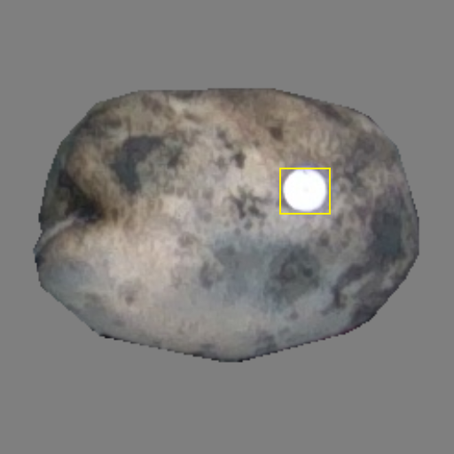
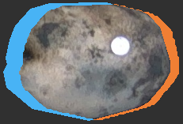

# Can we repeat the pin-versus-peel test on another model?

**TripoSR passed a one-frame CPU feasibility check. The frozen CoRe++ edits cannot be assumed to transfer unchanged.** Official TripoSR weights twice produced the same watertight surface from development frame **2R1-10 / 364**. The pin reached the model, and the unchanged scan supplied an approximate millimeter scale. The model predicted a very thin shape, and its resize spread the two archived mask footprints differently. This supports an exploratory RGB-model comparison only after checking that the intended edits are matched at its input.

The screen began with the project's [literature synthesis](../../../docs/literature_insights_2026-11-20.md), [related-work notes](../../../course/related_work.md) and [frozen pin protocol](../corepp_pin_multituber_protocol.md).

## Released candidates

| Candidate | Input, output and training domain | Compatibility and overlap |
|---|---|---|
| **TripoSR** | One masked RGB image drives triplane density and mesh geometry. The model was independently trained on renders of a curated Objaverse subset, with DINOv1 image initialization. | Official 1.68 GB weights loaded and ran locally. Its native mesh is in normalized coordinates. The observed-depth adapter below supplies an approximate fixed conversion. No 3DPotatoTwin overlap is documented. The exact training-asset subset is unavailable in the sources checked, so specimen overlap is unverified. [Paper §§2.1–2.2](https://arxiv.org/pdf/2403.02151) · [Pinned code](https://github.com/VAST-AI-Research/TripoSR/tree/107cefdc244c39106fa830359024f6a2f1c78871) · [Released weights](https://huggingface.co/stabilityai/TripoSR/tree/5b52193) |
| **Original CoRe and its potato baseline** | Single RGB-D view to DeepSDF. The original paper trained on sweet peppers and strawberries. The separately configured potato baseline uses 3DPotatoTwin. | The authors' `baseline` branch supplies source and its test config expects the separately trained encoder-decoder checkpoint `_super3d_best_val.pt`. The official Drive encoder listing contains only CoRe++ `_super3d_32_*` files, and the branch archive has no trained weights. I found no original fruit checkpoint via the authors' paper and lab page. In the potato baseline's published training list, the replay tuber **2R1-10** and **5 of the 10** multi-tuber development IDs appear in training. [Original paper](https://www.ipb.uni-bonn.de/wp-content/papercite-data/pdf/magistri2022ral-iros.pdf) · [Lab bibliography](https://www.ipb.uni-bonn.de/people/federico-magistri/index.html) · [Baseline config and code](https://github.com/UTokyo-FieldPhenomics-Lab/corepp/tree/f052ed8d100402085af5adf9eb0d3f4fabcf12df) · [Author encoder listing](https://drive.google.com/drive/folders/1TmiXc3g8-0xtCciFagCK4zGpzHrguwCq?usp=sharing) |
| **TCoRe** | The released RealSense loader back-projects RGB with depth and passes XYZ plus color to the sparse backbone. It predicts a deformed triangular mesh on a metric fruit scale. The released checkpoint is for sweet pepper, with no potato overlap in the disclosed training domain. | The author's checkpoint URL responded HTTP 200. The released forward path explicitly creates a CUDA MinkowskiEngine tensor, and the demo assumes a CUDA system. Its dataset path also uses supplied pose and fruit bounding-box files, so an inference-only adapter would need to establish a compatible canonical frame. The nominal `normals` config label does not override the RealSense RGB branch. [Paper](https://www.ipb.uni-bonn.de/wp-content/papercite-data/pdf/magistri2024icra.pdf) · [RGB-D loader](https://github.com/PRBonn/TCoRe/blob/c3fdcda3889ed45dac38fbb9b2ec1eb249c5f013/tcore/datasets/fruits.py#L142-L163) · [Backbone](https://github.com/PRBonn/TCoRe/blob/c3fdcda3889ed45dac38fbb9b2ec1eb249c5f013/tcore/models/backbone.py#L186-L262) · [Author checkpoint script](https://github.com/PRBonn/TCoRe/blob/master/scripts/download_checkpoint.sh) |
| **RecGen** | RGB, aligned metric depth, mask and intrinsics to a completed mesh and object pose. The released TRELLIS-derived model was fine-tuned on rendered ABO, HSSD, Objaverse and PartNeXt assets. No 3DPotatoTwin overlap is documented. | Official stage-one 70k and stage-two 75k weights are listed. The authors' runtime uses CUDA sparse-convolution dependencies. A community port describes small CPU smoke runs, so this is a potential porting option. A CPU run with the released pipeline and this potato remains unverified. [Author code and training notes](https://github.com/TRI-ML/recgen) · [Weight configuration](https://github.com/TRI-ML/recgen/blob/main/recgen_inference/build_recgen.py) · [Weights](https://huggingface.co/TRI-ML/RecGen) · [Community port](https://github.com/kaili-yang/ComfyUI-Recgen) |
| **F2G-Pose** | RGB features and depth predict 2,048 completed camera-frame points in meters. Training used synthetic SOPE objects, with no reported 3DPotatoTwin overlap. | Both the F2G checkpoint and its RADIO dependency are published. The release requires Linux/NVIDIA and CUDA PointNet++ and Chamfer extensions, and returns points rather than a triangle surface. A CPU port and prespecified surface reconstruction would both be needed. [Paper §4](https://arxiv.org/html/2610.31623v1) · [Model card](https://github.com/jrryzh/F2G-Pose/blob/main/docs/MODEL_CARD.md) · [Install and checksums](https://github.com/jrryzh/F2G-Pose/blob/main/docs/INSTALL.md) |
| **SAM 3D Objects** | A masked natural RGB image and optional point map condition full geometry. The reported training combines synthetic assets and increasingly real image–3D pairs. 3DPotatoTwin overlap is undocumented. | The author weights are gated and the official path requires Linux and an NVIDIA GPU with at least 32 GB of VRAM. [Paper](https://openaccess.thecvf.com/content/CVPR2026/papers/Chen_SAM_3D_3Dfy_Anything_in_Images_CVPR_2026_paper.pdf) · [Point-map code](https://github.com/facebookresearch/sam-3d-objects/blob/main/sam3d_objects/pipeline/inference_pipeline_pointmap.py) · [Setup](https://github.com/facebookresearch/sam-3d-objects/blob/main/doc/setup.md) · [Weights](https://huggingface.co/facebook/sam-3d-objects) |
| **PointRAFT, DWCNet and GenPC** | PointRAFT regresses potato traits from partial geometry and height. DWCNet learns geometric completion on PCN/CPCCD. GenPC renders a synthetic depth prompt from the partial point cloud before calling an image-to-3D prior. | PointRAFT's published checkpoint cannot provide a reconstructed surface. Its public split places 2R1-10 in test and five of the ten other development IDs in train. DWCNet and GenPC do not use the measured pin RGB in their published shape paths. Those geometry-only methods can serve as negative controls for recoloring. No potato training overlap is documented for them. [PointRAFT code](https://github.com/pieterblok/pointraft) · [Public split](https://github.com/pieterblok/pointraft/blob/a32bf67fb9eee7a1676ba1b50d11268018ef2221/data/3DPotatoTwin/splits.csv) · [DWCNet](https://doi.org/10.1016/j.cag.2025.104401) · [GenPC code](https://github.com/GenPC-Team/GenPC) |

## TripoSR CPU replay

The official checkpoint `stabilityai/TripoSR@5b52193/model.ckpt` matched the release LFS SHA-256 `429e2c6b22a0923967459de24d67f05962b235f79cde6b032aa7ed2ffcd970ee`. Both passes used CPU FP32, four PyTorch threads and evaluation mode, with the seed set once before model setup. Only the density-to-mesh binding was adapted to scikit-image's CPU marching cubes, using a frozen 128³ lattice and the released density threshold of 25. The first launcher attempt failed at input resize because the import override interfered with OmegaConf's configuration types. A narrower override fixed it before either successful forward pass. [Replay protocol](replay_protocol.md) · [Input, source and output hashes](replay.json)

| Unchanged pass | Forward wall time | Forward and mesh wall time | Forward and mesh CPU time |
|---|---:|---:|---:|
| 1 | 5.30 s | 6.36 s | 15.69 s |
| 2 | 5.32 s | 6.41 s | 15.67 s |

Model setup took 6.17 s and crop preparation took 0.048 s separately on this macOS arm64 host. The tokenizer inputs, triplanes, density predictions and mesh vertices and faces matched exactly across passes. The two native PLY files were byte-identical. Each mesh had 9,568 vertices, 19,132 triangles, and zero solid samples on the extraction-grid faces. Both were watertight, with **0.00 mm** repeat displacement under the same conversion.

### Pin and peel at the model input

The released alpha mask kept all 624 source pixels in the 26 × 24 annotated box. The 247 px square crop was composited on gray and bilinearly resized to 512 px. The box then covered 2,646 model pixels at greater than half annotation support, in a 54 × 49 px envelope. The traced RGB hash matched the actual tokenizer input in both runs. The square below marks the annotation for display only. [Exact unmarked model RGB](model_rgb.png)



As a mask-only check, each archived pilot mask contained 495 pixels before resizing. Transporting both through the same crop and bilinear resize gave 2,106 pin versus 2,113 peel pixels above half support, and 2,330 versus 2,334 at any nonzero support. This establishes different interpolation footprints. The realized pin and peel RGB deltas have yet to be checked on this model. Exact input matching would need to be demonstrated before using the frozen contrast with TripoSR.

### Scale and shape limitation

TripoSR's released forward path has no metric camera input. The fixed adapter used the unchanged reconstructed silhouette, the raw masked depth in mm and the released camera intrinsics from this same frame. It used a single similarity transform and never read a reference mesh or drainage measurement. The independently estimated lateral scales were **80.16 and 86.07 mm per normalized unit**, giving a uniform **83.07 mm per unit**. Perspective silhouette IoU was **0.817**. Among **10,875 of 12,109** held-out valid depth pixels covered by the mesh, median absolute depth residual was **4.26 mm** and p90 was **14.86 mm**. The three prespecified feasibility checks passed. [Fixed calibration and validation data](replay.json) · [Camera-frame mesh in mm](pass_1_camera_mm.ply)

The full predicted mesh spanned only **10.21 mm** along the viewing axis, while the 2nd-to-98th percentile depth range of the held-out visible scan alone was **26 mm**. The lateral fit makes a fixed millimeter displacement interpretable for this model's predictions, with clear limits on geometric fidelity. A TripoSR comparison would be a transfer test from internet 3D assets to conveyor potatoes. The model receives RGB alone, with depth used downstream for scale.



## Reproduce

Use the archived [CPU audit environment](../corepp_cpu_audit.md) from the repository root. The replay used Python 3.13.1, PyTorch 2.7.1, Transformers 4.53.2, Open3D 0.20.0, scikit-image 0.25.2, OmegaConf 2.3.0, trimesh 4.12.2, and rembg 2.0.87 with its CPU dependencies available for the upstream import. The released alpha mask bypassed learned foreground extraction. The cached DINO config initializes the architecture and the TripoSR checkpoint provides the weights.

The local asset directory contains the pinned source unpacked as `TripoSR-main`, the author `config.yaml` and `model.ckpt`, the [DINO architecture config](https://huggingface.co/facebook/dino-vitb16/blob/main/config.json) saved as `dino_config.json`, the source revision record, and the added packages in `deps/`. Each downloaded configuration's byte hash is in the replay record.

```bash
export DYLD_LIBRARY_PATH="$PWD/outputs/corepp_cpu_audit/runtime/libusb/1.0.30/lib"
export OPENBLAS_NUM_THREADS=1 VECLIB_MAXIMUM_THREADS=1 OMP_NUM_THREADS=1
triposr_assets=outputs/corepp_cross_model/triposr
outputs/corepp_cpu_audit/venv/bin/python -m studies.regional_shape_v1.corepp_cross_model_replay \
  --upstream "$triposr_assets/TripoSR-main" --checkpoint "$triposr_assets" \
  --deps "$triposr_assets/deps" --threads 4 \
  --out "$(mktemp -d)"
```

The study stopped after the two unchanged passes and input and scale audits. No color edit was run and all scored cohorts stayed closed. Ready for Astra to decide whether the adapter and domain mismatch fit the course scope.
