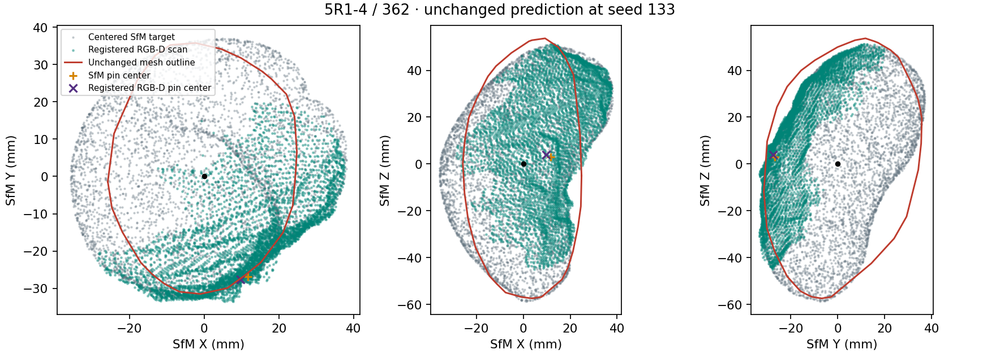

# Coordinate verification on 5R1-4 / 362

**Mapping passed before accuracy scoring.** The released CoRe++ metric uses the decoder mesh coordinates and the centroid-centered SfM target directly. For all five conditions, the reference is the full released triangle mesh translated into that target frame. The triangle surface retains its metric scale and SfM axis directions.

## Released path

1. `pcd_from_sfm.py` reads the SfM OBJ, uniformly samples 20,000 surface points, subtracts their centroid, and writes `laser/fruit.ply`. It applies one translation with unit scale and an identity rotation. The DeepSDF preparation reads the positions in this PLY when generating its supervision. [SfM preparation](https://github.com/UTokyo-FieldPhenomics-Lab/corepp/blob/0d6bae40b9215332efd566e6bca83bea171b99e9/data_preparation/pcd_from_sfm.py#L6-L30) · [DeepSDF target preparation](https://github.com/UTokyo-FieldPhenomics-Lab/corepp/blob/0d6bae40b9215332efd566e6bca83bea171b99e9/data_preparation/prepare_deepsdf_training_data.py#L140-L150)
2. The loader reads the resulting PLY and passes its XYZ array as `target_pcd`. The separate partial RGB-D point cloud has its Y and Z flipped during preprocessing. That operation has no role in the target coordinates or the RGB-D image encoder input. The SfM axes need not correspond to anatomical axes or the camera's right/down/forward axes. [Loader target and model inputs](https://github.com/UTokyo-FieldPhenomics-Lab/corepp/blob/0d6bae40b9215332efd566e6bca83bea171b99e9/dataloaders/cameralaser_w_masks.py#L463-L532) · [Partial geometry branch](https://github.com/UTokyo-FieldPhenomics-Lab/corepp/blob/0d6bae40b9215332efd566e6bca83bea171b99e9/dataloaders/cameralaser_w_masks.py#L249-L264)
3. `test.py` uses the decoded grid vertices and `target_pcd` in the same coordinates. The released Chamfer implementation converts the mesh to sampled points, then averages the two directed mean nearest-neighbor distances. It performs no pose fit, recentering or rescaling. The threshold 0.005 in the released test is in metres, and reported mesh volume converts cubic metres to mL. The study keeps the same fixed frame and uses deterministic point-to-triangle distances in mm. [Released test evaluation](https://github.com/UTokyo-FieldPhenomics-Lab/corepp/blob/0d6bae40b9215332efd566e6bca83bea171b99e9/test.py#L132-L198) · [Chamfer implementation](https://github.com/UTokyo-FieldPhenomics-Lab/corepp/blob/0d6bae40b9215332efd566e6bca83bea171b99e9/metrics_3d/chamfer_distance.py#L12-L25) · [Conversion to points](https://github.com/UTokyo-FieldPhenomics-Lab/corepp/blob/0d6bae40b9215332efd566e6bca83bea171b99e9/metrics_3d/metric.py#L41-L62)

## Numerical and visual checks

Recreating the target with Open3D seed 133 matched the float32 points loaded from the unmodified released preparation program bit for bit. The study recreates the target construction with that seed from released OBJs. The authors' original random sample and corresponding stored centroid for these development objects were unavailable. On 5R1-4 the centroid subtracted was **(0.8561, 5.3458, 129.7100) mm** in raw SfM coordinates. The released RGB-D-to-SfM matrix is a proper rigid transform. For the overlay only, the RGB-D scan and RGB-D pin landmark used this transform followed by the same centroid translation. The inverse remapped scan points to the original camera coordinates within **1.2 × 10⁻¹³ mm** numerical precision. [Audit numbers and hashes](coordinate_audit.json)

| Landmark | Raw SfM XYZ (mm) | Centered XYZ (mm) |
| --- | --- | --- |
| Maximum X vertex | (39.138, 9.375, 157.109) | (38.282, 4.029, 27.399) |
| Maximum Y vertex | (5.859, 42.400, 157.109) | (5.003, 37.054, 27.399) |
| Maximum Z vertex | (11.719, 18.750, 180.598) | (10.863, 13.404, 50.888) |

The centered SfM and transformed RGB-D pin centers were **(11.681, −26.884, 3.041) mm** and **(9.693, −27.598, 4.018) mm**. Their separation was **2.328 mm**. Registered scan points were **0.708 mm** from the SfM surface at the median and **2.527 mm** at the 95th percentile. The SfM and decoded outlines had their longest extent along Z, at **109.58 mm** and **111.06 mm**. The overlay preserves the differences in the outlines. No estimated prediction-to-reference transform was used. [Visual review](coordinate_review.json)

The accuracy metric gave **0.00000174 mm** on identical geometry and **4.000000 mm** on two copies of the same planar mesh separated by 4 mm along the normal. Reordering vertices and triangles and reversing triangle winding gave the same metric result after canonical ordering. Both distance checks met the 0.0001 mm tolerance. [Metric checks](coordinate_audit.json)
