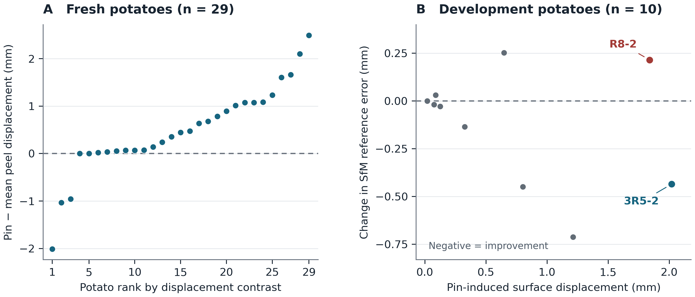

# Results

On 29 previously unscored potatoes assigned to the released CoRe++ model's test split, recoloring the registration pin in a single RGB-D view moved the predicted surface **0.4941 mm farther on average** than the mean response to identical RGB edits on three matched peel patches (95% acquisition-group bootstrap interval, **0.3089–0.6271 mm**). The potato-level contrast was positive for 25 potatoes, zero for one, and negative for three (Fig. 1A). Against the strongest fixed peel patch for each potato, the mean contrast was **0.3976 mm** (95% group interval, **0.2267–0.4956 mm**), with 24 positive, two zero, and three negative contrasts. That patch was selected by its median displacement across seeds. The five acquisition groups fell below the prespecified six-group minimum for a confirmatory decision, so both estimates are descriptive. [Fresh-potato table](corepp_pin_confirmation/per_potato.csv) · [Frozen protocol](corepp_pin_confirmation_protocol.md)

On ten development potatoes, the pin edit reduced error against the fixed structure-from-motion (SfM) reference on **six** potatoes, increased it on **three**, and tied on **one**. The equal-potato mean signed error change was **−0.1277 mm**. Similarly large displacements produced opposite accuracy changes (Fig. 1B). The predicted surface moved **2.0193 mm** on 3R5-2 and its reference error fell **0.4348 mm**. On R8-2 it moved **1.8399 mm** and its reference error rose **0.2153 mm**. [Development accuracy table](corepp_pin_accuracy/per_potato.csv)

The pin and three peel edits used identical per-pixel RGB differences on translated copies of the same mask. Dropout was paired across conditions for each of 16 seeds, and each potato contributed a median of the seed-level comparisons. At fixed lattice spacing, expanding from 20³ to 30³ reduced development mesh-boundary contacts from **321/800 to 0/800** and preserved the positive displacement contrast on the same nine of ten potatoes. Whether CoRe++ responds specifically to marker identity, and how physical marker removal would affect reconstruction accuracy, remain open. [Matched-edit protocol](corepp_pin_multituber_protocol.md) · [Per-potato grid check](corepp_pin_grid_boundary/report.md#paired-contrasts)



**Figure 1. Registration-pin recoloring and CoRe++ surface sensitivity.** **A** Potato-level pin-minus-mean-peel surface displacement, ordered by contrast. **B** Displacement from the unchanged prediction versus signed change in symmetric surface error against the SfM reference. Negative error change indicates improvement. Each point represents one potato.

## Does the pin effect transfer to a second model?

On the same ten development potatoes, pin recoloring displaced the predicted surface more than the mean of three matched peel edits on nine potatoes for CoRe++ and three for TripoSR. The two models favored the pin on the same three potatoes and both favored peel on one. On the other six, CoRe++ favored the pin and TripoSR favored peel. Against the strongest peel patch within each model, only two potatoes favored the pin in both models. All ten comparisons passed input matching and no-op replay. [Paired directions and strongest-peel control](triposr_pin_multituber/report.md)

The comparison uses the direction of each within-model contrast. CoRe++ uses RGB-D and TripoSR uses RGB alone; their training data, preprocessing and output coordinates also differ. The experiment shows that the preference for the pin location can differ between reconstruction pipelines on the same specimen. Which pipeline component explains that difference, and what happens when a physical marker is removed, remain open.

### Figure reproduction

Run from the repository root. The script reads only the two linked potato-level CSVs.

```sh
MPLCONFIGDIR="$PWD/.cache/matplotlib" outputs/corepp_cpu_audit/venv/bin/python \
  studies/regional_shape_v1/plot_corepp_pin_findings.py
```
