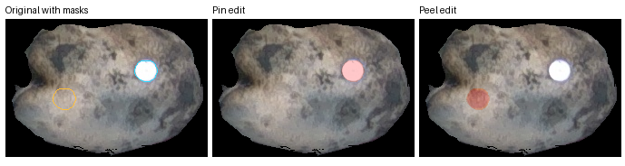

# CoRe++ pin-color pilot on 2R1-10 / 364

The pin edit moved the predicted surface more than the matched peel edit in **16 of 16** seed pairs. The median paired difference in mean symmetric surface distance was **+0.7665 mm**, with a range of **+0.3426 to +2.3198 mm**. Both edits changed the latent and the continuous signed distances. The pin edit changed the hull at every seed and the peel edit changed it at five. All 48 scored predictions produced watertight meshes. These are repeated dropout draws on one registered development frame. [Protocol](../corepp_pin_pilot_protocol.md) · [Machine-readable results](results.json)

## Paired no-op and frozen inputs

The no-op RGB passed through the same clipping, lossless PNG write and released preprocessing as the color interventions. Original and no-op matched exactly for the encoder input, latent, SDF, grid labels, mesh arrays and volume in all 16 pairs. On identical meshes, the largest point-to-triangle residual was 0.0000154 mm. Each condition restored the checkpoint parameters and buffers and reset the seeded RNGs at each inference stage. Both modules kept their audited training modes, including active decoder dropout. The scorer replayed the original latent and SDF hashes again at every seed. [CPU audit](../corepp_cpu_audit.md) · [No-op evidence](no_op_replay.json)

The pin mask rasterizes the release's visible-pin contour inside annotation 39. The hue came from the median RGB `[251, 134, 138]` of a 5 × 5 patch of the red pin in development image **5R2-3 / 356**. That image supplied color only. The pin edit sets HSV hue to 357.95° and saturation to 0.22 while preserving the original pixelwise HSV value. This preserves the value texture and can change luminance. The peel edit shifts the mask 90 px left and 31 px down onto a visually selected patch. The patch selector minimized clipping first, then the difference in mean distance to the alpha silhouette. Mean distances were 48.97 px for pin and 48.98 px for peel. Distances at corresponding mask pixels differed by 10.89 px RMS. [Pin mask](pin_mask.png) · [Peel mask](peel_mask.png) · [Red donor crop](donor_red_pin.png)

Each edit changed **495 of 495 intended model pixels**, with identical additive RGB deltas at corresponding pixels, zero clipped channels, and zero changes outside the mask. The mean RGB L2 change per edited pixel was 71.048 and the maximum was 78.026 on the 8-bit scale. The mean absolute R, G and B changes were 4.707, 48.747 and 50.713. The shared depth tensor, alpha, valid mask, crop, padding, and 8,000-point grid were held fixed. Source RGBA variants, shared depth and intrinsics are preserved locally under `outputs/corepp_pin_pilot/inputs/`. All checks and hashes were written before the first edited inference. [Frozen manifest](frozen_inputs.json) · [Unchanged model RGB](original_input_rgb.png) · [Pin model RGB](pin_input_rgb.png) · [Peel model RGB](peel_input_rgb.png)



## Paired results

Each edit is compared with the unchanged prediction from its own seed. SDF is the mean absolute change across the fixed grid in millimetres. Surface distance is the mean of 20,000 area-weighted samples in each direction, with fixed sampling across pairs. Identical hulls have zero geometric displacement. Volume sign is edited minus unchanged.

| Measure | Pin median (min to max) | Peel median (min to max) |
| --- | ---: | ---: |
| Latent L2 | 0.17690 (0.17690 to 0.17690) | 0.00232 (0.00232 to 0.00232) |
| Mean absolute SDF change (mm) | 0.56616 (0.55821 to 0.57307) | 0.00837 (0.00828 to 0.00853) |
| Grid labels changed out of 8,000 | 131.5 (113 to 146) | 2.5 (0 to 7) |
| Mean symmetric surface distance (mm) | 0.76925 (0.37467 to 2.31983) | 0.00000 (0.00000 to 0.09477) |
| Signed volume change (mL) | +14.67341 (+5.40839 to +45.90414) | 0.00000 (−1.35645 to 0.00000) |
| Absolute volume change (mL) | 14.67341 (5.40839 to 45.90414) | 0.00000 (0.00000 to 1.35645) |

| Seed | Pin latent L2 | Pin SDF (mm) | Pin labels | Pin surface (mm) | Pin ΔV (mL) | Pin abs(ΔV) (mL) | Peel latent L2 | Peel SDF (mm) | Peel labels | Peel surface (mm) | Peel ΔV (mL) | Peel abs(ΔV) (mL) | Pin − peel surface (mm) |
| ---: | ---: | ---: | ---: | ---: | ---: | ---: | ---: | ---: | ---: | ---: | ---: | ---: | ---: |
| 133 | 0.17690 | 0.57166 | 137 | 0.99398 | +19.25151 | 19.25151 | 0.00232 | 0.00835 | 1 | 0.00000 | +0.00000 | 0.00000 | +0.99398 |
| 134 | 0.17690 | 0.56883 | 131 | 0.62748 | +12.69692 | 12.69692 | 0.00232 | 0.00846 | 0 | 0.00000 | +0.00000 | 0.00000 | +0.62748 |
| 135 | 0.17690 | 0.56081 | 146 | 0.70886 | +13.67810 | 13.67810 | 0.00232 | 0.00828 | 3 | 0.00000 | +0.00000 | 0.00000 | +0.70886 |
| 136 | 0.17690 | 0.56554 | 123 | 0.65742 | +12.93592 | 12.93592 | 0.00232 | 0.00839 | 1 | 0.00000 | +0.00000 | 0.00000 | +0.65742 |
| 137 | 0.17690 | 0.57307 | 121 | 1.03765 | +18.70030 | 18.70030 | 0.00232 | 0.00846 | 3 | 0.00000 | +0.00000 | 0.00000 | +1.03765 |
| 138 | 0.17690 | 0.56300 | 143 | 0.90985 | +17.98426 | 17.98426 | 0.00232 | 0.00829 | 5 | 0.00782 | -0.14981 | 0.14981 | +0.90203 |
| 139 | 0.17690 | 0.56527 | 123 | 0.78228 | +14.55435 | 14.55435 | 0.00232 | 0.00832 | 1 | 0.00000 | +0.00000 | 0.00000 | +0.78228 |
| 140 | 0.17690 | 0.56609 | 142 | 0.73096 | +12.37330 | 12.37330 | 0.00232 | 0.00837 | 1 | 0.00000 | +0.00000 | 0.00000 | +0.73096 |
| 141 | 0.17690 | 0.56654 | 131 | 0.75621 | +14.79246 | 14.79246 | 0.00232 | 0.00844 | 5 | 0.00547 | -0.08425 | 0.08425 | +0.75074 |
| 142 | 0.17690 | 0.55821 | 136 | 2.31983 | +45.90414 | 45.90414 | 0.00232 | 0.00847 | 2 | 0.00000 | +0.00000 | 0.00000 | +2.31983 |
| 143 | 0.17690 | 0.56941 | 130 | 0.89932 | +16.91853 | 16.91853 | 0.00232 | 0.00831 | 1 | 0.00000 | +0.00000 | 0.00000 | +0.89932 |
| 144 | 0.17690 | 0.56657 | 118 | 0.37467 | +5.40839 | 5.40839 | 0.00232 | 0.00837 | 3 | 0.03206 | -0.46024 | 0.46024 | +0.34261 |
| 145 | 0.17690 | 0.56472 | 113 | 0.51878 | +9.70647 | 9.70647 | 0.00232 | 0.00831 | 1 | 0.00000 | +0.00000 | 0.00000 | +0.51878 |
| 146 | 0.17690 | 0.57132 | 132 | 1.10539 | +21.95541 | 21.95541 | 0.00232 | 0.00853 | 7 | 0.07230 | -0.37467 | 0.37467 | +1.03308 |
| 147 | 0.17690 | 0.56331 | 145 | 0.68634 | +13.44563 | 13.44563 | 0.00232 | 0.00841 | 4 | 0.00000 | +0.00000 | 0.00000 | +0.68634 |
| 148 | 0.17690 | 0.56624 | 135 | 0.96083 | +19.63841 | 19.63841 | 0.00232 | 0.00832 | 6 | 0.09477 | -1.35645 | 1.35645 | +0.86605 |

The matched control holds the additive RGB change and mean silhouette distance fixed. The patches differ in original color, texture, and spatial context, so the within-frame result does not isolate pin identity. The grid extent came from the frame's development reference. The pilot measures sensitivity of the released model under this grid, with no accuracy comparison. Only 2R1-10 / 364 went through inference. Confirmation cohorts stayed closed.

## Reproduction

Run from the repository root with the CPU audit's environment and the released weights and inputs it verified. The three phases must run in this order. The following command uses fresh directories to preserve this run's evidence.

```sh
export DYLD_LIBRARY_PATH="$PWD/outputs/corepp_cpu_audit/runtime/libusb/1.0.30/lib"
export MPLCONFIGDIR="$PWD/.cache/matplotlib"
export OPENBLAS_NUM_THREADS=1 VECLIB_MAXIMUM_THREADS=1 OMP_NUM_THREADS=1
for phase in noop freeze score
do
  outputs/corepp_cpu_audit/venv/bin/python -m studies.regional_shape_v1.corepp_pin_pilot "$phase" \
    --source data/raw/3DPotatoTwin \
    --upstream outputs/corepp_cpu_audit/upstream/corepp-0d6bae40b9215332efd566e6bca83bea171b99e9 \
    --released outputs/corepp_cpu_audit/released \
    --out-dir outputs/corepp_pin_pilot/replay \
    --input-dir outputs/corepp_pin_pilot/replay_inputs || break
done
```
