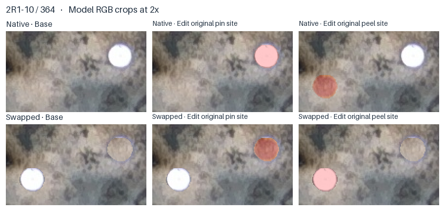

# CoRe++ pin-appearance swap on 2R1-10 / 364

The **original pin location** produced the larger median paired displacement before the swap, and the **original peel location** produced the larger median paired displacement after it. The pin-site-minus-peel-site contrast went from **+0.8520 mm** to **-0.3710 mm**, with a median paired change of **-1.2957 mm**. The more responsive site switched to the original peel location when it received the pin pixels. Sensitivity followed the transplanted RGB appearance in this synthetic input. [Frozen protocol](../corepp_pin_swap_pilot_protocol.md) · [Per-seed results](results.json)

## Displacement on the expanded grid

Each site edit is compared with its own unchanged layout at the same seed. Positive contrasts favor the original pin site and negative contrasts favor the original peel site. Values within 0.0001 mm of zero count as ties.

| Layout | Original pin site, mm | Original peel site, mm | Pin − peel, mm | Positive / tied / negative |
| --- | ---: | ---: | ---: | ---: |
| Native | 0.8520 (0.3556 to 2.2557) | 0.0000 (0.0000 to 0.0885) | +0.8520 (+0.3277 to +2.2557) | 16 / 0 / 0 |
| Swapped | 0.1148 (0.0174 to 0.1995) | 0.4942 (0.2746 to 0.8586) | -0.3710 (-0.6596 to -0.1556) | 0 / 0 / 16 |

Entries are medians with min to max in parentheses. The paired change (swapped contrast minus native contrast) was **-1.2957 (-2.6464 to -0.5059) mm**, with **0 / 0 / 16** positive / tied / negative seeds. The base swap by itself moved the surface **0.8170 (0.3963 to 2.0818) mm**. Its latent L2 change was **0.2347 (0.2347 to 0.2347)**.

| Seed | Native pin | Native peel | Swapped pin | Swapped peel | Native contrast | Swapped contrast | Paired change | Base swap |
| --- | ---: | ---: | ---: | ---: | ---: | ---: | ---: | ---: |
| 133 | 1.0324 | 0.0000 | 0.0912 | 0.4462 | +1.0324 | -0.3549 | -1.3873 | 1.0987 |
| 134 | 0.6345 | 0.0729 | 0.0174 | 0.5449 | +0.5616 | -0.5275 | -1.0891 | 0.5638 |
| 135 | 0.7202 | 0.0000 | 0.0419 | 0.2746 | +0.7202 | -0.2328 | -0.9530 | 0.7730 |
| 136 | 0.7225 | 0.0000 | 0.1606 | 0.3162 | +0.7225 | -0.1556 | -0.8782 | 0.6727 |
| 137 | 1.0153 | 0.0000 | 0.0478 | 0.4204 | +1.0153 | -0.3726 | -1.3879 | 1.0700 |
| 138 | 1.0824 | 0.0087 | 0.0526 | 0.5172 | +1.0737 | -0.4646 | -1.5383 | 1.0739 |
| 139 | 0.8545 | 0.0000 | 0.1989 | 0.8586 | +0.8545 | -0.6596 | -1.5141 | 0.8250 |
| 140 | 0.8495 | 0.0000 | 0.1389 | 0.5419 | +0.8495 | -0.4030 | -1.2525 | 0.6461 |
| 141 | 0.7605 | 0.0036 | 0.0609 | 0.3519 | +0.7569 | -0.2910 | -1.0479 | 0.7500 |
| 142 | 2.2557 | 0.0000 | 0.1995 | 0.5902 | +2.2557 | -0.3907 | -2.6464 | 2.0818 |
| 143 | 0.9223 | 0.0000 | 0.1551 | 0.5716 | +0.9223 | -0.4166 | -1.3389 | 0.8626 |
| 144 | 0.3556 | 0.0279 | 0.1425 | 0.3207 | +0.3277 | -0.1782 | -0.5059 | 0.3963 |
| 145 | 0.6797 | 0.0000 | 0.0599 | 0.2912 | +0.6797 | -0.2312 | -0.9110 | 0.8091 |
| 146 | 1.1607 | 0.0368 | 0.1820 | 0.5514 | +1.1239 | -0.3694 | -1.4933 | 1.0592 |
| 147 | 0.6935 | 0.0273 | 0.1384 | 0.4812 | +0.6663 | -0.3427 | -1.0090 | 0.5374 |
| 148 | 1.0362 | 0.0885 | 0.0457 | 0.5073 | +0.9477 | -0.4616 | -1.4093 | 0.8686 |

The archived 20³ native contrast was **+0.7665 (+0.3426 to +2.3198) mm**, positive on 16/16 seeds. All native model inputs, latents and interior SDF hashes reproduced that pilot. The native 30³ contrast was positive on 16/16 seeds. The 30³ grid and paired inner and outer decoder streams follow the boundary study. Surface comparisons use 20,000 fixed-seed area-weighted samples in each direction and canonical mesh ordering. [Original 20³ pilot](../corepp_pin_pilot/report.md) · [Expanded-grid procedure](../corepp_pin_grid_boundary/report.md)

## Frozen images and inference checks

Each of the four edits applied the identical archived RGB delta map on **495 pixels** with no clipping or out-of-mask changes. The native identity copy and the double swap restored the original RGBA pixel bytes. The shared depth, alpha, crop and intrinsics were fixed. The original pin and peel depths averaged **292.10 mm** and **301.54 mm**, respectively. The transplanted bright pin overlays the peel depth, and a visible purple rim remains at the original pin site. The crops show a visible composite seam. Those features, surrounding pixels and fixed depth are part of this one-frame intervention. [Frozen inputs](frozen_inputs.json) · [Visual review](visual_review.json)



All **32/32** no-op pairs matched exactly on the tensor, latent, interior and outer SDF, expanded-grid labels, raw and canonical mesh arrays, and volume. The largest mesh self-distance was **1.69e-05 mm**. The scored 30³ predictions had **0/96** mesh failures, **0/96** negative-SDF outer-layer contacts and **0/96** mesh-boundary contacts. [No-op replay](no_op_replay.json)

| Layout | Original pin site latent L2 | Original peel site latent L2 |
| --- | ---: | ---: |
| Native | 0.1769 (0.1769 to 0.1769) | 0.0023 (0.0023 to 0.0023) |
| Swapped | 0.0120 (0.0120 to 0.0120) | 0.0865 (0.0865 to 0.0865) |

The pilot used only frame 2R1-10 / 364. Marker identity and the effect of physically removing a pin remain open.

## Reproduction

Run from the repository root with fresh output and input directories. The supplied review applies to the exact reproduced crop. The phases separate preprocessing, visual sign-off, no-op and edited inference.

```sh
export DYLD_LIBRARY_PATH="$PWD/outputs/corepp_cpu_audit/runtime/libusb/1.0.30/lib"
export MPLCONFIGDIR="$PWD/.cache/matplotlib"
export OPENBLAS_NUM_THREADS=1 VECLIB_MAXIMUM_THREADS=1 OMP_NUM_THREADS=1
for phase in prepare seal noop score
do
  outputs/corepp_cpu_audit/venv/bin/python -m studies.regional_shape_v1.corepp_pin_swap_pilot "$phase" \
    --source data/raw/3DPotatoTwin \
    --upstream outputs/corepp_cpu_audit/upstream/corepp-0d6bae40b9215332efd566e6bca83bea171b99e9 \
    --released outputs/corepp_cpu_audit/released \
    --pilot-input-dir outputs/corepp_pin_pilot/inputs \
    --input-dir outputs/corepp_pin_swap_pilot/replay_inputs \
    --out-dir outputs/corepp_pin_swap_pilot/replay \
    --review studies/regional_shape_v1/corepp_pin_swap_pilot/visual_review.json || break
done
```
