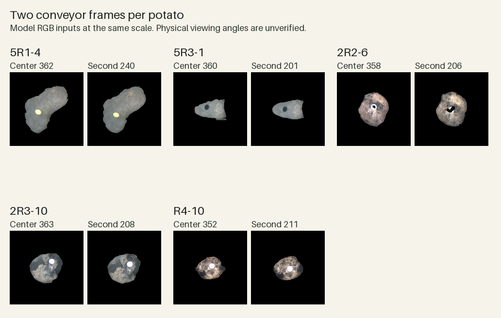
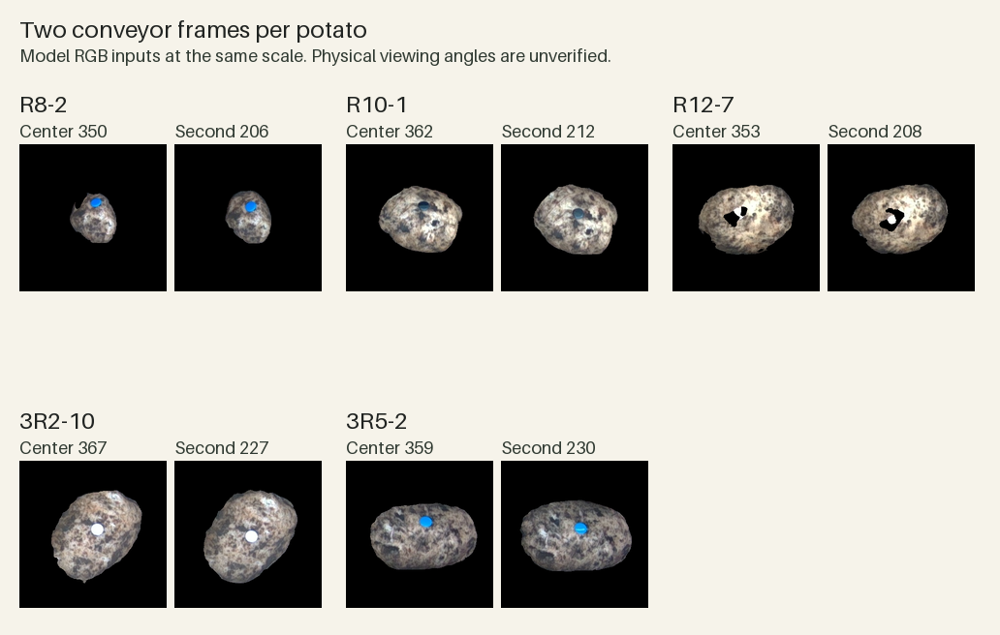

# Does a second conveyor frame improve CoRe++ volume estimates?

On ten development potatoes, averaging the two frame estimates lowered mean absolute volume error from **29.92 to 28.48 mL**. The paired change was **−1.44 mL on average** and **−1.91 mL at the median**, with **7 wins, 0 ties and 3 losses**. The second frame alone had the highest mean absolute error, **32.17 mL**. This is a modest average gain for this fixed comparison on the development cohort.

## Reference and procedure

The reference was the release's `3_pair/ground_truth.csv` field `volume_ml`. The dataset card identifies this as the drainage measurement and the methods describe water displacement. The CSV matched the checksum archived for the release. All ten IDs matched by exact `label`, with one positive finite measurement per ID, in mL. [Dataset card](https://huggingface.co/datasets/UTokyo-FieldPhenomics-Lab/3DPotatoTwin) · [Dataset paper, §2.3 and Table 1](https://pmc.ncbi.nlm.nih.gov/articles/PMC13109331/) · [Verified drainage rows](drainage_reference.json)

The registered center frame came first. For the second frame, the frozen rule sorted all complete RGB/depth pairs for that potato by numeric suffix and used zero-based index `(N−1)//4`. Here `N` ranged from 25 to 33. Both inputs are conveyor frames, and the physical viewing angles are unverified. The roster and exact archive members were frozen before inference and error calculation. [Protocol](../corepp_two_frame_volume_protocol.md) · [Frozen manifest](frozen_protocol.json)

Both frames used the same released masking, depth filtering, crop and normalization, verified checkpoint and 30³ grid. Seeds 133–148 were paired, using the archived interior and outer-point procedure. Per-frame predictions are the medians of 16 mesh volumes converted from m³ to mL. The two-frame estimate is the arithmetic mean of those medians. All three absolute errors use the same drainage value. [30³ grid verification](../corepp_pin_grid_boundary/report.md) · [Per-seed predictions](frame_predictions.json)

## Per-potato results

All volumes and errors are in mL. Each estimate cell shows **predicted volume / absolute error**. Negative Δ means averaging improved on center alone. The pair index is zero-based.

| Potato | Center frame | Second frame | Index / N | Drainage | Center / error | Second / error | Average / error | Δ vs center |
|---|---:|---:|---:|---:|---:|---:|---:|---:|
| 5R1-4 | 362 | 240 | 6 / 25 | 200 | 185.57 / 14.43 | 189.33 / 10.67 | 187.45 / 12.55 | −1.88 |
| 5R3-1 | 360 | 201 | 8 / 33 | 60 | 90.68 / 30.68 | 81.88 / 21.88 | 86.28 / 26.28 | −4.40 |
| 2R2-6 | 358 | 206 | 6 / 27 | 105 | 144.93 / 39.93 | 140.29 / 35.29 | 142.61 / 37.61 | −2.32 |
| 2R3-10 | 363 | 208 | 6 / 27 | 220 | 151.30 / 68.70 | 155.19 / 64.81 | 153.24 / 66.76 | −1.95 |
| R4-10 | 352 | 211 | 7 / 30 | 90 | 91.12 / 1.12 | 92.80 / 2.80 | 91.96 / 1.96 | +0.84 |
| R8-2 | 350 | 206 | 7 / 30 | 55 | 73.23 / 18.23 | 71.44 / 16.44 | 72.33 / 17.33 | −0.89 |
| R10-1 | 362 | 212 | 6 / 28 | 200 | 162.40 / 37.60 | 183.05 / 16.95 | 172.73 / 27.27 | −10.32 |
| R12-7 | 353 | 208 | 6 / 27 | 250 | 266.77 / 16.77 | 280.98 / 30.98 | 273.87 / 23.87 | +7.11 |
| 3R2-10 | 367 | 227 | 6 / 26 | 310 | 356.01 / 46.01 | 406.21 / 96.21 | 381.11 / 71.11 | +25.10 |
| 3R5-2 | 359 | 230 | 7 / 30 | 320 | 294.23 / 25.77 | 345.68 / 25.68 | 319.96 / 0.04 | −25.73 |

| Paired absolute error comparison | Mean change (mL) | Median change (mL) | Wins / ties / losses |
|---|---:|---:|---:|
| Average minus center | −1.44 | −1.91 | 7 / 0 / 3 |
| Second minus center | +2.25 | −2.77 | 7 / 0 / 3 |
| Average minus second | −3.69 | +1.38 | 4 / 0 / 6 |

The second frame improved on center alone on the same seven potatoes, but its larger misses yielded a higher mean error. Averaging reduced those misses and benefited especially from opposite-signed estimates on 3R5-2, where both single-frame errors were about 26 mL and the average was within 0.04 mL of the drainage value. On 3R2-10 both estimates were high, and averaging added 25.10 mL of error. This comparison supports a small development-set mean gain for the fixed average, with substantial variation across potatoes.

## Paired model crops

Each pair shows the RGB presented to the model after released masking, crop and padding. Black regions include masked pixels. The crops share the same display scale and show how much the visible input changed.





## Replay, coverage and time

All 10/10 potatoes completed with zero failures. The 160 center replays matched archived tensor, latent and signed-distance hashes and volumes within 1e-8 mL. All 160 second-frame meshes had valid volumes. Across both sets, no meshes touched the expanded grid faces and no face-grid sample was inside the predicted surface. The fresh cohorts stayed closed.

Second-frame extraction, preprocessing and inference added **120.73 CPU seconds** in total, or **12.07 seconds per potato**. Center replay separately used 120.04 CPU seconds. Combined prediction took 55.51 seconds of wall time on macOS arm64 with five one-thread workers. CPU totals exclude model startup and crop rendering. [Per-potato CSV](per_potato.csv) · [Machine-readable summary](results.json)

## Reproduce

From the repository root, with the archived CPU environment and release inputs in place, run the following into a new output directory.

```bash
export DYLD_LIBRARY_PATH="$PWD/outputs/corepp_cpu_audit/runtime/libusb/1.0.30/lib"
export MPLCONFIGDIR="$PWD/.cache/matplotlib"
export OPENBLAS_NUM_THREADS=1 VECLIB_MAXIMUM_THREADS=1 OMP_NUM_THREADS=1
run_volume() {
  outputs/corepp_cpu_audit/venv/bin/python -m studies.regional_shape_v1.corepp_two_frame_volume "$1" \
    --source data/raw/3DPotatoTwin \
    --upstream outputs/corepp_cpu_audit/upstream/corepp-0d6bae40b9215332efd566e6bca83bea171b99e9 \
    --released outputs/corepp_cpu_audit/released \
    --input-dir outputs/corepp_pin_multituber/inputs \
    --out-dir "${2:-studies/regional_shape_v1/corepp_two_frame_volume}" --workers 5
}
run_output=$(mktemp -d)
run_volume freeze "$run_output"
run_volume predict "$run_output"
run_volume evaluate "$run_output"
```
