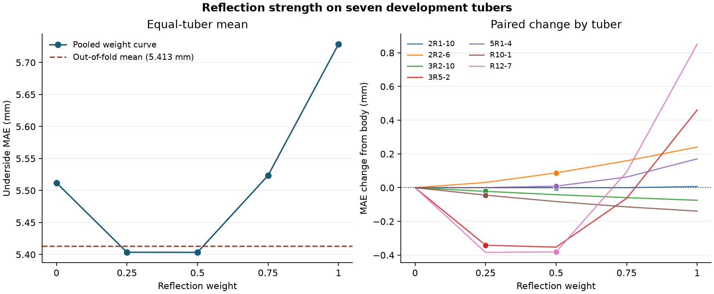

# Leave-one-tuber-out reflection strength

**Ready for Astra to interpret.** Choosing the reflection weight on the other six evaluable tubers reduced out-of-fold underside MAE from **5.5121 to 5.4133 mm**, a paired change of **−0.0988 mm**. The aggregate gain persisted under all eight registration probes. It was concentrated in 3R5-2 and R12-7. The one-sector forward shift still had lower MAE than aligned reflection at the same fold weights. This is development evidence for Astra's judgment on size, coverage, and whether an independent cohort is warranted. [Astra decision](astra_decision.md)

## Coverage and endpoint reproduction

The seven evaluated tubers came from the original 12. The replay retained 10/24 bands and 12,202 cells with the original fit, masks, sectors, and support. It reproduced the original results JSON byte for byte. Independently scoring the weight grid reproduced the body endpoint at 5.512091882 mm and the full-reflection endpoint at 5.728710571 mm, with agreement at every evaluable band and tuber. [Original development report](results.md)

For each weight of 0, 0.25, 0.5, 0.75 and 1, the scorer subtracted the weighted signed correction from the body lower height on each cell before taking absolute error. It averaged cells within each sector, then gave equal weight to sectors, passing bands and tubers at their respective levels. Each fold minimized the six training tubers' mean MAE, breaking ties toward the smaller weight. All shifts and registration probes used the selected nominal fold weight.

## Left-out tuber scores

All errors and changes are in mm. The last column is the mean paired change after dropping that tuber's test result and keeping the other six fold choices fixed. It measures each fold's contribution to the aggregate.

| Left-out tuber | Passing bands | Scored cells | Selected weight | Smooth body MAE | Selected MAE | Change vs. body | Mean change without this fold |
| --- | ---: | ---: | ---: | ---: | ---: | ---: | ---: |
| 2R1-10 | 1/2 | 1,699 | 0.50 | 7.6704 | 7.6702 | −0.0002 | −0.1152 |
| 2R2-6 | 2/2 | 1,636 | 0.50 | 2.3962 | 2.4837 | +0.0875 | −0.1298 |
| 2R3-10 | 0/2 | 0 | — | — | — | — | — |
| 3R2-10 | 2/2 | 2,937 | 0.25 | 5.7538 | 5.7319 | −0.0218 | −0.1116 |
| 3R5-2 | 1/2 | 1,720 | 0.25 | 4.7272 | 4.3862 | −0.3410 | −0.0584 |
| 5R1-4 | 1/2 | 892 | 0.50 | 8.8633 | 8.8726 | +0.0093 | −0.1168 |
| 5R2-3 | 0/2 | 0 | — | — | — | — | — |
| 5R3-1 | 0/2 | 0 | — | — | — | — | — |
| R10-1 | 2/2 | 1,867 | 0.25 | 5.5465 | 5.5022 | −0.0443 | −0.1078 |
| R12-7 | 1/2 | 1,451 | 0.50 | 3.6273 | 3.2464 | −0.3809 | −0.0518 |
| R4-10 | 0/2 | 0 | — | — | — | — | — |
| R8-2 | 0/2 | 0 | — | — | — | — | — |
| **Equal-tuber mean** | **10/24** | **12,202** | | **5.5121** | **5.4133** | **−0.0988** | |

Five of seven paired changes were negative, including the 0.0002 mm difference for 2R1-10. The median paired change was −0.0218 mm. Dropping either 3R5-2 or R12-7 leaves a mean gain of about 0.05–0.06 mm. Dropping both leaves a **+0.0061 mm** mean error increase across the remaining five fixed fold scores. This omission diagnostic uses the original trained fold weights.

## Error versus weight

The pooled MAEs were 5.512092, 5.403555, 5.403432, 5.523405 and 5.728711 mm in ascending weight order. The pooled minimum at 0.50 was only 0.000123 mm below 0.25. Four folds selected 0.50 and three selected 0.25. The pooled curve uses all seven tubers to assess each fixed weight. Dots on the individual curves mark the weight chosen from that tuber's six training peers.



## Shifted controls and practical comparator

Positive shift offsets move each correction forward by that number of sectors in the original counterclockwise ordering. The two neighboring offsets are +1 and −1, with −1 equivalent to +7. The shifted mean is the mean of seven errors per fold. All methods use the same scored cells.

| Left-out tuber | Mean shifted MAE | +1 shift MAE | −1 shift MAE | Clipped q95 mirror MAE |
| --- | ---: | ---: | ---: | ---: |
| 2R1-10 | 7.6872 | 7.6869 | 7.6702 | 8.3825 |
| 2R2-6 | 2.4152 | 2.6380 | 2.2862 | 2.4960 |
| 3R2-10 | 5.7793 | 5.7808 | 5.7009 | 7.3137 |
| 3R5-2 | 4.9561 | 3.7247 | 5.3372 | 6.7902 |
| 5R1-4 | 8.9693 | 8.8633 | 8.9017 | 5.9874 |
| R10-1 | 5.5559 | 5.3875 | 5.6539 | 5.4200 |
| R12-7 | 4.2768 | 2.8630 | 4.5042 | 4.1757 |
| **Equal-tuber mean** | **5.6628** | **5.2777** | **5.7220** | **5.7951** |

Aligned reflection averaged 0.2495 mm below the mean shifted error and 0.3818 mm below the clipped mirror. The +1 diagnostic averaged 0.1356 mm below aligned reflection and remained lower in every probe. Candidate weight selection used aligned predictions only.

## Registration sensitivity

Each probe reused the original ray offset or reference rotation. The nominal and perturbed scores used the same intersected support within that probe. All eight probes retained the seven tubers and 10 bands and lost one to five of the 12,202 scored cells. The arrow gives nominal to perturbed paired change on that support. The last three columns are perturbed MAEs in mm.

| Probe | Cells | Aligned − body | Aligned − mean shifted | +1 shift | −1 shift | Clipped q95 |
| --- | ---: | ---: | ---: | ---: | ---: | ---: |
| Ray x − RMSE | 12,197 | −0.0988 → −0.0854 | −0.2493 → −0.2403 | 5.2183 | 5.6525 | 5.7541 |
| Ray x + RMSE | 12,198 | −0.0988 → −0.1110 | −0.2492 → −0.2577 | 5.3520 | 5.8062 | 5.8375 |
| Ray y − RMSE | 12,200 | −0.0988 → −0.1075 | −0.2493 → −0.2571 | 5.4037 | 5.8232 | 5.8518 |
| Ray y + RMSE | 12,200 | −0.0988 → −0.0884 | −0.2494 → −0.2403 | 5.1660 | 5.6337 | 5.7449 |
| Rotate x −1° | 12,201 | −0.0988 → −0.0963 | −0.2494 → −0.2549 | 5.2077 | 5.6422 | 5.7396 |
| Rotate x +1° | 12,200 | −0.0988 → −0.1007 | −0.2493 → −0.2451 | 5.3524 | 5.8056 | 5.8519 |
| Rotate y −1° | 12,197 | −0.0988 → −0.1054 | −0.2493 → −0.2565 | 5.1611 | 5.6254 | 5.6970 |
| Rotate y +1° | 12,201 | −0.0988 → −0.0916 | −0.2493 → −0.2433 | 5.3996 | 5.8260 | 5.8965 |

The selected predictions for 3R5-2 and R12-7 improved on their smooth-body scores under every probe. The nominal change for 2R1-10 was effectively zero on these scales. The probes vary lateral position and tilt around the scan centroid with the nominal belt depth held fixed.

## Reproduce

The machine-readable results record the saved baseline and decision hashes, each fold's training IDs and error curve, the selected test scores, seven individual shifts, and each tuber's matched-support scores for all eight probes. [Results JSON](reflection_weight_results.json)

```sh
OPENBLAS_NUM_THREADS=1 VECLIB_MAXIMUM_THREADS=1 OMP_NUM_THREADS=1 \
MPLCONFIGDIR="$PWD/.cache/matplotlib" \
  .venv/bin/python -m studies.regional_shape_v1.reflection_weight \
  --source data/raw/3DPotatoTwin
```
