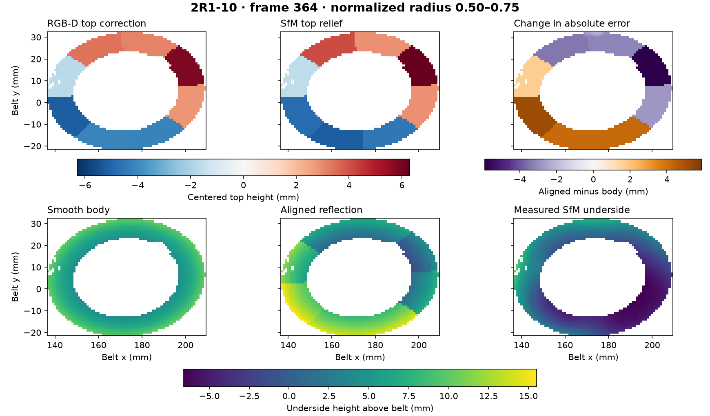

# Regional underside prediction on 12 development tubers

**Ready for Astra to interpret.** Seven of 12 tubers and 10 of 24 radial bands were evaluable. Aligned reflection averaged **5.729 mm** underside MAE, versus **5.512 mm** for the fitted body and **6.460 mm** for the mean of the seven shifted controls. The paired differences were **+0.217 mm** versus the body and **−0.731 mm** versus the shifted control. All eight registration probes preserved both directions. This was a development run on the cohort specified in the [protocol](protocol.md).

## Coverage and failures

All 12 released pairs passed the RGB-D intake and existing registration overlap checks. All 12 body fits converged. R12-7 reached the body model's upper exponent bound of 4. The nominal reference had 23,429 paired rays out of 23,589 cells. Of the 160 rejected rays, 147 had no crossings and 13 had more than two.

| Normalized radial band | Nominal cells | Screened scan cells | Paired SfM rays | Common cells before band gate | Evaluable bands | Scored cells |
| --- | ---: | ---: | ---: | ---: | ---: | ---: |
| 0.25–0.50 | 8,837 | 7,535 | 8,836 | 7,534 | 4/12 | 3,205 |
| 0.50–0.75 | 14,752 | 13,784 | 14,593 | 13,751 | 6/12 | 8,997 |
| Total | 23,589 | 21,319 | 23,429 | 21,285 | 10/24 | 12,202 |

The 12,202 scored cells represent 95.3% of the 12,800 nominal cells in passing bands. Each sector needed at least 20 screened-scan and paired-reference cells in common and at least half its nominal cells. Fourteen bands failed. Marker masking was the only failure flag in the offending sectors of 12 bands. The 5R3-1 outer band had overlapping marker, foreground and depth exclusions. The 5R1-4 outer band had too few valid reference rays in sector 5 even though its screened scan count passed.

Each listed fraction is common cells over nominal cells in the failed sector. Sector numbers are zero-based.

| Tuber | Inner-band failures | Outer-band failures |
| --- | --- | --- |
| 2R1-10 | s0 23/128, s1 51/129 | |
| 2R3-10 | s0 14/78 | s0 19/122 |
| 3R5-2 | s1 9/132 | |
| 5R1-4 | | s5 87/203 |
| 5R2-3 | s5 4/50, s6 18/51 | s5 35/83, s6 41/83 |
| 5R3-1 | s2 2/73 | s2 40/117 |
| R12-7 | s2 26/115, s3 41/116 | |
| R4-10 | s1 0/50, s2 7/46 | s1 40/86 |
| R8-2 | s2 0/46, s3 0/41 | s2 6/72, s3 20/74 |

## Per-tuber underside error

All errors and differences are in mm. Scored coverage is common over nominal cells within passing bands. Negative paired differences favor aligned reflection. The clipped 95th-percentile mirror covered every scored cell and used the same aggregation as the three primary predictions.

| Tuber | Frame | Bands | Scored coverage | Body | Aligned | Shifted | Aligned − body | Aligned − shifted | Clipped q95 mirror |
| --- | --- | ---: | ---: | ---: | ---: | ---: | ---: | ---: | ---: |
| 2R1-10 | 364 | 1/2 | 1,699/1,721 | 7.670 | 7.677 | 7.911 | +0.007 | −0.233 | 8.382 |
| 2R2-6 | 358 | 2/2 | 1,636/1,715 | 2.396 | 2.637 | 2.489 | +0.241 | +0.148 | 2.496 |
| 2R3-10 | 363 | 0/2 | — | — | — | — | — | — | — |
| 3R2-10 | 367 | 2/2 | 2,937/3,024 | 5.754 | 5.679 | 6.226 | −0.075 | −0.547 | 7.314 |
| 3R5-2 | 359 | 1/2 | 1,720/1,740 | 4.727 | 5.188 | 7.233 | +0.461 | −2.045 | 6.790 |
| 5R1-4 | 362 | 1/2 | 892/968 | 8.863 | 9.034 | 9.703 | +0.171 | −0.668 | 5.987 |
| 5R2-3 | 356 | 0/2 | — | — | — | — | — | — | — |
| 5R3-1 | 360 | 0/2 | — | — | — | — | — | — | — |
| R10-1 | 362 | 2/2 | 1,867/2,085 | 5.547 | 5.407 | 5.617 | −0.139 | −0.210 | 5.420 |
| R12-7 | 353 | 1/2 | 1,451/1,547 | 3.627 | 4.478 | 6.040 | +0.851 | −1.562 | 4.176 |
| R4-10 | 352 | 0/2 | — | — | — | — | — | — | — |
| R8-2 | 350 | 0/2 | — | — | — | — | — | — | — |
| **Equal-weight tuber mean** | | **10/24** | **12,202/12,800** | **5.512** | **5.729** | **6.460** | **+0.217** | **−0.731** | **5.795** |

Aligned reflection beat the body in 2/7 tubers and the mean shifted control in 6/7. The leave-one-tuber-out mean difference ranged from +0.111 to +0.276 mm versus the body and from −0.878 to −0.512 mm versus the shifted control. The two largest shifted-control gains, 3R5-2 and R12-7, contributed 70% of the net improvement summed across tubers. The individual one-sector shift averaged 5.391 mm, compared with 5.729 mm for aligned reflection. The planned control averages all seven shifts.

### Belt-relative heights

Aligned reflection predicted below the nominal belt plane on 2,528 of 12,202 cells across all seven scored tubers, with a minimum height of −7.465 mm. Per-shift counts ranged from 2,413 to 2,632, with a minimum height across shifts of −7.463 mm. The body and clipped mirror had no cells below the nominal plane. Scored SfM heights also fell below that plane on 4,623 cells, reaching −7.430 mm. The shared 350 mm camera-to-belt depth is approximate and predates this study. These values measure heights relative to that plane. The lateral and rotation probes leave the assumed belt depth fixed.

## Registration sensitivity and top relief agreement

The lateral probes offset reference rays by the released per-pair registration RMSE, which ranged from 0.378 to 0.698 mm. The rotation probes rotate only the SfM mesh by ±1° about each belt-plane axis through the RGB-D point centroid. Each comparison uses the intersection of the nominal and perturbed reference supports with the screened scan. All probes retained the same seven tubers and ten bands. Each removed one to five of the 12,202 scored cells. Across all 24 bands, including excluded bands, the probes removed 3–22 of the 21,285 nominal common cells before the band gate.

Each contrast column gives the nominal score and then the perturbed score, recomputed on the same support for that row. Lower displacement is the largest tuber-level p95 of the absolute change in measured underside height.

| Probe | Scored cells | Aligned − body (mm) | Aligned − shifted (mm) | RGB-D vs SfM top relief MAE (mm) | Max lower displacement p95 (mm) |
| --- | ---: | ---: | ---: | ---: | ---: |
| Ray x − RMSE | 12,197 | +0.217 → +0.240 | −0.730 → −0.724 | 0.587 → 0.593 | 1.21 |
| Ray x + RMSE | 12,198 | +0.217 → +0.195 | −0.731 → −0.734 | 0.587 → 0.624 | 1.30 |
| Ray y − RMSE | 12,200 | +0.217 → +0.199 | −0.731 → −0.735 | 0.587 → 0.613 | 1.15 |
| Ray y + RMSE | 12,200 | +0.217 → +0.235 | −0.731 → −0.724 | 0.587 → 0.627 | 1.12 |
| Rotate x −1° | 12,201 | +0.217 → +0.208 | −0.731 → −0.764 | 0.587 → 0.649 | 0.79 |
| Rotate x +1° | 12,200 | +0.217 → +0.225 | −0.731 → −0.699 | 0.587 → 0.575 | 0.77 |
| Rotate y −1° | 12,197 | +0.217 → +0.217 | −0.730 → −0.740 | 0.587 → 0.574 | 1.12 |
| Rotate y +1° | 12,201 | +0.217 → +0.220 | −0.731 → −0.719 | 0.587 → 0.682 | 1.11 |

The two contrasts kept their signs for every scored tuber across all eight probes. The largest per-tuber change was 0.249 mm versus the body and 0.284 mm versus the shifted control. On the full nominal support, the equal-tuber MAE between centered RGB-D and SfM top relief was 0.585 mm. Across bands, top relief MAE ranged from 0.311 to 0.949 mm and Pearson correlation across the eight sector medians ranged from 0.657 to 0.995. The scan and SfM heights were measured independently on paired cells and referenced to the same scan-fitted body.

## Example

The plot shows the first evaluable tuber by ID and its first passing band. Purple in the error panel shows where the in-place correction reduced absolute error, and orange shows where it increased error. For this tuber, the improvements and increases nearly canceled in the sector-weighted mean.



## Implementation and replay

The runner uses the previous body's robust vertical profile and ellipse from the scan hull. It orients the major axis toward positive belt x, using positive belt y for a perpendicular tie, and measures counterclockwise sectors from that axis in normalized ellipse coordinates. Nominal denominators include every 1 mm band cell in the fitted ellipse. The scan estimates each cell from the median of five observations within 1.5 mm and rejects locations outside the observation hull or flagged by the existing RGB-D masks. The scan's centered correction uses all screened scan cells. Each method is scored on common scan and reference cells with equal weighting of sectors within bands, bands within tubers, and tubers in the cohort. The reference uses the released rigid transform and the existing outward-oriented two-crossing check.

The [machine-readable results](results.json) include input hashes, both band denominators for each tuber, scan mask counts, per-band and per-tuber scores, all seven shifted errors, signed relief estimates, belt-relative heights, and per-tuber probe results. Analytic fixtures checked both correction signs, a bilateral broad deviation, a top-only deviation, and a lower deviation displaced by four sectors. Additional checks cover weighting, coverage, and rescoring on common support.

An independent replay produced byte-identical results and figure files. A replay of the earlier fresh lobe pilot reproduced its saved JSON byte for byte after the shared helper changes. All 86 tests across the project and the three study directories passed.

```sh
OPENBLAS_NUM_THREADS=1 VECLIB_MAXIMUM_THREADS=1 OMP_NUM_THREADS=1 \
MPLCONFIGDIR="$PWD/.cache/matplotlib" \
  .venv/bin/python -m studies.regional_shape_v1.study \
  --source data/raw/3DPotatoTwin \
  --out studies/regional_shape_v1/results.json \
  --example studies/regional_shape_v1/example.png

.venv/bin/python -m pytest -q tests studies/real_lobes_v1 \
  studies/body_detail_v1 studies/regional_shape_v1
```
