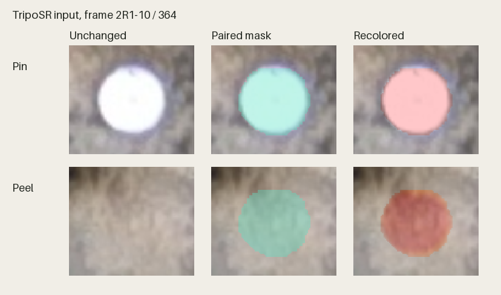

# One-frame TripoSR pin-versus-peel pilot

**The peel edit moved TripoSR’s prediction farther on 2R1-10 / 364.** The mean symmetric displacement was **0.00406455 native units** for peel and **0.00258275** for pin. The pin-minus-peel difference was **−0.00148180 native units**, or **−0.1231 mm** under the fixed approximate scale. The [archived CoRe++ pilot](../corepp_pin_pilot/report.md) found the opposite direction on the same frame, with pin larger in all 16 paired draws. The interventions were matched within each model’s input. This pilot compares direction on one frame. Cross-architecture effect sizes, accuracy and generalization remain open.

## Frozen model inputs

The archived pin and peel masks were transported from the registered source frame through TripoSR’s crop and bilinear resize. Their translated intersection at the 512-pixel input provided one mask shape with one-to-one pixel correspondence, with the peel offset by **187 pixels left and 64 down**. Both sites were fully supported by the released foreground mask. The candidate change came from the archived pin recoloring after TripoSR preprocessing. It was rounded in normalized RGB coordinates and capped jointly to the allowed channel range at both sites. This is a TripoSR-specific matched intervention.

The final pre-normalization RGB tensors had **2,079 changed pixels per site**, **zero off-mask changes**, and **exactly identical realized channel deltas** at every paired pixel. The mean and maximum RGB vector changes were **70.94** and **77.89** on a 0–255-equivalent scale. The mean signed channel changes were **+4.46 red, −48.94 green, and −50.53 blue**. Joint caps adjusted 268 of the 6,237 paired channel values and all final values stayed in range. Crops, tensor hashes and the paired delta map were saved before edited inference. The model's tokenizer received the frozen tensors exactly. [Frozen checks and hashes](frozen_inputs.json) · [Exact input tensors and masks](inputs.npz) · [Full-frame locations](mask_locations.png)



## Replay and displacement

The unchanged and zero-delta runs matched each other and the archived tokenizer input, triplane, density-grid, vertex and face hashes. That gate passed and was recorded before running the edits. Both edits changed the continuous density field. All four meshes were finite, watertight and consistently wound, with positive volume and zero solid grid nodes on the 128³ lattice boundary. The density threshold remained 25. [No-op gate](no_op_replay.json) · [Per-condition results](results.json)

| Comparison against unchanged | Mean symmetric distance, native units | Approximate distance, mm | Density changed | Valid mesh |
|---|---:|---:|:---:|:---:|
| Unchanged against itself | 2.1235e−9 | 1.7639e−7 | No | Yes |
| Zero-delta no-op | 2.1235e−9 | 1.7639e−7 | No | Yes |
| Pin edit | 0.00258275 | 0.2145 | Yes | Yes |
| Peel edit | 0.00406455 | 0.3376 | Yes | Yes |
| **Pin minus peel** | **−0.00148180** | **−0.1231** | | |

The symmetric score averages closest-triangle distances from 20,000 seeded area-weighted samples per direction. The self-comparison used that same numerical calculation, with a maximum residual of 1.0537e−7 native units. The archived single-frame camera transform was held fixed. Rigid rotation and translation leave the native distances unchanged, so the approximate millimeter column is the native result multiplied by **83.0653 mm per unit**. The prior audit found an unusually thin TripoSR prediction on this frame. The scale conversion is appropriate for describing movement of that prediction, with fidelity still unverified. [Fixed camera transform and scale audit](../corepp_cross_model/report.md)

Forward plus mesh extraction took **6.24 s** for unchanged, **6.33 s** for no-op, **7.37 s** for pin and **6.81 s** for peel on four CPU threads. The same official TripoSR checkpoint and verified CPU harness were used throughout. Only this development frame was opened.

## Reproduce

Run from the repository root with the [verified CPU environment and local TripoSR checkpoint](../corepp_cross_model/report.md#reproduce). Use a new output directory.

```bash
export DYLD_LIBRARY_PATH="$PWD/outputs/corepp_cpu_audit/runtime/libusb/1.0.30/lib"
export OPENBLAS_NUM_THREADS=1 VECLIB_MAXIMUM_THREADS=1 OMP_NUM_THREADS=1
export PYTHONPATH="$PWD/src${PYTHONPATH:+:$PYTHONPATH}"
triposr_pilot_output=$(mktemp -d)
outputs/corepp_cpu_audit/venv/bin/python -m studies.regional_shape_v1.triposr_pin_pilot freeze --out "$triposr_pilot_output" &&
outputs/corepp_cpu_audit/venv/bin/python -m studies.regional_shape_v1.triposr_pin_pilot score --out "$triposr_pilot_output"
```

[Protocol](../triposr_pin_pilot_protocol.md) · [Runner](../triposr_pin_pilot.py)
