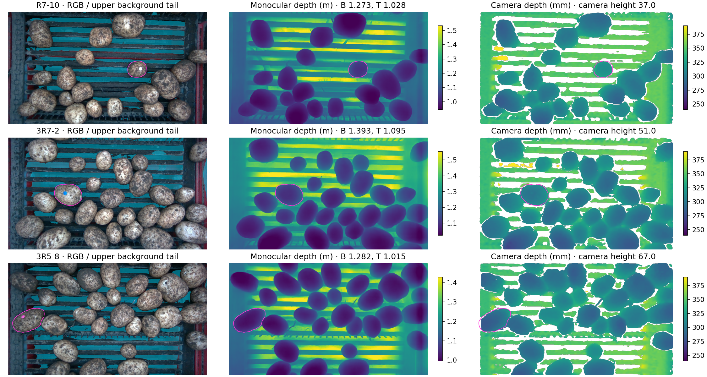

# L1 benchmark for zero-shot monocular potato height

**Monocular depth increased weight error on these development potatoes.** Weight mean absolute error (MAE) rose from **16.02 g with silhouette alone to 23.71 g with L1**. The paired increase was **+7.69 g** (95% tuber-bootstrap interval **+3.76 to +11.55 g**). L1 had **9.52 g higher weight MAE** than camera-estimated height (95% interval **+5.55 to +13.46 g**). All 40 potatoes were scorable. [Per-potato data](per_potato.csv) · [Full-precision results](results.json)

| Trait prediction, same 40 development potatoes | Weight MAE (g) | Volume MAE (mL) |
|---|---:|---:|
| L0 · Archived silhouette-only prediction | 16.02 | 16.99 |
| L1 · Monocular height with the frozen belt rule | 23.71 | 22.75 |
| L2 · Archived learned RGB-plus-silhouette height | 15.92 | 16.73 |
| L3 · Archived camera-estimated height | 14.18 | 15.12 |

| Paired contrast, 40/40 potatoes | Weight MAE change (g) [95% interval] | Volume MAE change (mL) [95% interval] |
|---|---:|---:|
| L1 minus silhouette-only, primary for weight | +7.69 [+3.76, +11.55] | +5.76 [+1.98, +9.52] |
| L1 minus L2 learned RGB height | +7.78 [+3.75, +11.70] | +6.02 [+2.20, +9.84] |
| L1 minus camera height | +9.52 [+5.55, +13.46] | +7.64 [+3.91, +11.42] |

Positive changes mean higher absolute error for L1, and the intervals use 10,000 paired whole-potato bootstrap draws. L1 improved weight error on 11 potatoes and worsened it on 29 versus silhouette alone, with zero ties. Both traits used their original physical measurements, grams including the tack and drainage volume in mL. [Paired results and counts](results.json)

| Height predictor, same 40 camera-height references | Scored | Height MAE (mm) | Signed bias (mm) |
|---|---:|---:|---:|
| L1 · Monocular | 40/40 | 30.21 | +30.21 |
| L2 · Learned RGB plus silhouette | 40/40 | 4.73 | +1.12 |

L1 overestimated camera height on every potato. Its mean absolute height error exceeded L2's by **25.48 mm** (paired 95% interval **+22.16 to +28.78 mm**). Across the 40 L1 cases, B ranged from **0.970 to 1.475 m**, T from **0.742 to 1.155 m**, and inferred height from **58.44 to 101.70 mm**. The failure counts were zero for image or inference failure, invalid quantiles and nonpositive height. This shows that the far-background ratio produced a usable number on every case while systematically overstating height in this setup. [Saved B, T, height and error by potato](per_potato.csv)
## Model and preflight

The model was **Depth Anything V2 Metric Indoor Large HF**, revision `d2fc6a93601aabb1139a3bf0ebfcb4e89c67817f`. Its 1,341,322,868-byte safetensors checkpoint matched SHA-256 `04d3295ff4f9cbee72b8998a85930fe870b45ba4431e7af47415fbded02388ca`, and both configuration files matched the published Git blob IDs. The authors trained the indoor metric variant on synthetic Hypersim scenes and document output in metres, with larger depth farther from the camera and a 20 m maximum. [Pinned checkpoint](https://huggingface.co/depth-anything/Depth-Anything-V2-Metric-Indoor-Large-hf/tree/d2fc6a93601aabb1139a3bf0ebfcb4e89c67817f) · [Authors’ metric-depth documentation](https://github.com/DepthAnything/Depth-Anything-V2/tree/main/metric_depth) · [Model and image manifest](frame_manifest.json)

Inference used the entire 1280 × 720 input with its original background RGB. The released DPT processor resized it to **924 × 518** using bicubic interpolation, preserved aspect ratio up to the 14-pixel grid, applied no padding, divided RGB values by 255 and normalized channels by the frozen mean and standard deviation. Its bicubic postprocessing returned depth to the original 1280 × 720 grid before applying the provided alpha mask. Three synthetic landmarks returned at their original pixel coordinates. On the three fixed training examples, the monocular and camera maps ordered the target median closer than the local exterior ring median, and raw camera heights replayed the archive exactly. The three samples all overestimated height with the fixed monocular rule. The running model was CPU FP32 with six threads, PyTorch 2.7.1 and Transformers 4.53.2. [Pinned preprocessing configuration](https://huggingface.co/depth-anything/Depth-Anything-V2-Metric-Indoor-Large-hf/blob/d2fc6a93601aabb1139a3bf0ebfcb4e89c67817f/preprocessor_config.json) · [Training-only checks](training_preflight.json)

| Fixed training potato | B (m) | T (m) | Monocular height (mm) | Camera height (mm) |
|---|---:|---:|---:|---:|
| R7-10 | 1.273 | 1.028 | 67.41 | 37.00 |
| 3R7-2 | 1.393 | 1.095 | 74.81 | 51.00 |
| 3R5-8 | 1.282 | 1.015 | 73.03 | 67.00 |



The magenta outline marks the target. Cyan marks the pixels outside the target at or above the background 85th percentile. The overlays show that many of these pixels lie in roller gaps, particularly in the first two examples. The camera depth panels mask readings outside the archived valid range. The maps support a check of pixel alignment and depth ordering. The nominal metric predictions also have a different absolute scale from the local camera readings. [Preflight overlays](training_overlays.png) · [Numerical diagnostics](training_preflight.json)

## Calibration rule and evaluation boundary

The single fixed rule used **B**, the 85th percentile over all valid depths outside the provided mask, and **T**, the fifth percentile inside it. The height was **350 × (1 − T/B) mm**. Valid depth was finite and positive. B can include pixels from gaps, other potatoes and surrounding structure, and the point physically supporting the target has no independently measured belt depth in this archive. No alignment or scale fit to measured camera depths was applied. [Frozen protocol](protocol.md) · [Belt calibration audit](../regional_shape_v1/calibration_data_audit.md)

We kept the archived projected area, aspect ratio and separate weight and volume fits fixed, replacing only the height in the area × height term. The 40 records of B, T, heights and trait predictions were saved before opening the validation camera heights, L2 estimates or trait measurements. The evaluation used the same provided masks and exact center frames as the benchmark. These 40 potatoes were previously studied development cases. The 45 SAM 2 confirmation potatoes and the reserved cohorts stayed closed. [Frozen predictions](predictions_before_targets.json) · [Earlier camera-height benchmark](../rgb_only_height_value_v1/report.md) · [Learned RGB height comparison](../rgb_predicted_height_v1/report.md)

## Runtime and reproduction

The 40 images took **163.11 s** of summed per-frame wall time on the local arm64 CPU, with **4.07 s** median per frame and **161.24 s** in model forward calls. Loading the cached model and processor took **0.15 s** separately. Per-frame time includes RGB loading, model input and output transforms, quantiles and trait substitution. [Timing data](predictions_before_targets.json) · [Runtime summary](results.json)

Run from the workspace root with the release image archives and the earlier L0, L2 and L3 studies. The commands use the archived CPU Python environment and the three official pinned files in `outputs/rgb_monocular_height_v1/checkpoint/`. Each stage checks the relevant frozen inputs, and the inference checks the model files against the published hashes. [Pinned checkpoint files](https://huggingface.co/depth-anything/Depth-Anything-V2-Metric-Indoor-Large-hf/tree/d2fc6a93601aabb1139a3bf0ebfcb4e89c67817f)

```bash
export PYTHONPATH="$PWD/src:$PWD/outputs/corepp_cross_model/triposr/deps"
export OPENBLAS_NUM_THREADS=1 OMP_NUM_THREADS=1 VECLIB_MAXIMUM_THREADS=1
export MPLCONFIGDIR="$PWD/.cache/matplotlib"
cpu_python=outputs/corepp_cpu_audit/venv/bin/python
l1_run=$(mktemp -d)
"$cpu_python" -m studies.rgb_monocular_height_v1.infer freeze --out "$l1_run" &&
"$cpu_python" -m studies.rgb_monocular_height_v1.infer preflight --out "$l1_run" &&
"$cpu_python" -m studies.rgb_monocular_height_v1.score freeze --out "$l1_run" &&
"$cpu_python" -m studies.rgb_monocular_height_v1.infer predict --out "$l1_run" &&
"$cpu_python" -m studies.rgb_monocular_height_v1.score score --out "$l1_run"
```

[Inference and training overlays](infer.py) · [Paired scorer](score.py)
