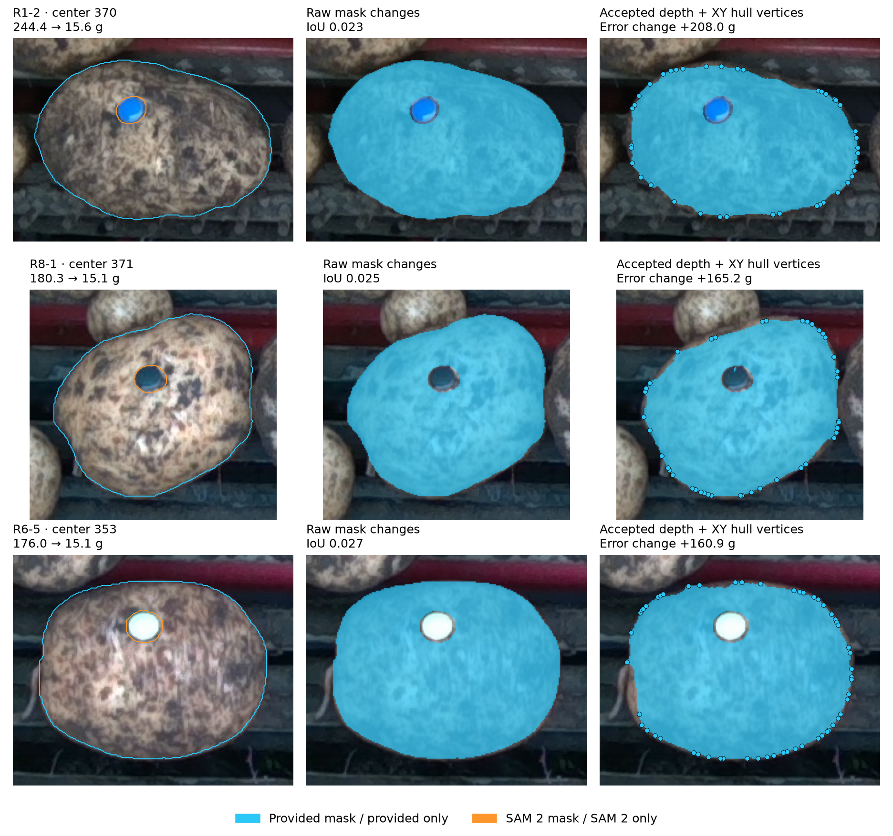

# One-click SAM 2 masks for potato weight estimation

Replacing the provided center mask with a one-click SAM 2 mask increased mean absolute weight error from **16.23 g to 56.20 g** on the 40 development potatoes. The paired increase was **39.97 g** (95% tuber-bootstrap interval **21.60 to 59.63 g**). Error increased on 24 potatoes and decreased on 16, with no ties. The median paired change was +1.72 g. The primary comparison retains all 40 estimates, including the cases where the mask followed the registration pin. [Per-potato results](per_potato.csv) · [Full-precision summary](results.json)

## Measurement pipeline replay

The same 40 validation potatoes, center frames and frozen Model A were used throughout. The model takes XY convex hull area × height in cm³ and predicts grams including the tack. Height is 350 mm minus the fifth percentile of camera depth, floored at zero. Raw depth is in mm, and the pinhole projection uses the released D405 intrinsics. [Archived Model A](../multiframe_weight_correction_v1/train_fit.json) · [Weight-study report](../multiframe_weight_correction_v1/report.md) · [Released intrinsics](../../data/raw/3DPotatoTwin/1_rgbd/0_camera_intrinsics/realsense_d405_camera_intrinsic.json)

Using the provided alpha mask and all valid raw depths kept 12,183 additional points across the 40 potatoes. It inflated some XY hulls, with a maximum replay discrepancy of 224.37 g on 4R6-7. Projecting the released PLYs back into the images established which pixels had been excluded. The release's histogram filter reproduced the **exact PLY pixel membership on all 40 centers**, with a maximum corresponding XYZ discrepancy of 0.000019 mm. The remaining differences are consistent with PLY coordinate precision. [Release filtering code](../../data/raw/3DPotatoTwin/1_rgbd/pin_regions.py) · [Per-potato replay](baseline_replay.csv) · [Replay summary](baseline_replay.json)

| Absolute replay discrepancy | Valid depth only, median / max | With release filter, median / max |
|---|---:|---:|
| XY area, mm² | 132.619 / 4,508.204 | 0.000098 / 0.000322 |
| Height, mm | 0.000008 / 0.000015 | 0.000008 / 0.000015 |
| Model A prediction, g | 4.4107 / 224.3690 | 0.000020 / 0.000044 |

The filter uses each potato's measured thickness in mm (`x3_depth_mm`) as the maximum candidate depth range. The thickness was held fixed across the two mask conditions. The filter was recomputed on each mask, so changed pixels can also move the accepted depth bounds. The results therefore apply to the archived measurement pipeline with measured thickness available.

## Tracking setup

The frozen checkpoint was Meta's **SAM 2.1 Hiera Tiny**, SHA-256 `7402e0d864fa82708a20fbd15bc84245c2f26dff0eb43a4b5b93452deb34be69`, with the upstream video predictor at commit `2b90b9f5ceec907a1c18123530e92e794ad901a4`. One positive click was simulated at the deepest interior pixel of the earliest released mask. The predictor saw original scene RGB, including the background, through the frozen center. We dropped alpha without compositing and used the original resize and normalization with lossless PNG decoding. This was the only prompt. The tracker used RGB alone. This is an exploratory validation-cohort comparison. Test and reserved cohorts stayed closed. [Frozen protocol](protocol.md) · [Frame and click manifest](frame_manifest.json) · [Official SAM 2 release](https://github.com/facebookresearch/sam2#model-description) · [Upstream RGB preprocessing](https://github.com/facebookresearch/sam2/blob/2b90b9f5ceec907a1c18123530e92e794ad901a4/sam2/utils/misc.py)

The CPU run processed 585 RGB frames in **13 min 20 s** of tracking wall time, excluding model load. The median was **20.44 s per potato**. The predictor returned a nonempty center mask and a scorable estimate for **40/40** potatoes, with zero empty intermediate masks. Two entry masks excluded the prompt pixel, on 4R8-3 and R6-5. [Tracking log by potato](tracking.json)

## Which pixels changed the estimates?

Center mask IoU averaged **0.598**, with a median of **0.960** and a range of **0.023–0.983**. Visual review found that **16/40 masks concentrated on the registration pin** with IoU between 0.023 and 0.076. The other **24/40** matched the potato with IoU between 0.933 and 0.983. This visual count describes target tracking quality. All 40 masks remain in the primary weight comparison. [Per-potato IoU](per_potato.csv) · [Saved center masks](center_masks/)

In the three largest weight shifts, the mask lost 17,336–21,989 accepted depth pixels from the potato. The XY footprint shrank by about 98%, while the height changed by 1–4 mm. None of the three gained accepted depth pixels. The loss of the potato's footprint explains the underestimates. [Per-potato depth support and hull checks](per_potato.csv)

| Potato | Center mask IoU | Measured, g | Provided → SAM 2 estimate, g | Change in absolute error, g |
|---|---:|---:|---:|---:|
| R1-2 | 0.023 | 234 | 244.4 → 15.6 | +208.0 |
| R8-1 | 0.025 | 192 | 180.3 → 15.1 | +165.2 |
| R6-5 | 0.027 | 188 | 176.0 → 15.1 | +160.9 |



High overlap could still hide a large footprint change. On **2R2-1** (IoU **0.976**), 213 extra accepted pixels lay outside the provided mask. The added hull vertices included isolated pixels near neighboring potatoes above the target. The projected area grew by 1,788 mm² at the same 52 mm height, raising the prediction from 119.2 to 190.4 g. The absolute error happened to fall by 71.2 g. This case shows how far-out pixels can move a convex-hull estimate even when nearly all of the potato mask agrees. [Per-potato depth support and hull checks](per_potato.csv)

## Reproduce

From the workspace root, use the existing project and CoRe++ CPU Python environments and the locally cached official SAM 2 assets. The checkpoint is in `outputs/sam2_center_weight_v1/assets/`, the upstream source is in its `sam2-main` subdirectory, and Hydra Core 1.3.2 and iopath 0.1.10 are in `deps`. The recorded run used PyTorch 2.7.1 on arm64 macOS. [Tracking configuration](tracking_config.json) · [Checkpoint download](https://dl.fbaipublicfiles.com/segment_anything_2/092824/sam2.1_hiera_tiny.pt) · [Pinned source](https://github.com/facebookresearch/sam2/tree/2b90b9f5ceec907a1c18123530e92e794ad901a4)

```bash
export OPENBLAS_NUM_THREADS=1 VECLIB_MAXIMUM_THREADS=1 OMP_NUM_THREADS=1
export MPLCONFIGDIR="$PWD/.cache/matplotlib"
sam_weight_run=$(mktemp -d)
sam_weight_code=studies/sam2_center_weight_v1/run.py
.venv/bin/python "$sam_weight_code" freeze --output "$sam_weight_run" &&
.venv/bin/python "$sam_weight_code" baseline --output "$sam_weight_run" &&
outputs/corepp_cpu_audit/venv/bin/python "$sam_weight_code" track --output "$sam_weight_run" &&
.venv/bin/python "$sam_weight_code" score --output "$sam_weight_run"
```

[Runnable implementation](run.py)
