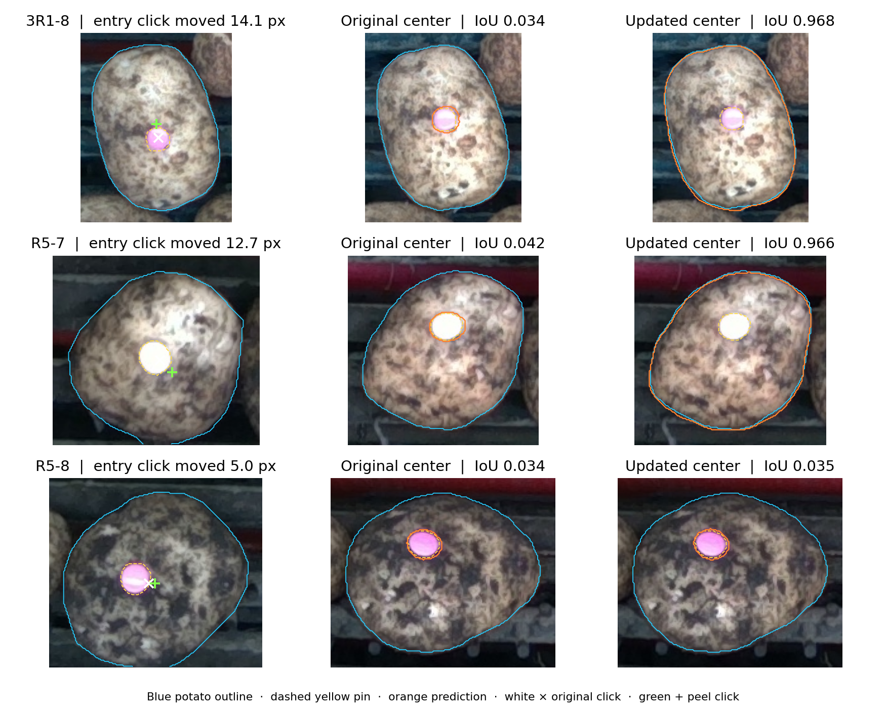

# Where to Click: One-Point SAM 2 Tracking for Conveyor Potato Weight Estimation

## Held-out confirmation

**All 45 of 45 enrolled potatoes had a correct center mask**, defined as intersection over union (IoU) ≥ 0.5 with the provided potato mask. The exact 95% binomial interval was **92.1% to 100.0%**. One first-time operator used the frozen written instruction and an annotation-derived arrow identifying the target. All 45 clicks landed on the intended potato outside the pin. There were no skips or center-mask failures. [Held-out confirmation report](report.md) · [Frozen protocol](protocol.md)

**All 45 of 45 weights were scorable.** Mean absolute error (MAE) was **12.26 g** with the human-click SAM 2 masks and **12.36 g** with the provided masks on the same potatoes. The mean paired change in absolute error was **−0.11 g** for SAM 2 minus provided (95% tuber-bootstrap interval **−0.85 to +0.60 g**). The interval includes zero, leaving the direction of the weight-accuracy change unresolved. [Held-out confirmation report](report.md)

## Why the weight estimate used the center frame

On the same 40 development potatoes, center-only estimation had the lowest observed MAE of the three original frame layouts. Averaging the three adjacent or the three spaced estimates gave MAEs of 16.82 g and 16.63 g, compared with 16.15 g for center alone. A separate regression used the same 118 training potatoes for both models and tested a feature derived from the two outer views. Its MAE was 16.230 g with the added feature and 16.227 g for center-only Model A. We retained Model A and the frame whose released potato-position suffix was closest to 360 px, the midpoint of the 720 px image. The RGB sequence from entry to center was used for tracking, with weight estimated from the center frame. [Three-frame weight report](../multiframe_weight_v1/report.md) · [Center-model comparison report](../multiframe_weight_correction_v1/report.md) · [SAM 2 center-mask report](../sam2_center_weight_v1/report.md)

## How the click protocol developed

1. **Automatic entry click.** A simulated click at the deepest interior pixel of the provided entry mask produced 24 correct center masks out of 40. The other 16 tracked the registration pin. The largest errors came from masks that kept the pin and omitted most of the potato footprint, shrinking the hull area used by the weight estimator. All 40 still produced numeric estimates, and MAE rose from 16.23 g with the provided masks to 56.20 g with the SAM 2 masks. [SAM 2 center-mask report](../sam2_center_weight_v1/report.md)
2. **Controlled relocation.** All 12 automatic clicks on or inside the pin outline ended on the pin. The experiment moved only those clicks to the nearest eligible peel pixel under a fixed five-pixel clearance rule on the rasterized masks. Ten of the 12 recovered the potato, bringing the full result to 34/40. The four original clicks just outside the outline that ended on the pin had already selected it at entry and stayed on it through center. This isolated the effect of moving the prompt on the same images with the same tracker. [Pin-to-peel relocation report](../sam2_pin_prompt_v1/report.md)
3. **First human session.** Thirty-five clicks landed on the pin, two outside the intended potato, and three on potato skin outside the pin outline. Only one center mask matched the potato, and 36 of the 39 failures selected the pin at entry. No failed track first acquired and then lost the potato. This session exposed a click-placement problem and gave little evidence about consistently placed peel clicks. [First human-session report](../sam2_human_prompt_v1/report.md)
4. **Coached repeat.** On the same 40 scenes, the clarified instruction named the small colored circle as the registration pin and asked for a click on skin with a gap from the circle and potato edge. All 40 clicks landed on the intended potato outside the pin, and all 40 center masks matched. The repeat used familiar development scenes. [Coached-repeat report](../sam2_human_prompt_v1/repeat_01/report.md) · [Repeat instruction](../sam2_human_prompt_v1/repeat_01/protocol.md)
5. **Held-out confirmation.** A first-time operator received the same written instruction and arrow on a frozen cohort of previously unused targets from the PointRAFT test split. The protocol and order were frozen before collection, and all enrolled potatoes stayed in the mask denominator. [Held-out confirmation report](report.md) · [Cohort audit](eligibility_audit.csv)

*Figure 1. Each row shows one potato with its original and relocated click. The white × marks the original click and the green + the relocated one. The blue outline is the provided potato mask and the orange outline is the SAM 2 prediction. For 3R1-8, moving the click increased center IoU from 0.034 to 0.968 and changed its estimated weight from 15.47 g to 153.51 g. Measured weight was 160 g. R5-8 shows a case where the relocated click still left the tracker on the pin.* [Pin-to-peel relocation report](../sam2_pin_prompt_v1/report.md)

## Results by condition

The development conditions reuse the same 40 potatoes. A dash indicates that mask correctness was unscored or that the provided mask served as the reference. Scorable weights are shown over the full cohort, including for the paired provided-mask baseline of the first human session.

| Condition | Cohort | Correct center masks | Scorable weights | Weight MAE (g) | Study report |
|---|---|---:|---:|---:|---|
| Human peel click | Held-out confirmation | 45/45 | 45/45 | 12.26 | [Held-out confirmation](report.md) |
| Provided center mask | Held-out confirmation | — | 45/45 | 12.36 | [Held-out confirmation](report.md) |
| Center alone, original regression | Development | — | 40/40 | 16.15 | [Three-frame weight](../multiframe_weight_v1/report.md) |
| Three-frame adjacent mean | Development | — | 40/40 | 16.82 | [Three-frame weight](../multiframe_weight_v1/report.md) |
| Three-frame spaced mean | Development | — | 40/40 | 16.63 | [Three-frame weight](../multiframe_weight_v1/report.md) |
| Model A, center-only regression | Development | — | 40/40 | 16.227 | [Center-model comparison](../multiframe_weight_correction_v1/report.md) |
| Model B, center plus outer-area feature | Development | — | 40/40 | 16.230 | [Center-model comparison](../multiframe_weight_correction_v1/report.md) |
| Provided center mask with raw-depth replay | Development | — | 40/40 | 16.23 | [SAM 2 center masks](../sam2_center_weight_v1/report.md) |
| Automatic deepest-interior click | Development | 24/40 | 40/40 | 56.20 | [SAM 2 center masks](../sam2_center_weight_v1/report.md) |
| Controlled peel relocation on the 12 pin clicks | Development | 34/40 | 40/40 | 28.96 | [Pin-to-peel relocation](../sam2_pin_prompt_v1/report.md) |
| First human session | Development | 1/40 | 39/40 | 148.44 | [First human session](../sam2_human_prompt_v1/report.md) |
| Provided mask on the first session’s paired subset | Development | — | 39/40 | 16.34 | [First human session](../sam2_human_prompt_v1/report.md) |
| Coached human repeat | Development | 40/40 | 40/40 | 15.57 | [Coached repeat](../sam2_human_prompt_v1/repeat_01/report.md) |

## What the comparison establishes

The comparison evaluates **mask substitution within a fixed weight pipeline**. Both masks were applied to the same raw center-frame depth. The release’s depth filter used the same measured tuber thickness for each pair (`x3_depth_mm`). The frozen Model A converted the projected hull area times the height proxy into a weight estimate. The reference was measured weight **including the tack** (`weight_g_inctack`). The held-out interval describes variation across potatoes for one first-time operator under the annotation-derived location cues. The frozen pipeline produced usable masks and similar weight MAE on those potatoes. [SAM 2 center-mask report](../sam2_center_weight_v1/report.md) · [Three-frame weight report](../multiframe_weight_v1/report.md) · [Held-out confirmation report](report.md)
