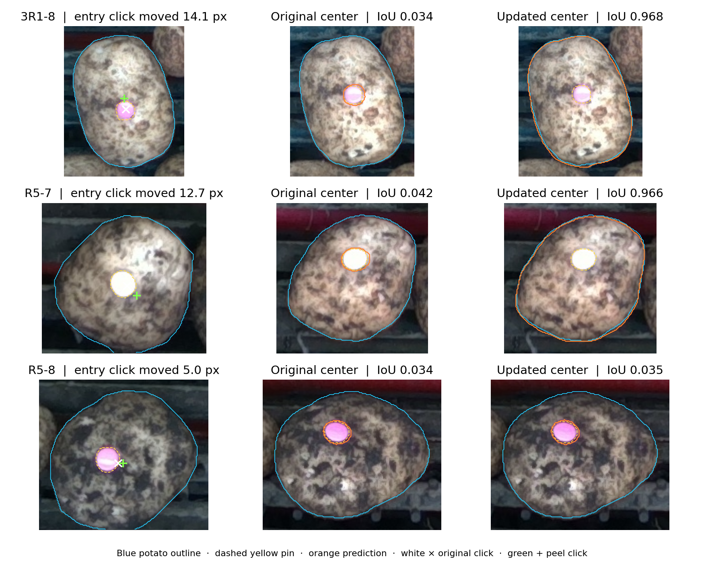
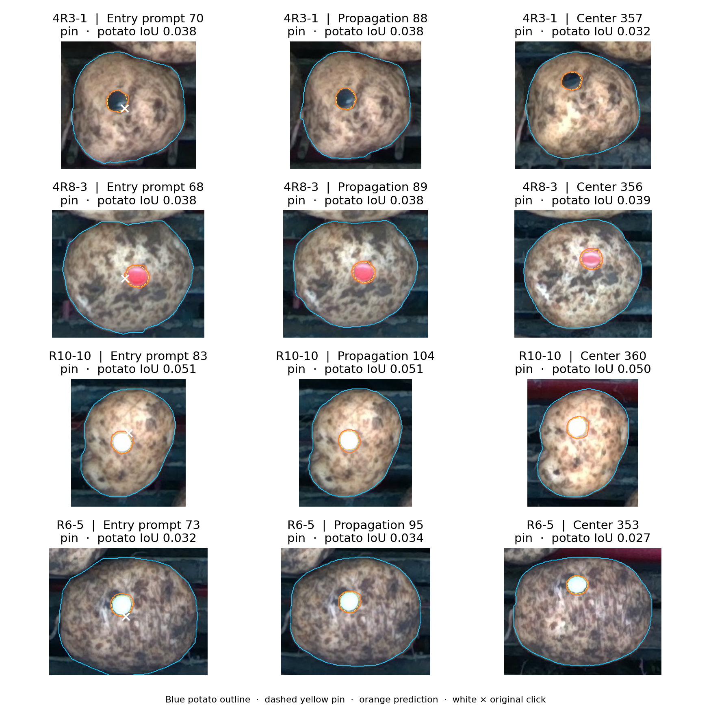

# Moving a SAM 2 click from the registration pin to potato peel

Moving the single click from the pin onto nearby peel recovered the potato on **10 of 12** changed tracks at the prespecified center IoU threshold of 0.5. Across all 40 development potatoes, mean absolute weight error fell from **56.20 g to 28.96 g**, a paired reduction of **27.24 g**. The updated estimate still had **12.73 g** more MAE than the **16.23 g** provided-mask baseline. All 40 weights were scorable. [Per-potato results](per_potato.csv) · [Full-precision summary](results.json)

## Frozen comparison

The 40 development potatoes, frame files, CPU SAM 2.1 Hiera Tiny checkpoint and tracker settings came from the original center-weight study. Each updated run used the same one-point prompt format and the same RGB frames from entry through center. The weight calculation reused the released depth filter, its measured-thickness input, and the frozen Model A. Test and reserved cohorts stayed closed. [Protocol](protocol.md) · [Original center-weight study](../sam2_center_weight_v1/report.md)

The entry audit joined every click to its exact RGB filename and released polygon. All **12/12** clicks on or inside the pin polygon ended with a pin-dominant mask. **4/28** outside-pin clicks also ended on the pin. All four counts matched the expected audit. The replacement used the nearest eligible peel pixel, breaking ties by smaller y and then smaller x. Clearance was at least five pixels to both the rasterized pin and the nearest non-potato pixel. Six replacements were 4.95 px from the continuous polygon outline because of rasterization. The annotations simulated a known peel click. The 28 unaffected predictions came from the archive. [Audit counts](entry_audit.json) · [Frozen coordinates and distances](clicks.csv) · [Input hashes](frozen_clicks.json)

## The 12 moved clicks

Clicks moved **5.00–14.14 px** (median **9.64 px**). The ten recovered masks reached center IoU of **0.950–0.974**, and absolute weight error decreased in all ten. **3R7-10** and **R5-8** still returned pin-dominant masks. With the four unchanged pin failures, the updated rule still selected a pin-dominant mask on **6/40** potatoes. The 16 inference runs took **5 min 25 s** on CPU, including the four unchanged replays. [Tracking records](tracking.json) · [Per-potato results](per_potato.csv)

| Potato | Move, px | Original → updated IoU | Original → updated weight, g | Measured, g | Change in absolute error, g |
|---|---:|---:|---:|---:|---:|
| 3R1-8 | 14.14 | 0.034 → 0.968 | 15.47 → 153.51 | 160 | −138.04 |
| 3R7-10 | 11.70 | 0.065 → 0.059 | 15.15 → 14.16 | 60 | +0.99 |
| 4R1-2 | 12.21 | 0.040 → 0.967 | 14.88 → 115.13 | 116 | −100.25 |
| 4R4-8 | 5.00 | 0.054 → 0.970 | 15.40 → 94.48 | 94 | −78.13 |
| R1-2 | 5.00 | 0.023 → 0.963 | 15.60 → 244.80 | 234 | −207.60 |
| R1-3 | 9.43 | 0.040 → 0.973 | 16.54 → 169.99 | 154 | −121.47 |
| R3-2 | 6.40 | 0.055 → 0.957 | 15.54 → 100.08 | 94 | −72.38 |
| R4-4 | 8.00 | 0.076 → 0.950 | 14.70 → 60.23 | 58 | −41.06 |
| R5-7 | 12.73 | 0.042 → 0.966 | 14.43 → 95.70 | 98 | −81.27 |
| R5-8 | 5.00 | 0.034 → 0.035 | 15.34 → 15.43 | 134 | −0.09 |
| R8-1 | 9.85 | 0.025 → 0.969 | 15.08 → 188.74 | 192 | −173.66 |
| R9-2 | 11.18 | 0.043 → 0.974 | 14.35 → 97.00 | 94 | −76.65 |



## Why four outside-pin clicks still failed

**All four selected the pin immediately and stayed on it.** The clicks were 0.71–2.24 px outside the vector pin outline. Each immediate mask was pin-dominant before propagation, and each later mask through center was also pin-dominant. On 4R8-3 and R6-5, the immediate mask excluded the click pixel. On the other two, it included that pixel but mostly covered the pin. Every replayed center mask matched the archived mask pixel for pixel. [Replay summary](outside_pin_replays.csv) · [Frame-by-frame IoU and state](outside_pin_per_frame.csv)



## Reproduce

Run from the workspace root with the pinned SAM 2 assets and CPU Python environment from the original study. The code shares that study's tracker and inference settings. The outside-pin replays must match before the moved tracks run.

```bash
export OPENBLAS_NUM_THREADS=1 VECLIB_MAXIMUM_THREADS=1 OMP_NUM_THREADS=1
export MPLCONFIGDIR="$PWD/.cache/matplotlib"
sam_pin_run=$(mktemp -d)
sam_pin_code=studies/sam2_pin_prompt_v1/run.py
sam_pin_python=outputs/corepp_cpu_audit/venv/bin/python
"$sam_pin_python" "$sam_pin_code" freeze --output "$sam_pin_run" &&
"$sam_pin_python" "$sam_pin_code" track --output "$sam_pin_run" &&
"$sam_pin_python" "$sam_pin_code" score --output "$sam_pin_run"
```

[Runnable code](run.py) · [Archived tracker configuration](../sam2_center_weight_v1/tracking_config.json)
