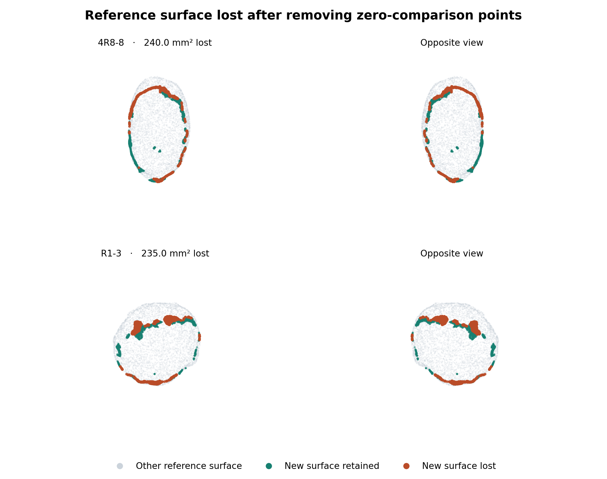

# What do zero-comparison points contribute to three-view fusion?

**Retain the points and flag their uncertainty when recovering surface is the priority.** Removing all zero-comparison outer points lowered the mean far-centroid fraction by **1.00 percentage point** compared with count-matched random removal. It also lost **163.15 mm² more** of the surface that fusion originally added, per potato. Removal lowered the far-point fraction on **9/10** potatoes and lost more newly recovered surface on **10/10**. [Per-potato data](per_potato.csv) · [Paired results](results.json)

## Method and replay

The ten development potatoes used the frozen SAM 2 masks, frames and RAFT alignment. All **12,144** zero-comparison raw outer points and the **200** matched random masks were frozen before reading reference labels or meshes. Each random draw removed the same number of raw points per outer source view, sampled uniformly without replacement. Every center point was preserved before rebuilding the **1 mm** voxel centroids in the archived SfM frame. The controls match raw-point deletions. Mean centroid counts after voxelization were **10,652.5** for zero-comparison removal and **11,099.4** for random removal, versus **11,165.5** in unfiltered fusion. [Frozen protocol](protocol.md) · [Frozen masks and hashes](frozen_removals.json) · [All random draws](random_repeats.csv)

The center and unfiltered fusion scores replayed on **10/10**. Each method was evaluated on the same **50,000** reference samples per potato. The relevant surface is the exact set covered within 2 mm by unfiltered fusion and missed by center. It averaged **583.04 mm²**. Lost area counts only members of that set that move out of coverage after voxelization. The far-point metric counts fused centroids whose closest distance to the reference mesh is greater than 2 mm.

## Error and coverage together

Each result weights potatoes equally after averaging 20 random draws within potato. There were no scoring failures.

| Reconstruction | Centroids farther than 2 mm | Originally new surface retained | Originally new surface lost | Lost area per potato |
| --- | ---: | ---: | ---: | ---: |
| Archived unfiltered fusion | 5.845% | 100.00% | 0.00% | 0.00 mm² |
| Zero-comparison removal | 4.823% | 72.54% | 27.46% | 165.20 mm² |
| Count-matched random removal | 5.820% | 99.63% | 0.37% | 2.06 mm² |

Relative to random removal, the paired changes for zero-comparison removal were **−1.00 percentage point** in far centroids (95% interval **−1.52 to −0.53**), **+27.10 points** in originally new surface lost (**+21.82 to +32.53**), and **+163.15 mm²** in lost area (**+118.88 to +203.16**). Relative to unfiltered fusion, the far fraction fell **1.02 points** (**0.54 to 1.56** points lower) and **27.46%** of the originally new surface was lost (**22.19% to 32.88%**). Intervals are descriptive whole-potato bootstraps.

On **4R8-8**, only **0.94%** of the 1,176 zero-comparison raw points exceeded 2 mm in the earlier diagnostic. Removing them increased the far-centroid fraction from **3.091% to 3.171%** and lost **239.95 mm²** of the originally new surface (**28.66%**). Random removal lost **1.89 mm²**. This shows why having no comparison can signal uncertainty while those points still support useful coverage. [Archived raw-point diagnostic](../depth_consistency_diagnostic_v1/per_potato.csv)

| Potato | Raw points removed (raw error) | Far centroid % (unfiltered / zero / random) | Original new area (mm²) | Retained % (zero / random) | Lost % (zero / random) | Lost mm² (zero / random) |
| --- | ---: | --- | ---: | --- | --- | --- |
| 4R4-8 | 1,317 (30.98%) | 7.766 / 5.046 / 7.690 | 708.26 | 72.88 / 99.72 | 27.12 / 0.28 | 192.07 / 1.99 |
| 3R7-10 | 471 (23.99%) | 5.035 / 4.323 / 5.027 | 223.06 | 86.23 / 99.69 | 13.77 / 0.31 | 30.71 / 0.69 |
| 2R1-9 | 935 (25.88%) | 4.770 / 3.803 / 4.750 | 622.72 | 78.20 / 99.63 | 21.80 / 0.37 | 135.72 / 2.32 |
| R1-3 | 1,375 (22.04%) | 5.960 / 5.055 / 5.935 | 527.71 | 55.47 / 99.74 | 44.53 / 0.26 | 235.00 / 1.38 |
| R9-2 | 687 (11.06%) | 7.410 / 7.084 / 7.383 | 482.98 | 86.07 / 99.51 | 13.93 / 0.49 | 67.29 / 2.35 |
| 4R4-10 | 956 (41.74%) | 10.470 / 8.200 / 10.397 | 414.63 | 66.31 / 99.43 | 33.69 / 0.57 | 139.71 / 2.38 |
| 4R6-7 | 1,826 (21.41%) | 4.232 / 3.668 / 4.220 | 730.67 | 69.59 / 99.67 | 30.41 / 0.33 | 222.20 / 2.43 |
| 4R8-8 | 1,176 (0.94%) | 3.091 / 3.171 / 3.089 | 837.24 | 71.34 / 99.77 | 28.66 / 0.23 | 239.95 / 1.89 |
| R11-5 | 2,272 (23.11%) | 2.705 / 1.429 / 2.697 | 733.88 | 69.74 / 99.69 | 30.26 / 0.31 | 222.05 / 2.27 |
| R10-10 | 1,129 (17.63%) | 7.016 / 6.455 / 7.017 | 549.29 | 69.54 / 99.48 | 30.46 / 0.52 | 167.32 / 2.86 |



Orange marks newly recovered reference samples lost after zero-comparison removal. Green marks those still covered. The gray reference points provide shape context. R1-3 had the largest loss by area among the other nine potatoes. The two viewpoints show where lost coverage follows sections of the surface perimeter.

## Reproduce

From the workspace root, use the archived clouds, frozen diagnostic and local SfM release. The first command seals the removal masks. Only the second reads the reference geometry.

```sh
export OPENBLAS_NUM_THREADS=1 OMP_NUM_THREADS=1 VECLIB_MAXIMUM_THREADS=1
export DYLD_LIBRARY_PATH="$PWD/outputs/corepp_cpu_audit/runtime/libusb/1.0.30/lib"
export MPLCONFIGDIR="$PWD/.cache/matplotlib"
zero_out=$(mktemp -d)
zero_python=outputs/corepp_cpu_audit/venv/bin/python
zero_script=studies/zero_comparison_fusion_v1/run.py
"$zero_python" "$zero_script" freeze --out "$zero_out" &&
"$zero_python" "$zero_script" evaluate --out "$zero_out"
```

[Runner](run.py)
